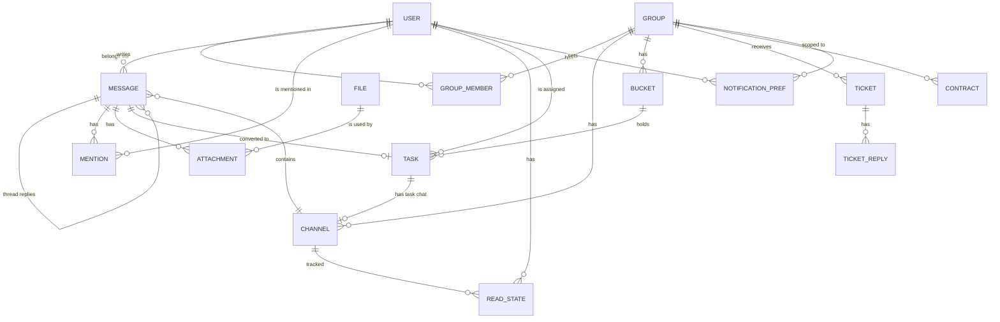

# Data model

Target model for all phases. Fields are indicative until the entity's phase. Status is `planned` for every entity; Phase 1 adds only a technical `app_meta` table (planned for Phase 1), no product entities.

`ApiKey` (eGrant ticket ingestion) stands alone and has no relations.

| entity | purpose | phase | status |
|---|---|---|---|
| User | a person who logs in; role `superadmin`, `admin` or `client` | 2 | planned |
| Group | one client organization; has eGrant URL and invite token | 3 | planned |
| GroupMember | links a client to their one group (admins need no rows) | 3 | planned |
| Channel | one abstraction for group chat, DM and task chat | 4 | planned |
| Message | a post in a channel with per-channel `seq`, optional thread parent | 4 | planned |
| ReadState | last read `seq` per user and channel (unread counts) | 4 | planned |
| Mention | an @-tag of a user in a message | 5 | planned |
| Attachment | links a file to a message, task, contract or ticket | 5 | planned |
| File | stored file: storage key, mime, size, thumbnail (first used for group logos) | 3 | planned |
| NotificationPref | per user per group: `all`, `mentions` or `none` | 6 | planned |
| Bucket | a task board column | 8 | planned |
| Task | a card: title, assignee, due date, priority, labels, position | 8 | planned |
| Ticket | support request from eGrant, status `new`, `in_progress`, `resolved` | 12 | planned |
| ApiKey | secret used by eGrant to send tickets | 12 | planned |
| TicketReply | an admin reply on a ticket | 13 | planned |
| Contract | agreement with a client; admin-only; reminder and draft fields | 14 | planned |
| app_meta | technical table proving migrations work (not a product entity) | 1 | planned |

Notes: the superadmin is a `User` with role `superadmin`, created on first start from `SUPERADMIN_EMAIL`. See [glossary](../glossary.md) for terms and [roadmap](../roadmap.md) for phases.
