# Data model

Target model for all phases. Fields are indicative until the entity's phase. Status is `built` for the technical `app_meta` table (Phase 1) and for `User` and the auth tables `Session`, `Account`, `Verification` (Phase 2); the file, notification, bucket, task, task assignee and task attachment tables are `built` (Phases 4 and 8); `PushSubscription` and `GroupNotificationSetting` are `built` (Phase 6); the knowledge and reminder tables are `built` (Phase 17, migration 0012), knowledge folders too (Phase 24, migration 0022), and the chat-file columns of `knowledge_items` (Phase 25, migration 0024); every other entity is `planned`.

```mermaid
erDiagram
    USER ||--o{ GROUP_MEMBER : "belongs via"
    GROUP ||--o{ GROUP_MEMBER : has
    GROUP ||--o{ CHANNEL : has
    TASK ||--o| CHANNEL : "has task chat"
    CHANNEL ||--o{ MESSAGE : contains
    USER ||--o{ MESSAGE : writes
    MESSAGE ||--o{ MESSAGE : "thread replies"
    MESSAGE ||--o{ MENTION : has
    USER ||--o{ MENTION : "is mentioned in"
    MESSAGE ||--o{ ATTACHMENT : has
    FILE ||--o{ ATTACHMENT : "is used by"
    USER ||--o{ READ_STATE : has
    CHANNEL ||--o{ READ_STATE : tracked
    GROUP ||--o{ BUCKET : has
    BUCKET ||--o{ TASK : holds
    TASK ||--o{ TASK_ASSIGNEE : has
    USER ||--o{ TASK_ASSIGNEE : "is assigned"
    TASK ||--o{ TASK_ATTACHMENT : has
    FILE ||--o{ TASK_ATTACHMENT : "is used by"
    MESSAGE ||--o| TASK : "converted to"
    GROUP ||--o{ TICKET : receives
    TICKET ||--o{ TASK : "turned into"
    GROUP ||--o{ CONTRACT : has
    USER ||--o{ GROUP_NOTIFICATION_SETTING : sets
    USER ||--o{ PUSH_SUBSCRIPTION : "has devices"
    USER ||--o{ NOTIFICATION_EVENT : receives
    GROUP ||--o{ NOTIFICATION_EVENT : "scoped to"
    GROUP ||--o{ GROUP_NOTIFICATION_SETTING : "scoped to"
    GROUP ||--o{ KNOWLEDGE_ITEM : has
    USER ||--o{ KNOWLEDGE_ITEM : creates
    KNOWLEDGE_ITEM ||--o{ KNOWLEDGE_ATTACHMENT : has
    FILE ||--o{ KNOWLEDGE_ATTACHMENT : "is used by"
    KNOWLEDGE_ITEM ||--o| REMINDER_SET : "has reminders"
    TASK ||--o| REMINDER_SET : "has custom reminders"
    REMINDER_SET ||--o{ REMINDER_TIME : has
    REMINDER_SET ||--o{ REMINDER_RECIPIENT : notifies
    USER ||--o{ REMINDER_RECIPIENT : "is reminded"
    BULK_CAMPAIGN ||--o{ BULK_RECIPIENT : "is sent to"
    USER ||--o{ BULK_RECIPIENT : receives
    USER ||--o| BULK_SUBSCRIPTION : "bulk email setting"
```

The ticket intake key is configuration (`TICKETS_API_KEY`), not a table. Ticket replies are the ticket's chat (part 21.3), not a table of their own. `tasks.source_ticket_id` (set null, partial index) links a task to the ticket it was made from; part 21.5 sets it through `createTasksFromSource` (also together with `source_message_id` for a message of a ticket chat). `tasks.source_meeting_id` (migration 0032, FK to `knowledge_items`, on delete set null, partial index `tasks_source_meeting_id_idx` where not null) links a task to the meeting it was made from (`POST /api/knowledge/:id/meeting/tasks`, through `createTasksFromSource`); the meeting's detail lists those tasks (`listTasksFromMeeting`).

| entity | purpose | phase | status |
|---|---|---|---|
| User | a person who logs in; role `superadmin`, `admin` or `client` | 2 | built |
| Session, Account, Verification | login sessions and one-time codes; tables owned by better-auth (see below) | 2 | built |
| Group | one client organization; has normalized eGrant URL (unique), invite token (unique, 32 chars) and optional logo key; `groups` table. `deactivated_at` (migration 0050, null = active): set while a client group is deactivated (`setGroupActive`); the membership readers then ignore its memberships, and `BEFORE INSERT` triggers (`refuse_in_deactivated_group`, `refuse_message_in_deactivated_group`) on `messages`, `tasks`, `buckets`, `tickets` (also `UPDATE OF group_id`), `knowledge_items`, `knowledge_folders`, `projects`, `project_events` and `reminder_sets` raise SQLSTATE `SPG01` (API: `409 group_inactive`; [ADR 0038](../decisions/0038-egrant-groups-webhook-and-group-deactivation.md)). `kind` (`client` default, or `admin`; check `groups_kind_check`, migration 0037): the one admin group "eGrant tím" (Phase 34; partial unique index `groups_one_admin` on `(true) where kind = 'admin'`, inserted by the migration and kept by `ensureAdminGroup` at server start, which also creates its board and chat). `egrant_url` is nullable only for it (check `groups_egrant_url_check`); its invite token is never shown | 3, 34 | built |
| GroupMember | a person's membership of a group (admins need no rows); `group_members`, primary key `(user_id, group_id)`, `role` (`client` reads the group, `ziadatel` only their own tickets; check `group_members_role_check`), `removed_at` (an admin removed it; null = active); partial indexes `(group_id, role)` and `(user_id)` where `removed_at is null`; both keys cascade on delete. A client may belong to several groups (Phase 21) | 3, 21 | built |
| PendingInvite | the latest invite a person typed their email on before signing in; one per user; `pending_invites`, `user_id` primary key, `group_id`, `created_at`, both cascade. Applied on sign-in (`applyPendingInvite`) | 21 | built |
| GroupManager | an admin who manages a group (an account manager; a flag, not a role); `group_managers` (migration 0011): `group_id` (cascade), `user_id` (cascade), `created_at`, primary key `(group_id, user_id)`, index `group_managers_user_id_idx` on `user_id`. Many managers per group, many groups per admin. Only active admins and superadmins count: every reader (`modules/groups/managers.ts`) joins `user` on role and `disabled_at is null`, so a disabled admin keeps their rows and counts again when re-enabled. Only `addManager`, which refuses a client, a disabled or an unknown user, writes rows. Migration 0011 seeds it once: each active admin becomes a manager of every group where they are assigned to an open task or wrote a not-deleted message (group or task chat) in the last 60 days; their notification modes are left alone | 18 | built |
| Channel | a chat room; Phase 21 adds `ticket_id` (FK to `tickets`, cascade; set exactly for `kind = 'ticket'`, CHECK `channels_ticket_check`; partial unique index `channels_ticket_unique`, migration `0019_ticket_chat`); `channels` table: `group_id` (cascade, index `channels_group_id_idx`), `kind` (`group`, `task` or `ticket`, CHECK `channels_kind_check`), `task_id` (FK to `tasks`, cascade, migration 0009; set exactly for task chats, CHECK `channels_task_check` `(kind = 'task') = (task_id is not null)`), `last_seq` bigint (per-channel change counter, incremented under the row lock on every write), `created_at`. Partial unique index `channels_group_unique` on `group_id` where `kind = 'group'`: one group chat per group. Partial unique index `channels_task_unique` on `task_id` where `task_id is not null` (the same rows as `kind = 'task'`, by the check; written this way so the planner also uses it for the cascade from a deleted task): one chat per task. Both chats are created on first use with `insert ... on conflict do nothing` and a select (`ensureGroupChannel`, `ensureTaskChannel`), so parallel first reads still give one row. Deleting a task deletes its chat (cascade: messages, mentions, attachments, read states); `deleteTask` first locks the channel row and lists the chat's files (`taskChatFileIds`), detaches them with the task's own in the transaction and deletes them after the commit (`deleteDetachedFiles`) | 5, 9 | built |
| Message | a post in a channel; `messages` table: `channel_id` (cascade), `author_id` (user, no `ON DELETE` rule), `parent_id` (nullable, cascade; only a top-level message is a parent, a reply's parent is the thread root), `reply_to_id` (nullable, cascade; the message in the same thread a reply answers), `body`, `mentions_all`, `client_id` (unique with `author_id` as `messages_author_client_unique`, makes retries safe), `change_seq` bigint (the channel's `last_seq` at the last change; a new reply also bumps the parent's), `reply_count`, `last_reply_at`, `edited_at`, `deleted_at` (soft delete), `created_at`. Indexes `(channel_id, parent_id, created_at)` and `(channel_id, change_seq)`, and (migration 0015, Phase 20, the dashboard's unread @all mentions) the partial `messages_mentions_all_top_idx` and `messages_mentions_all_reply_idx` on `(channel_id, created_at)` where `mentions_all and deleted_at is null` and `parent_id is null` / `is not null`; (migration 0028, Phase 27) the partial `messages_parent_id_idx` and `messages_reply_to_id_idx` where not null, for the self-references' cascades; (migration 0063, message search, [ADR 0057](../decisions/0057-message-search-stored-fold-column-trigram.md)) `search_text`, a stored generated column `spolu_fold(body)` with mention tokens replaced by a space (`''` once deleted; the message reads leave it out), and the partial trigram GIN index `messages_search_text_trgm_idx` where `deleted_at is null and search_text <> ''`. All timestamps have millisecond precision | 5, 20 | built |
| ReadState | `read_states` table: `(user_id, channel_id)` primary key (both cascade), `last_read_at`; the top-level, not deleted messages by others created after it are unread (a time, not a seq). Task chats use the same table, and `thread_read_states` for their threads; `markAllRead` (read-all) moves both at once | 5 | built |
| ThreadReadState | `thread_read_states` table (migration 0008): one row per person of a thread (its root author and every replier; everyone a reply can quote is one of them), primary key `(root_id, user_id)`, `channel_id`, `last_read_at`, `last_reply_at` (a copy of the thread's newest reply time), all three FKs cascade. A reply writes it in the send transaction: every row of the thread gets the newest reply time the transaction sees (`max(created_at)` of the thread's replies, so a concurrent reply with a later time that committed first is covered), the replier's `last_read_at` moves to that time, and the root author gets a row with `last_read_at` = the root's time on the first reply. Each person the reply names (Phase 20; never @all, never the replier) gets a row with `last_read_at` = the reply's time minus 1 ms; an existing row keeps its `last_read_at`, so a mention never marks older replies read. Deleting a reply marks every person with nothing unread left in that thread read up to `last_reply_at`, so the row leaves the partial index. Opening the thread moves the reader's `last_read_at` to now (a non-person gets no row). The partial index `thread_read_states_unread_idx` on `(user_id, channel_id) where last_reply_at > last_read_at` holds only threads with something new. The migration gives every existing thread's people a row read up to the release | polish C1 | built |
| Mention | an @-tag of a user in a message; `message_mentions`, primary key `(message_id, user_id)`, both cascade; `created_at` timestamptz not null, the message's `created_at` copied on every write (send and edit; an edit keeps the message's time; migration 0040 backfilled it from `messages`); index `message_mentions_user_created_idx` on `(user_id, created_at desc)` (migration 0040, replacing 0015's `message_mentions_user_message_idx` on `(user_id, message_id)`: the dashboard's mentions of one user read only the last 90 days) | 5, 20 | built |
| Attachment | links a file to a message; `message_attachments`, primary key `(message_id, file_id)`, `position`, both cascade, index on `file_id`. Links to tasks, contracts and tickets come with their phases | 5 | built (messages) |
| Reaction | one person's emoji on a message (Phase 28, migration 0031); `message_reactions`: `message_id` (cascade), `user_id` (cascade, index `message_reactions_user_idx`), `emoji` (one emoji, validated by `EmojiSchema`), `created_at`; primary key `(message_id, user_id, emoji)`. A message's delete removes them; a change moves the message's `change_seq`. At most 20 different emoji per message (service) | 28 | built |
| MessageKnowledgeItem | a knowledge item attached to a message (Phase 28, migration 0031); `message_knowledge_items`: `message_id` (cascade), `item_id` (no foreign key: a deleted item stays and shows as unavailable), `position`; primary key `(message_id, item_id)`, index `message_knowledge_items_item_idx` on `item_id`. Migration 0031 also adds `knowledge_items_chat_file_idx` (partial, `chat_file_id` not null) | 28 | built |
| MessageTaskLink / MessageTicketLink | a task or ticket attached to a message (Phase 34, migration 0039); `message_task_links` (`message_id` cascade, `task_id`, `position`; primary key `(message_id, task_id)`, index on `task_id`) and `message_ticket_links` (same with `ticket_id`); no foreign key to `tasks` / `tickets`: a deleted one stays and shows as unavailable. Migration 0039 also adds the trigram indexes `tasks_title_trgm_idx` (`tasks.title`) and `tickets_subject_trgm_idx` (`tickets.subject`, ADR 0015) for the picker's search | 34 | built |
| File | stored file of one group; `files` table: `group_id` (cascade, indexed; null only for a file sent to the ticket intake for a ticket without a client: admins alone read it, and it gets the group when the ticket gets its client; migration 0023), `uploaded_by` (no `ON DELETE` rule: a future hard delete of a user who uploaded files must handle those rows first; null for a file received from the ticket intake, migration 0023), `name`, `mime` (sniffed for PNG/JPEG/WebP, else the declared type; a declared png/jpeg/webp whose bytes are not that image is stored as `application/octet-stream`, other declared types are kept and always served as attachments), `size`, `storage_key` (`files/<groupId>/<id>`, `files/no-group/<id>` for an intake file of a ticket without a client; a key never changes when the file moves to another group), optional WebP `preview_key` with `width`/`height`, `attached_at`. Lifecycle: uploaded unattached, attached by the owning module in its transaction, deleted with it; unattached files older than 24 h are cleaned up (partial index on `created_at`). A future group delete cascades the rows but not the storage objects: it must call `deleteFiles` first. A copy (`copyFile`, a message file kept on a task card) is its own row with its own storage objects, unattached until its owner attaches it; deleting either leaves the other intact. `admins_only` boolean, not null, default false (migration 0012): set on the files of an admins-only knowledge item, it follows the item's visibility, and clients cannot read such a file | 4, 17 | built |
| NotificationEvent | one notification for one recipient; `notification_events` table: `user_id` (cascade), nullable `group_id` (cascade), `kind` (`chat.message`, `chat.mention`, `chat.thread_reply`, `task.moved`, `task.assigned`, `task.deadline`, `task.urgent`, `reminder.due`), `payload` jsonb, `created_at`, `delivered_at` (null until the delivery worker decided the event; set at insert only for a kind with no notification group; held null for up to 24 hours for someone on Push without a device, UX review N7; no row at all for a disabled recipient or one whose channel for the event's group is `none`, Phase 27 S5), `email_due_at` (nullable; when the batched email for this event may go out), `emailed_at` (nullable; when it was emailed or skipped), `in_centre` (nullable boolean, migration 0062: the worker's verdict for the notification centre, true when the event passed the person's audience, read state, rank and mode, null until decided), `dedupe_key` (nullable; partial unique index `notification_events_dedupe_unique` on `(user_id, dedupe_key)` where not null, so e.g. a deadline reminder is recorded at most once). Indexes `(user_id, delivered_at)`, `created_at`, partial `notification_events_undelivered_idx` on `created_at` where `delivered_at is null and in_centre is null` (migration 0062; it was `delivered_at is null`), partial `notification_events_held_idx` on `created_at` where `delivered_at is null and in_centre` (0062), partial `notification_events_centre_idx` on `(user_id, created_at, id)` where `in_centre` (0062, the centre's list and unread count), and partial `notification_events_email_due_idx` on `email_due_at` where `emailed_at is null and email_due_at is not null` (migration 0010 adds the last three columns and indexes, and marks every event that existed before it as delivered and emailed so the worker never sends that backlog); written by `recordNotifications` inside the caller's transaction. All events of one message are recorded in one transaction and so share `created_at`; delivery finds an event's siblings (same user and `payload->>'messageId'`) through the `created_at` index, so recording one message's events in two transactions would break "one push per message" (pinned by a test in `deliver.test.ts`; an expression index on `payload->>'messageId'` would remove the assumption if ever needed). Purged after 30 days by `notifications.purge-old` | 4, 6 | built |
| NotificationCentreState | the notification centre's state per person (UX review F2, migration 0062, `modules/notifications/schema.ts`); `notification_centre_state`: `user_id` primary key (cascade), `read_at` (nullable; the last "Mark all as read": listed events created later are unread), `snoozed_until` (nullable; pushes are skipped until then) | 2026-10-18 | built |
| GroupNotificationSetting | a user's mode for one group, overriding their own default and the role default; `group_notification_settings`: `(user_id, group_id)` primary key (both cascade), `mode` (`all`, `mentions` or `off`, CHECK `group_notification_settings_mode_check`), index on `group_id` (migration 0010), `origin` (`user` or `manager`, default `user`, CHECK `group_notification_settings_origin_check`, migration 0011). `manager` marks the `all` row written when the user became the group's manager (only when they had no row); stopping deletes the row only while it is still `manager`. Setting a mode with the bell writes `user`, so the user's choice survives stopping; setting the all-groups default deletes every row, manager rows included. Effective mode: this override, else `user.default_group_mode`, else `all` for clients and `mentions` for admins | 6, 18 | built |
| TaskSeen, TicketSeen | when a user last opened a task (its panel) or a ticket (its page), for unseen changes (2026-10-17, migration 0036, owned by `modules/notifications`, see [spec](../superpowers/specs/2026-10-17-unseen-changes-design.md)); `task_seen` / `ticket_seen`: `user_id` (cascade), `task_id` / `ticket_id` (cascade), `seen_at`; primary key `(user_id, task_id)` / `(user_id, ticket_id)`, index on the item (`task_seen_task_id_idx`, `ticket_seen_ticket_id_idx`). The migration marks every pair that had events as seen, so changes before the release do not count. The same migration adds the partial expression indexes `notification_events_unseen_task_idx` `(user_id, (payload->>'taskId'), created_at)` and `notification_events_unseen_ticket_idx` (`ticketId`), each where the kind is a counted one and the id is set (`notifications/unseen-kinds.ts`; migration 0051 recreates both with `task.due_changed`, `task.overdue` and `ticket.resolved`, 2026-10-18; migration 0062 with `description.mention`, 2026-10-18) | — | built |
| ProjectSeen, KnowledgeSeen | when a user last opened a project (its sheet, or the Prehľad timeline on it) or a knowledge item: a mention in its description from before is read on the dashboard's Mentions card (2026-10-18, migration 0062, owned by `modules/notifications`); `project_seen` / `knowledge_seen`: `user_id` (cascade), `project_id` / `item_id` (cascade), `seen_at`; primary key `(user_id, project_id)` / `(user_id, item_id)`, index on the item (`project_seen_project_id_idx`, `knowledge_seen_item_id_idx`). The same migration adds `notification_events_description_mention_idx` `(user_id, created_at) where kind = 'description.mention'` for the card | — | built |
| PushSubscription | one browser push subscription (one per device); `push_subscriptions`: `id` text PK, `user_id` (cascade, index `push_subscriptions_user_id_idx`), `endpoint` (unique), `p256dh`, `auth`, nullable `user_agent`, `created_at`, nullable `last_success_at` (migration 0010) | 6 | built |
| Bucket | a task board column; `buckets` table: `group_id` (cascade), `kind` (`todo`, `egrant_review`, `client_review`, `done`, `custom`; CHECK `buckets_kind_check`), `name` (custom buckets only, max 60; CHECK `buckets_name_check`), `position` (fractional-index key, `text collate "C"` so it sorts byte-wise), `created_at`. Unique `(group_id, kind)` where `kind <> 'custom'` (one of each fixed bucket) and unique `(group_id, position)`. The fixed buckets start at `a0` (To do), `a3` (eGrant review), `a6` (client review), `a9` (Completed); admins reorder every bucket afterwards, so any bucket may hold any key (no schema change: the order was already a per-group `position`) | 8 | built |
| Task | a card; `tasks` table: `group_id` (cascade, indexed), `bucket_id` (FK with no action, so a group delete can cascade both tables in one statement), `position` (collated `"C"`, unique per bucket), `title`, `description`, `created_by`, `due_date` (date, no time), `urgent`, `link` (text, null when none: an http(s) URL of at most 2048 characters, checked by the shared schema, not by the database; migration 0014), `completed_at` (set when moved into Completed), `source_message_id` (the chat message the task was made from; FK to `messages`, on delete set null, migration 0009, partial index `tasks_source_message_id_idx` where not null: it serves that cascade and listing a message's tasks; messages are only soft-deleted, so it is cleared only when the message's channel goes with its task), `created_at`, `updated_at` (both written from JS `new Date()`, millisecond precision, so the ISO string round-trips for the 409 check). Partial indexes on `due_date` where not completed and on `urgent` where urgent serve the Phase 6 reminders. `tasks_open_group_idx` on `(group_id, completed_at)` (migration 0015) serves the Phase 20 global task board: the chosen clients' open tasks, or those completed in the last 30 days. Two changes from the first model: a task has zero to ten assignees (rows in `task_assignees`, not a single assignee column) and priority and labels were dropped (the `urgent` flag replaces priority); Phase 33 (migration 0038): `project_id`, `event_id` (composite FKs `(project_id, group_id)` → `projects` set null `(project_id)`, `(event_id, project_id)` → `project_events` set null `(event_id)` on update cascade; CHECK an event needs its project; indexes `(group_id, project_id, event_id)`, partial `(event_id, project_id)`); Phase 34 part D (migration 0043): `tasks_search_order_idx` on `((completed_at is not null), created_at desc, id desc)`, the admin group picker's newest-first page across every group | 8 | built |
| TaskAssignee | the assignees of a task (zero to ten); `task_assignees`: `(task_id, user_id)` primary key, both cascade, index on `user_id` | 8 | built |
| TaskAttachment | `task_attachments`: `(task_id, file_id)` primary key, both cascade; links a task to its files | 8 | built |
| KnowledgeItem | a knowledge card of one group (note, file, link, reminder, or a file from a chat); `knowledge_items` table: `group_id` (cascade), `type` (CHECK `knowledge_items_type_check`: `note`, `file`, `link`, `reminder`, `chat_file`), `visibility` (default `public`; CHECK `knowledge_items_visibility_check`: `public` or `admins`, admins only), `title` (CHECK `knowledge_items_title_check`, at most 200 characters), `body` (default `''`; the note or reminder body, the file or link description, Markdown, at most 10 000 by the API), `url` (set exactly for links, CHECK `knowledge_items_url_check` `(type = 'link') = (url is not null)`), `folder_id` (Phase 24; FK to `knowledge_folders`, no `ON DELETE` rule, null at the top level), `created_by` (no `ON DELETE` rule), `created_at` (default `now()`, full precision: items of one transaction share it, so the list cursor carries the database's text of it), `updated_at` (default `now()`, `timestamptz(3)`: millisecond precision, so the ISO string round-trips for the 409 `knowledge_changed` check), `search_text` (not null; title, body as plain text, URL and file names, lower-cased and without diacritics, written by the service). Indexes `knowledge_items_group_created_idx` `(group_id, created_at desc nulls first, id desc nulls first)` (the tab's list and cursor), `knowledge_items_created_idx` `(created_at desc nulls first, id desc nulls first)` (the global list), `knowledge_items_created_by_idx`, `knowledge_items_folder_created_idx` `(folder_id, group_id, created_at desc nulls first, id desc nulls first)` (a folder's page, `folder_id = $1` or `is null` with the group; folder first so a folder delete's FK check uses it), and the GIN trigram index `knowledge_items_search_idx` on `search_text gin_trgm_ops` (search with `ILIKE`; the `pg_trgm` extension is created by migration 0012). `NULLS FIRST` is spelled out because it is what `order by created_at desc, id desc` means; drizzle's `.desc()` alone writes `NULLS LAST`, which that order cannot read from the index. Chat files (Phase 25, `chat_file`): `chat_message_id` and `chat_file_id` (together a FK to `message_attachments (message_id, file_id)` `ON DELETE CASCADE`, `knowledge_items_chat_attachment_fk`: the entry goes with the message's attachment rows, so with the deleted message, the file, the task or ticket chat and the group), `chat_channel_id` (the message's chat; a ticket chat's move updates `group_id` by it) and `chat_kind` (`group`, `task` or `ticket`, CHECK `knowledge_items_chat_kind_check`); CHECK `knowledge_items_chat_check`: the four are set exactly for `chat_file`. A chat file is always `public`, has no folder, `title` = the file name, `created_at` = the message's time. "Save as a file" (2026-10-17, no migration) turns one into `type = file`: the four `chat_*` columns become null (so the cascade from the message no longer reaches it) and its own copy of the file (`copyFile`) joins through `knowledge_attachments`. Indexes: unique `knowledge_items_chat_unique` `(chat_message_id, chat_file_id)` where set, `knowledge_items_chat_channel_idx` where set, `knowledge_items_group_chat_created_idx` `(group_id, created_at desc, id desc) where type = 'chat_file'` (the kind is filtered on top), and `knowledge_items_root_created_idx` `(group_id, created_at desc, id desc) where folder_id is null and type <> 'chat_file'` (the folder view's top level, which never lists chat files). Migration 0024 backfills one row per file of every live message. In the admin group (Phase 34 P34-C) `admins` reads "Only eGrant" and `public` "Shareable with clients": a new item and a chat file there start `admins`, and migration 0042 (data only) set every earlier public item of the admin group to `admins` (its attached files `admins_only`) | 17, 25, 34 | built |
| KnowledgeFolder | a folder of one group's knowledge base (Phase 24); `knowledge_folders`: `group_id` (cascade), `parent_id` (self FK, no `ON DELETE` rule, null at the top level), `name` (CHECK `knowledge_folders_name_check`, 1–100 characters), `visibility` (default `public`; CHECK `public` or `admins`), `created_by`, `created_at`, `updated_at` (`timestamptz(3)`). Indexes on `group_id` and `parent_id`. At most 1000 per group (service). Invariant kept by the service: everything inside an admins-only folder is admins-only. A delete moves the folder's subfolders and items to its parent first | 24 | built |
| KnowledgeAttachment | `knowledge_attachments`: `(item_id, file_id)` primary key, both cascade, index on `file_id`; links a note or file item to its files | 17 | built |
| KnowledgeMeeting | `knowledge_meetings` (Phase 30, migration 0029): one row per `meeting` item (`item_id` primary key, cascades): `starts_at` (indexed, the dashboard card), `meeting_url`, `recording_url`, `transcript_url`, `transcript` (≤ 400 000), `transcript_source` (`manual`/`ai`/`teams`; `teams` since migration 0048), `transcript_admins_only` (Teams T1, migration 0048, default false: a Teams import holds the transcript and its summary for admins until an admin shares it; cleared also when the transcript is emptied), `recording_state` (`none`/`processing`/`ready`/`failed`), `recording_file_id` (the compact audio, also a `knowledge_attachments` row so it follows the visibility), `upload_key` (the original upload while it waits), `ai_state` (`idle`/`queued`/`transcribing`/`summarizing`/`done`/`failed`), `ai_error`, `ai_run` (the current run; a stale job stops), `ai_updated_at`, `summary` (jsonb `MeetingSummary`), `series_id` (FK `knowledge_meeting_series`, set null) and `series_index` (recurring calls, migration 0062, ADR 0049: the call's series and its place in it; partial unique index `knowledge_meetings_series_unique` on both where `series_id` is not null) |
| KnowledgeMeetingSeries | a recurring call's rule and template (migration 0062, [ADR 0049](../decisions/0049-recurring-calls-rule-and-materialised-occurrences.md)); `knowledge_meeting_series`: `group_id` (cascade, indexed), `frequency` (CHECK `weekly`/`biweekly`/`monthly_date`/`monthly_weekday`), `time_zone` (IANA, the creator's), `anchor_starts_at` and `anchor_index` (occurrence `anchor_index` starts then; an "all following" move re-anchors), `until` (date, inclusive) or `count` (CHECK not both), `next_index` (the next occurrence to create, never reused, so a cancelled call is not created again), `next_starts_at` (its start; null once ended; partial index `knowledge_meeting_series_next_idx`: the hourly job's due rows), the template `title`, `body`, `visibility`, `folder_id` (set null, indexed; a folder's delete moves it to the parent), `meeting_url`, `reminder_offsets` (int[], minutes before the start), `reminder_recipient_ids` (text[]), `created_by` (indexed), `created_at`, `updated_at`. Every call of a series is a normal `meeting` item, created up to 60 days ahead | Calls | built |
| ReminderSet | the reminders of one subject; `reminder_sets` table: `group_id` (cascade), `knowledge_item_id` (FK, cascade, nullable, unique index `reminder_sets_knowledge_item_unique`), `task_id` (FK `tasks.id`, cascade, nullable, unique index `reminder_sets_task_unique`, migration 0013: a task's custom reminders), `created_by`, `created_at`; index `reminder_sets_group_id_idx` on `group_id` (the group cascade and group-scoped lists). CHECK `reminder_sets_subject_check` `num_nonnulls(knowledge_item_id, task_id) = 1`: one FK column per subject kind, so deleting the subject deletes its reminders in the database. The board's per-task count of unfired times (`upcomingReminders`) reads `reminder_sets_task_unique` and `reminder_times_set_at_idx` | 17, 19 | built |
| ReminderTime | one date-time of a set; `reminder_times`: `set_id` (cascade), `at` timestamptz, `fired_at` (nullable; set once the fire job handled it), `updated_at` (when `at` was last set; the `.ics` SEQUENCE and LAST-MODIFIED). Partial index `reminder_times_due_idx` on `at` where `fired_at is null` (the fire job's due query) and `reminder_times_set_at_idx` `(set_id, at)` | 17 | built |
| ReminderRecipient | who a set notifies; `reminder_recipients`: `(set_id, user_id)` primary key (both cascade), `source` (CHECK `reminder_recipients_source_check`: `author`, `added` by the author, `subscribed` by themselves), `added_by` (FK user, no `ON DELETE` rule), index on `user_id` | 17 | built |
| Ticket | support request; `tickets`: `id`, `number` (identity, unique, shown `#123`), `group_id` (null = without client; cascade), `status` (`new`, `in_progress`, `resolved`), `source` (`api`, `manual`), `requester_user_id` (set null), `requester_name`, `requester_email`, `requester_phone`, `area`, `subject`, `programme`, `body`, `due_date`, `url`, `instance_url`, `request_id` (the intake's idempotency key, unique, null for manual tickets; migration 0021), `created_by` (set null), `requester_notified_at` (the "Ticket created" email, once), `created_at`, `updated_at`, `resolved_at`. The `file_links` text[] of the first version was dropped in migration 0023 (eGrant now sends the files themselves). Indexes `(group_id, status, created_at desc)`, `(requester_user_id, created_at desc)`, `(created_at desc) where group_id is null`, `(due_date) where status <> 'resolved'`, and (migration 0028) `tickets_created_idx` `(created_at desc nulls first, id desc nulls first)` for the admins' global list; Phase 33 (migration 0038): `project_id`, `event_id` (the same composite FKs as tasks; CHECK a project needs a client), `egrant_project_id` (≤ 100, the intake's raw id, part P3) with the partial index `(group_id, egrant_project_id) where project_id is null and egrant_project_id is not null` | 21 | built |
| TicketFollower | `ticket_followers` (Phase 21) was dropped by migration `0033_drop_ticket_followers` (owner decision 2026-10-17: no per-ticket following; who hears a ticket follows from its riešitelia and "Watch tickets") | 21 | removed |
| TicketAttachment | files uploaded with a ticket made by hand or sent to the intake as base64; `ticket_attachments`, primary key `(ticket_id, file_id)`, `position` (int, default 0, migration 0023: the order the files were picked or sent; the ticket lists them by it), index on `file_id`; both cascade | 21 | built |
| TicketAssignee | `ticket_assignees`, primary key `(ticket_id, user_id)`, `created_at`; a riešiteľ of the ticket (an admin, or a client of its group); cascades with the ticket and the user. Index `ticket_assignees_user_idx` (`user_id`) for "my tickets" on the dashboard and the list filter. Migration `0026_ticket_assignees_watch`. | owner request 2026-10-17 | built |
| TicketWatchSetting | `ticket_watch_settings`, primary key `(user_id, group_id)`, `watching` boolean; only a choice the user made ("Watch tickets"); without a row clients and the group's managers watch, other admins do not (`modules/tickets/watch.ts`). Index `ticket_watch_settings_group_idx` (`group_id`). Migration `0026_ticket_assignees_watch`. | owner request 2026-10-17 | built |
| TicketRating | a requester's rating of a resolved ticket (2026-10-19, migration `0063_ticket_rating`, `modules/tickets/schema.ts`; [spec](../superpowers/specs/2026-10-19-ticket-rating-design.md)); `ticket_ratings`: primary key `(ticket_id, user_id)` (both cascade: a deleted ticket or user takes its ratings), `value` (CHECK `up`/`down`), `comment` (nullable plain text, CHECK 1 to 1 000 characters), `down_notified_at` (when the 👎 notification went; at most once per rating), `created_at`, `updated_at` (the last change of value or comment: the stats period and the list order). Indexes `ticket_ratings_updated_idx` `(updated_at desc, ticket_id desc, user_id desc)` (the admins' list, keyset), `ticket_ratings_updated_value_idx` `(updated_at, value)` (the summary's counts: a year is half the table, where only a narrow index-only scan beats the heap) and `ticket_ratings_user_idx` (the user FK). The same migration adds `tickets_resolved_at_idx` `(resolved_at desc) where status = 'resolved'` for the response rate. No `group_id` copy: the client filter joins `tickets` by primary key. Only the tickets module reads it | owner request 2026-10-19 | built |
| Project | a client's project (Phase 33, migration 0038, `modules/projects/schema.ts`); `projects`: `group_id` (cascade), `name` (CHECK 1..200), `name_key` (`normalizeSearch(name)`), `description` (≤ 10 000), `status` (`active`/`archived`), `source` (`manual`/`egrant`), `egrant_project_id` (≤ 100), `created_by` (set null), `created_at`, `updated_at` (ms), `archived_at`, `egrant_delivered_at`, `egrant_sent_at` (part P3); `unique (id, group_id)` (target of the composite FKs), indexes `(group_id, status, name_key, id)` and `created_by` | 33 | built (P1) |
| ProjectNameKey | `project_name_keys`: primary key `(group_id, kind, key)`, `kind` `name` (current name and aliases) or `egrant_id`; `(project_id, group_id)` → `projects (id, group_id)` cascade, indexed | 33 | built (P1; `egrant_id` rows from P3) |
| ProjectEvent | `project_events`: `project_id`, `group_id` (`(project_id, group_id)` → `projects (id, group_id)` cascade), `name`, `name_key`, `description`, `occurs_on` date, `source`, `egrant_name_key`, `egrant_date` (part P3's pairing), `created_by`, `created_at`, `updated_at`; `unique (id, project_id)`; indexes `(project_id, group_id, occurs_on, id)`, `(group_id, occurs_on, id)` (timeline), partial `(project_id, egrant_name_key, egrant_date) where source = 'egrant'`, `created_by` | 33 | built (P1) |
| ProjectAttachment | `project_attachments`: `file_id` primary key (cascade), `project_id` or `event_id` (cascade; CHECK exactly one), partial indexes on both | 33 | built (P1) |
| EgrantChange | `egrant_changes`: a pending or dismissed field change from eGrant on a project (part P3): `group_id`, `project_id` (cascade), `event_id` (cascade, null), `kind` (project name/description, event name/date/description, add, remove; CHECK of which target each needs), `event_key`, `value` jsonb, `value_hash`, `state`, `sent_at`, `received_at`; unique `(project_id, kind, coalesce(event_id, event_key, ''))`, indexes `(project_id) where pending`, `(group_id, state)`, `event_id` | 33 | built (table, P1; used by P3) |
| EgrantProjectInbox | `egrant_project_inbox`: deliveries for an instance without a client (part P3), primary key `(instance_host, project_id)`, `payload` jsonb, `sent_at`, `received_at` (indexed, 180-day cleanup) | 33 | built (table, P1; used by P3) |
| KnowledgeLink | `knowledge_links` (knowledge module): a knowledge item attached to a description (part P5): `item_id` (no FK), exactly one of `task_id`, `ticket_id`, `project_id`, `event_id`, `knowledge_item_id` (each cascade, partial index), `position`; unique `(item_id, coalesce(…))` | 33 | built (table P1, written and read by P5: `knowledge/links.ts`) |
| BulkCampaign | a bulk email (`modules/bulk-email/schema.ts`, migration `0020_bulk_email`); `bulk_campaigns`: `id` (UUID), `name`, `subject` and `preheader` (default `''`), `blocks` jsonb (default `[]`, the shared `BulkBlockSchema` list: the desktop version), `phone_blocks` jsonb (Phase 31, migration 0030; null = the phone version follows the desktop one), `content_version` smallint (default 1 = Phase 23 blocks, 2 = builder v2, CHECK `bulk_campaigns_content_version_check`; read through `upgradeBlocks`, every save writes 2), `phone_check_shown_at` (the one-time phone check before a send), `audience` jsonb (`BulkAudienceSchema`), `status` (`draft`, `sending`, `sent`, `cancelled`, default `draft`; CHECK `bulk_campaigns_status_check`), `version` (default 1, optimistic lock), `sender` and `recipient_count` (set when sending starts), `created_by`, `updated_by`, `sent_by` (user, set null), `created_at`, `updated_at`, `send_started_at`, `finished_at`; index `bulk_campaigns_status_updated_idx` `(status, updated_at desc)` | 23 | built (tables; API from part 23.2) |
| BulkRecipient | the frozen recipient list of a campaign; `bulk_recipients`: primary key `(campaign_id, user_id)` (both cascade), `email`, `name`, `language` (copied when sending starts; CHECK `bulk_recipients_language_check`, the codes of `UserLanguages`, migration 0025), `status` (`queued`, `sending`, `sent`, `failed`, `skipped`, `cancelled`, default `queued`; CHECK `bulk_recipients_status_check`), `error` (reason of `failed`/`skipped`), `attempts` smallint, `provider_transaction_id`, `provider_message_id` (Elastic's answer, for later webhook matching), `sent_at`, `updated_at`; indexes `bulk_recipients_campaign_status_idx` `(campaign_id, status)`, `bulk_recipients_campaign_name_idx` `(campaign_id, name, user_id)` (the report's keyset order, migration 0049) and `bulk_recipients_user_idx` | 23 | built (table) |
| WeeklySummary | one client group's weekly summary of one ISO week (2026-10-19, `modules/weekly-summary/schema.ts`, migration `0063_client_weekly_summary`); `weekly_summaries`: `id`, `group_id` (cascade), `week` text `YYYY-Www` (CHECK), `window_start` / `window_end` (CHECK end after start; a window is at most 14 days), `status` (`preparing`, `draft`, `sending`, `sent`, `skipped`; no `expired`), `skip_reason` (`no_activity`, `manager`), `source` (`ai`, `facts`; null while preparing), `ai_failed`, `language` (the text language, CHECK of `UserLanguages`), `content` jsonb (`WeeklySummaryContent`: intro, the `done` / `waiting` / `upcoming` items `{ id, ref: { kind: task \| ticket \| event, id } \| null, text }`, closing; zod on every write), `search_text` (plain text of the content, rewritten on every content write, never sent to the web), `version` (optimistic concurrency), `updated_by` / `sent_by` (set null), `sent_at`, timestamps. `unique (group_id, week)` (idempotent prepare; the latest row of a group); indexes `(week, status, group_id)` (the list, the reminder), `(group_id, window_end, id)` and `(window_end, id)` (the archive, read backwards), gin trigram on `spolu_fold(search_text)` (the archive text), `(group_id, status) where status = 'draft'` (older drafts), `(status, updated_at) where status in ('preparing', 'sending')` (the sweep), `(updated_by)`, `(sent_by)`. **Kept permanently**: nothing deletes a row but the group's own deletion. | 2026-10-19 | built |
| WeeklySummaryRecipient | who got a summary, frozen at Send; `weekly_summary_recipients`: primary key `(summary_id, user_id)` (both cascade), `name` (at Send), `email` (blanked after 90 days by `weekly-summary.purge`), `language`, `status` (`pending`, `sent`, `failed`), `sent_at`; indexes `(user_id)`, `(summary_id) where status = 'pending'` (the send batch), `(sent_at) where email is not null` (the purge). | 2026-10-19 | built |
| WeeklySummaryRevision | append-only: the content a regeneration or a restore replaced, kept permanently; `weekly_summary_revisions`: `id`, `summary_id` (cascade), `version`, `content`, `language`, `source`, `created_by` (set null, indexed), `created_at`; index `(summary_id, created_at)`. | 2026-10-19 | built |
| WeeklySummaryGroupSetting, WeeklySummaryUnsubscribe, WeeklySummaryAdminPref, WeeklySummaryReminder | `weekly_summary_group_settings` (`group_id` pk, cascade; `enabled`; no row = on), `weekly_summary_unsubscribes` (`(user_id, group_id)` pk, both cascade; index `(group_id)`: a client who turned it off for a group), `weekly_summary_admin_prefs` (`user_id` pk; `remind`; no row = remind), `weekly_summary_reminders` (`(user_id, week)` pk: one reminder per manager and week). The same migration adds the source indexes `tasks_group_due_open_idx (group_id, due_date) where completed_at is null` and `tickets_group_resolved_idx (group_id, resolved_at) where resolved_at is not null`. | 2026-10-19 | built |
| BulkSubscription | a person's bulk email setting; no row = subscribed. `bulk_subscriptions`: `user_id` primary key (cascade), `subscribed`, `email` (the address at the change), `campaign_id` (the campaign whose link was used; set null), `source` (`link`, `one_click`, `profile`, `provider`; CHECK `bulk_subscriptions_source_check`), `changed_at`. Read only by bulk email, never by login codes or notifications. Written by `modules/bulk-email/subscriptions.ts` (links, one-click, the profile setting, the daily Elastic sync) | 23 | built |
| BulkImage | an image uploaded in the bulk email builder, served publicly by its unguessable id; `bulk_images`: `id` (UUID), `storage_key` (`bulk/<id>`), `mime` (`image/png` or `image/jpeg`, CHECK `bulk_images_mime_check`), `size`, `width`, `height`, `uploaded_by` (set null), `created_at` | 23 | built (table) |
| McpToken | a personal access token for the MCP server (2026-10-18, migration 0046, `modules/mcp/schema.ts`); `mcp_tokens`: `user_id` (cascade, indexed), `name`, `token_hash` (hex SHA-256, unique; the token itself is never stored), `prefix` (its first 14 characters, for the list), `scope` (CHECK `read`/`write`), `created_at`, `expires_at` (at most 365 days), `last_used_at` (touched at most once a minute), `revoked_at` (also set for every token of a deactivated user), `oauth_grant_id` (migration 0046: set for an OAuth connection's access token, which rotates on refresh; null for a personal token) | MCP | built |
| CalendarFeed | a person's calendar subscription (2026-10-19, migration 0063, [ADR 0051](../decisions/0051-personal-calendar-feed.md), `modules/calendar/schema.ts`); `calendar_feeds`: `user_id` (primary key, FK `user`, cascade: one feed per person), `nonce` (16 random bytes, base64url), `token_hash` (hex SHA-256 of the token derived from `APP_SECRET`, the user and the nonce; unique `calendar_feeds_token_hash_unique`, the fetch's only lookup; the token itself is never stored), `include_events`, `include_tasks`, `include_calls` (default true), `last_fetched_at` (written at most once an hour), `created_at`, `updated_at`. Rotating writes a new nonce and hash; revoking and deactivating the user delete the row | calendar feed | built |
| ReplySnippet | an admin's saved reply (F7, migration 0054, `modules/snippets/schema.ts`); `reply_snippets`: `id`, `author_id` (cascade, index `reply_snippets_author_id_idx`), `title`, `body`, `shared` (default false; partial index `reply_snippets_shared_idx` where shared), `created_at`, `updated_at` | F7 | built |
| SavedView | a person's saved filter set of one list page (F5, migration 0054, `modules/saved-views/schema.ts`); `saved_views`: `id`, `user_id` (cascade), `page` (CHECK `board`, `tickets`, `knowledge`, `finance`; `finance` since migration 0061), `name`, `url` (the page's path and filter params), `created_at`; index `saved_views_user_page_idx` `(user_id, page, created_at)` | F5 | built |
| TeamsOrganizer | a Help admin's Microsoft account (Teams T1, migration 0048, `modules/teams/schema.ts`); `teams_organizers`: `user_id` (primary key, cascade), `entra_user_id` (unique), `upn`, `display_name`, `checked_at` (a lookup by email is trusted for a day; a missing account deletes the row) | Teams | built |
| TeamsMeetingLink | the Teams side of one knowledge meeting (Teams T1, migration 0048, owner answer 6: the call stays the user-facing object); `teams_meeting_links`: `item_id` (primary key, FK `knowledge_meetings.item_id`, cascade), `origin` (CHECK `help`/`linked`), `organizer_user_id` (set null, indexed), `organizer_entra_id`, `organizer_name`, `online_meeting_id` (null until Graph lists it; partial unique index where not null: one Teams meeting follows one item), `join_url`, `event_id` and `ical_uid` (Help-made), `starts_at` (the item's start at create or connect time: with `duration_minutes` it fixes the transcript window and the poll schedule, so a later edit of the item's start moves neither), `duration_minutes`, `record_automatically`, `record_applied`, `transcript_state` (CHECK `waiting`/`imported`/`available`/`none`/`failed`), `transcript_ids` (text[]: the Graph transcripts of the last import), `next_poll_at` (partial index where not null: the poll job's due rows), `last_polled_at`, `last_error` (a Graph error code only), `calendar_nonce` and `calendar_token_hash` (the public page: the token is derived from the nonce with `APP_SECRET`, only its SHA-256 is stored, partial unique index; CHECK both or neither), `created_by` (set null, indexed), `created_at`, `updated_at` | Teams | built |
| TeamsSeriesPlan | "Also for the following meetings" of a series (migration 0062, ADR 0049, `modules/teams/schema.ts`); `teams_series_plans`: `series_id` (primary key, FK `knowledge_meeting_series`, cascade), `organizer_user_id` (cascade, indexed), `organizer_entra_id`, `organizer_name`, `duration_minutes`, `record_automatically`, `attendees` (jsonb), `next_index` (the next occurrence to give a Teams meeting; each call once), `last_error`, `created_at`, `updated_at` | Teams | built |
| McpOAuthClient | an OAuth client that registered itself (RFC 7591; 2026-10-18, migration 0047, ADR 0034); `mcp_oauth_clients`: `id` (the `client_id`), `secret_hash` (nullable: public client), `auth_method`, `name` (self-declared, ≤ 100), `redirect_uris` (text[]; only `https://claude.ai`, `https://claude.com` or http loopback), `created_at`, `last_used_at`; deleted when without an active connection a day after registration if never used, else 30 days after the last use | MCP | built |
| McpOAuthGrant | a connection: a user's approval of a client; `mcp_oauth_grants`: `client_id` (cascade, indexed), `user_id` (cascade, indexed), `scope` (CHECK), `redirect_uri`, `created_at`, `expires_at` (the newest refresh token's), `revoked_at`. Its access token is the `mcp_tokens` row with `oauth_grant_id` (unique, cascade) | MCP | built |
| McpOAuthCode | an authorization code; `mcp_oauth_codes`: `code_hash` (unique), `client_id` (cascade, indexed), `user_id`, `redirect_uri`, `code_challenge` (PKCE S256), `scope`, `resource`, `expires_at` (2 minutes, indexed), `used_at` (single use), `grant_id` (set null, indexed: a reuse revokes it) | MCP | built |
| McpOAuthRefreshToken | `mcp_oauth_refresh_tokens`: `grant_id` (cascade, indexed), `token_hash` (unique), `expires_at` (30 days), `used_at` (rotation; a used one presented again revokes the connection) | MCP | built |
| McpAuditEntry | one write tool call through MCP, also a refused one; `mcp_audit_log`: `user_id` (cascade), `token_id` (set null), `tool`, `target_id` (nullable, at most 100 characters), `status` (the route's HTTP status), `ok`, `created_at`; index `(user_id, created_at desc)`; never arguments or content; rows older than 180 days are deleted daily at 03:20 by the pg-boss job `mcp.cleanup-audit` (`modules/mcp/jobs.ts`; a scan of a small table, no index on `created_at` alone) | MCP | built |
| Contract | agreement with a client; admin-only; reminder and draft fields | 14 | superseded by FinanceItem (`type = 'contract'`, Phase 32, spec decision 3) |
| FinanceFolder | a folder of one client's finance documents (Phase 32, migration 0034); `finance_folders`: `group_id` (cascade, indexed; nullable since migration 0044: null is a folder of the organisation, Phase 32 E), `parent_id` (self FK, no `ON DELETE` rule, indexed), `name` (CHECK 1..100), `created_by`, `created_at`, `updated_at` (ms) | 32 | built (A1; used by part B) |
| FinanceItem | a contract, document or note of one client (Phase 32, migration 0034), or since migration 0044 (Phase 32 E, [ADR 0032](../decisions/0032-finance-items-without-a-client.md)) an item of the organisation; `finance_items`: `group_id` (cascade; nullable: null for an expense, an organisation document or note, and a contract of several clients), `type` (CHECK `contract`, `document`, `note`, `expense`), `payer_name` (1..200, a contract of several clients: set exactly when it has no `group_id`), `expense_kind` (`salary`, `other`), `payee_id` (FK `user`, set exactly for a salary; partial index), an expense's date stored as `starts_on = ends_on`, the title allowed empty only for a salary, `folder_id` (FK, no rule), `title` (CHECK 1..200), `body` (≤ 10 000), `contract_number` (≤ 60), `amount_minor` bigint (≥ 0), `currency` (`EUR`, `UAH`), `starts_on`, `ends_on` (≥ `starts_on`) — the five contract columns set exactly for a contract (CHECK `finance_items_contract_check`) —, `search_text` (trigram GIN), `created_by` (indexed), `created_at` (full precision, the list cursor), `updated_at` (ms, the `409 finance_changed` check). Indexes: `(group_id, created_at desc, id desc)`, `(folder_id, group_id, created_at desc, id desc)`, `(starts_on, group_id) where type = 'contract'`, `(ends_on) where type = 'contract'`; since 0044 `(created_at desc, id desc) where group_id is null` (the organisation's card), `(starts_on) where type = 'expense'` (money out, the ledger's expense sorts), `(payee_id) where payee_id is not null`; since 0045 (Phase 33 P6, decision 23) `project_id` (text, no foreign key; CHECK `finance_items_project_check`: only on a contract of one client) with `(group_id, project_id, starts_on) where type = 'contract'`. The CHECK `finance_items_contract_check` keeps each type's columns exact (every comparison guarded by `is not null`). Part B's list reads the first two (keyset `created_at, id`; `listItems` also sorts contracts by `starts_on`, `ends_on` or `amount_minor` with `(value, id)` keysets for part D) and the trigram index for a search | 32 | built (A1); used by part B |
| FinanceContractShare | one client's share of a contract of several clients (Phase 32 E, migration 0044); `finance_contract_shares`: primary key `(item_id, group_id)` (both cascade), `amount_minor` bigint (CHECK > 0, in the contract's currency), index `(group_id, item_id)`. The shares of a contract add up exactly to its `amount_minor` (checked by `shareProblem` in the schema and the service on every write; a deleted client takes its share, decision E21) | 32 | built (part E) |
| FinanceAttachment | `finance_attachments`: `(item_id, file_id)` primary key, both cascade, index on `file_id`; only finance-only files | 32 | built (A1) |
| FinanceTimeEntry | the minutes one admin spent for a client (Phase 32, migration 0034); `finance_time_entries`: `group_id` (cascade; nullable since migration 0035: null only for a ticket entry of a ticket without a client, owner decision 24, or (migration 0041) a manual entry added on `/finance` with "Bez klienta"; CHECK `finance_time_entries_group_check`), `user_id`, `source` (`task`, `ticket`, `manual`), `task_id` and `ticket_id` (FK set null; the subject), `linked_ticket_id` (FK set null: a task entry's ticket, the work-log unit), `title` (the subject's title when written), `minutes` (null = requested; CHECK 0..6000), `worked_on` date (Bratislava; null only before the first completion or resolution), `covered_by_tasks` (a ticket answered "the linked tasks cover it": 0 minutes), `note` (≤ 500), `created_by`, `updated_by`, `created_at`, `updated_at`, `filled_at`. CHECKs: the subject columns follow the source, a manual entry has minutes and a day, a task or ticket entry a title, `covered_by_tasks` only on a ticket with 0 minutes. Unique `(task_id, user_id)` and `(ticket_id, user_id)` where set; partial indexes `(group_id, worked_on, id)`, `(worked_on, group_id)`, `(user_id, worked_on)` where filled with a day, `(user_id)` where requested, `(task_id)`, `(coalesce(ticket_id, linked_ticket_id), worked_on)` (a ticket unit), `(linked_ticket_id)`. Since migration 0045 (Phase 33 P6, decision 25) `project_id` and `event_id` (text, no foreign key: finance's own copy of the task's or ticket's pair, or a manual entry's choice; a deleted project leaves them; CHECK `finance_time_entries_event_check`: an event only with a project) with partial indexes `(group_id, project_id, worked_on)` and `(group_id, event_id, worked_on)` where filled with a day | 32 | built (A1, migration 0035 in A2, 0041 after D, 0045 in Phase 33 P6; filled by the time hooks of part A2 and part C) |
| FinanceRate | an admin's hourly rate from a day on (Phase 32, migration 0034); `finance_rates`: `user_id`, `rate_minor` bigint (> 0), `currency` (`EUR` only), `effective_from` date (null = "from the start"), `created_by`, `created_at`; unique `(user_id, coalesce(effective_from, '-infinity'))`, index `(user_id, effective_from desc nulls last)` | 32 | built (A1; used from part C) |
| FinanceBackfill | `finance_backfills`: `name` (primary key), `done_at`: the finance module's one-off data jobs that are done (migration 0045, Phase 33 P6: `finance.backfill-projects`, run once at start) | 33 | built (P6) |
| app_meta | technical table proving migrations work (not a product entity) | 1 | built |

**Every foreign key leads an index** (Phase 27, migration 0028; the test `infra/db/foreign-key-indexes.test.ts` fails otherwise). Without one, each deleted parent row makes PostgreSQL check the child table with a sequential scan: deleting a chat channel with 2 000 messages took 95 s on 500 000 messages, through `messages.parent_id` and `reply_to_id`, and 39 ms with the indexes. Migration 0028 added `messages_parent_id_idx`, `messages_reply_to_id_idx` (both partial, where not null), `read_states_channel_idx`, `thread_read_states_channel_idx`, `notification_events_group_idx` (partial), `pending_invites_group_idx`, `task_attachments_file_idx` and `bulk_subscriptions_campaign_idx` (partial). The one exception is the foreign keys to `"user"` (`created_by`, `uploaded_by`, …): users are disabled, never deleted.

**Indexes of migration 0049 (2026-10-18, server performance review).** `groups_name_id_idx` `(name, id)` (`GET /api/groups?limit=` pages by it); `group_members_group_removed_idx` `(group_id, role) where removed_at is not null` (a group's removed members and requesters: the primary key leads with the user, the active index skips removed rows); `tasks_group_search_order_idx` `(group_id, (completed_at is not null), created_at desc nulls first, id desc nulls first)` replaces `tasks_group_id_idx` (a group's picker in index order; it also serves every lookup by group and the foreign key); `tasks_urgent_open_idx` `(urgent) where urgent and completed_at is null` replaces `tasks_urgent_idx` (the hourly urgent reminders); `tickets_body_head_trgm_idx` gin `(left(body, 200) gin_trgm_ops)` (the ticket search's body branch, `left(body, 200) ilike 'q%'`); it and `tickets_subject_trgm_idx` (recreated) are `with (fastupdate = off)`: no pending list, so the search's plans do not depend on when a vacuum last ran (tickets are written rarely); `tickets_unassigned_open_created_idx` `(created_at desc) where group_id is null and status in ('new', 'in_progress')` (the Tickets card); `bulk_recipients_campaign_name_idx`; `finance_time_entries_group_project_idx` `(group_id, project_id)` (every entry of a project, open requests too: the project foreign key and a merge; the partial index of the filters skips requests); `session_expires_at_idx`. Not added: `messages (channel_id, created_at desc, id desc)` for the AI's recent messages (a rare read, and every message write would pay for it) and `user.finance_access_by` (users are never deleted, `NEVER_DELETED` in the foreign key test).

### User and auth tables (built in Phase 2)

`user` (`modules/users/schema.ts`): `id` text PK, `name`, `email` (unique, stored lower-cased and trimmed), `email_verified` (false for a client created by an invite link, a ticket or an admin's invite until they sign in with a code or a ticket email's link; true for admins and anyone who signed in. An unverified user with an active `client` membership is an invited member, "Pozvaný" (Phase 22b); no column of its own), `image`, `role` (`superadmin | admin | client`, default `client`, indexed, CHECK `user_role_check`; CHECK `user_email_lower_check` enforces `email = lower(email)`), `disabled_at` (set when an admin is removed; blocks login), `created_at`, `updated_at`. Phase 6 (migration 0010) adds the notification settings: `default_group_mode` (nullable, `all | mentions | off`, CHECK `user_default_group_mode_check`; null means the role default), `phone_nav` (`classic | bottom`, default `classic`, CHECK `user_phone_nav_check`; the phone navigation, migration 0062), `language` (`sk | en | cs | sl | bg | et | it | hr | uk` since migration 0025, default `sk`, CHECK `user_language_check` built from `UserLanguages` by `infra/db/language-check.ts`; the language of emails and pushes) and `email_fallback_at` (nullable; set once when the iOS fallback ran, so it never adds email again after a manual change). Brief item C (migration 0016) dropped Phase 6's `push_enabled` and `email_enabled` (resetting everyone to the defaults, except users with `email_fallback_at` set and email still on, who get `chat`, `tasks` and `knowledge` on both: their fallback never runs again) and added `notification_channels` (jsonb, not null, default `{}`): the user's own channel per notification group (`chat`, `tasks`, `tickets`, `knowledge`, and `meetings` since 2026-10-17 with no migration → `email | push | both | none`); a missing or unknown value means the group's default (`tickets` both, the rest push; `resolveChannels` in shared, `channelSql` in SQL). One group is written with `jsonb_set`, so concurrent changes of two groups both stay. Removed admins are kept, not deleted; adding the same email again reactivates them.

`session`, `account`, `verification` (`modules/auth/schema.ts`) match better-auth's expected shape (snake_case columns, timestamptz); `session.user_id` and `account.user_id` reference `user.id` on delete cascade. Only better-auth writes `session` and `account` (the auth module also writes its own `verification` rows: email-change codes and passkey challenges); expired `verification` rows (login codes) and, since 2026-10-18, expired `session` rows (`deleteExpiredSessions`, index `session_expires_at_idx`, migration 0049) are deleted daily at 03:15 by the pg-boss job `auth.cleanup-verifications` (`modules/auth/jobs.ts`); `account` stays empty with email-code login.

`ticket_sign_in_links` (`modules/auth/schema.ts`, migration 0027, implemented; [ADR 0022](../decisions/0022-one-click-ticket-sign-in-link.md)): `id` text PK, `token_hash` (hex SHA-256 of the link's token, unique; the token itself is never stored), `user_id` → `user` and `ticket_id` → `tickets` (both on delete cascade, indexed), `expires_at` (7 days after `created_at`, indexed), `created_at`, `last_used_at` (nullable). Written by the auth module only; rows that expired are deleted by the same daily `auth.cleanup-verifications` job.

`passkeys` (`modules/auth/schema.ts`, migration 0062, built; [ADR 0050](../decisions/0050-admin-passkeys-with-simplewebauthn.md)): an admin's passkeys (WebAuthn). `id` text PK, `user_id` → `user` (on delete cascade, `passkeys_user_id_idx`), `name` (the admin's label, up to 60 characters), `credential_id` (base64url, unique: the sign-in looks the passkey up by it), `public_key` (the COSE key, base64url; no private material is ever stored), `webauthn_user_id` (the user handle the passkey was made with, an HMAC of the user id, base64url), `counter` (bigint, the signature counter; 0 for authenticators that do not count), `transports` (comma-separated, may be empty), `device_type` (`singleDevice` / `multiDevice`), `backed_up` (boolean), `created_at`, `last_used_at` (nullable, set at each sign-in). At most 10 per admin. Written by the auth module only; deactivating a user deletes theirs. The pending challenges are `verification` rows (`passkey-register:<userId>`, `passkey-login:<challenge>`, `passkey-reauth:<userId>` for the re-check code), five minutes, removed by the first answer or the daily cleanup.

Notes: the superadmin is a `User` with role `superadmin`, created on start from `SUPERADMIN_EMAIL` (name from `SUPERADMIN_NAME`, default the part before `@`); a disabled superadmin with that email is re-enabled, but an existing admin or client with that email is never promoted (`ensureSuperadmin` answers `refused` and the server logs an error). See [glossary](../glossary.md) for terms and [roadmap](../roadmap.md) for phases.

### Finance columns on other tables (Phase 32, migration 0034)

- `user.finance_access_at` (timestamptz, null = no right) and `user.finance_access_by` (FK to `user`, who granted it), with CHECK `user_finance_access_check`: only an `admin` or the superadmin can hold it. Written only through `setFinanceAccess` (users service); `deactivateUser` clears both.
- `files.finance_only` boolean, default false: a finance file, readable only by finance admins, never attached or copied by another module (`modules/files/policy.ts`, `service.ts`).
- `reminder_sets.group_id` is nullable since migration 0044 (Phase 32 E): null only for a finance item of the organisation (CHECK `reminder_sets_group_check`).
- `files.group_id` null also holds a finance file of the organisation (uploaded through `POST /api/finance/org/files`, storage key `files/finance-org/<id>`).
- `reminder_sets.finance_item_id` (FK to `finance_items`, cascade, unique index `reminder_sets_finance_item_unique`); the CHECK `reminder_sets_subject_check` becomes `num_nonnulls(knowledge_item_id, task_id, finance_item_id) = 1`. The reminders subject kind `finance` (`SUBJECT_COLUMNS.finance`), its adapter `modules/finance/reminder-subject.ts` (part B); the fire job and `listUpcomingForUser` read the column.
- `reminder_sets.event_id` (migration 0053, F15: FK to `project_events`, cascade, unique index `reminder_sets_event_unique`); the CHECK `reminder_sets_subject_check` becomes `num_nonnulls(knowledge_item_id, task_id, finance_item_id, event_id) = 1`. The reminders subject kind `event` (`SUBJECT_COLUMNS.event`), its adapter `modules/projects/reminder-subject.ts`; the fire job and `listUpcomingForUser` read the column. Deleting an event deletes its reminders.

### Global search indexes (2026-10-18, migration 0062)

- The function `spolu_fold(text)` (PL/pgSQL, `IMMUTABLE STRICT PARALLEL SAFE COST 1000`): NFD, the combining marks U+0300–U+036F removed, lower-cased, like `normalizeSearch` ([ADR 0046](../decisions/0046-global-search-module-functions-and-fold-index.md)). Hand-written in the migration (drizzle-kit does not track functions); `infra/db/fold.ts` renders its calls for the schema and the queries.
- Trigram GIN indexes on folded expressions: `groups_name_fold_trgm_idx` (`spolu_fold(name)`), `tasks_title_fold_trgm_idx`, `tickets_subject_fold_trgm_idx`, `projects_name_fold_trgm_idx`, `project_events_name_fold_trgm_idx`, `user_search_fold_trgm_idx` (`spolu_fold(name || ' ' || email)`). Read by the global search only; the pickers and the ticket list keep `tasks_title_trgm_idx`, `tickets_subject_trgm_idx` and `tickets_body_head_trgm_idx` (migration 0049), which index the raw text for `ilike` and so cannot serve an accent-blind match (the global search searches the subject only, not the body). `tickets_subject_fold_trgm_idx` is `with (fastupdate = off)` like the other two ticket trigram indexes. They are in migration 0062 (`0062_night_integration`, the one migration of the 2026-10-19 integration branch), whose hand-written first statement creates `spolu_fold` before the indexes that use it.
- `tickets_body_head_fold_trgm_idx` (`spolu_fold(left(body, 200))`, trigram GIN, `fastupdate = off`; migration `0063_ticket_ai_draft`, built): the similar resolved tickets of an AI ticket draft match folded stems in the start of the body ([ADR 0053](../decisions/0053-ai-draft-retrieval-with-trigrams.md)).
