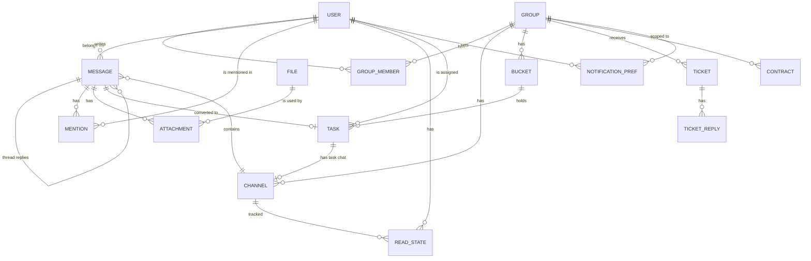

# Data model

Target model for all phases. Fields are indicative until the entity's phase. Status is `built` for the technical `app_meta` table (Phase 1) and for `User` and the auth tables `Session`, `Account`, `Verification` (Phase 2); every other entity is `planned`.

`ApiKey` (eGrant ticket ingestion) stands alone and has no relations.

| entity | purpose | phase | status |
|---|---|---|---|
| User | a person who logs in; role `superadmin`, `admin` or `client` | 2 | built |
| Session, Account, Verification | login sessions and one-time codes; tables owned by better-auth (see below) | 2 | built |
| Group | one client organization; has normalized eGrant URL (unique), invite token (unique, 32 chars) and optional logo key; `groups` table | 3 | built |
| GroupMember | links a client to their one group (admins need no rows); `group_members`, `user_id` is the primary key, `group_id` is indexed, both cascade on delete | 3 | built |
| Channel | one abstraction for group chat, DM and task chat | 4 | planned |
| Message | a post in a channel with per-channel `seq`, optional thread parent | 4 | planned |
| ReadState | last read `seq` per user and channel (unread counts) | 4 | planned |
| Mention | an @-tag of a user in a message | 5 | planned |
| Attachment | links a file to a message, task, contract or ticket | 5 | planned |
| File | stored file: storage key, mime, size, thumbnail (first used for group logos) | 3 | planned |
| NotificationPref | per user per group: `all`, `mentions` or `none` | 6 | planned |
| Bucket | a task board column | 8 | planned |
| Task | a card: title, assignee, due date, priority, labels, position | 8 | planned |
| Ticket | support request from eGrant, status `new`, `in_progress`, `resolved` | 12 | planned |
| ApiKey | secret used by eGrant to send tickets | 12 | planned |
| TicketReply | an admin reply on a ticket | 13 | planned |
| Contract | agreement with a client; admin-only; reminder and draft fields | 14 | planned |
| app_meta | technical table proving migrations work (not a product entity) | 1 | built |

### User and auth tables (built in Phase 2)

`user` (`modules/users/schema.ts`): `id` text PK, `name`, `email` (unique, stored lower-cased and trimmed), `email_verified` (always true for users we create), `image`, `role` (`superadmin | admin | client`, default `client`, indexed, CHECK `user_role_check`; CHECK `user_email_lower_check` enforces `email = lower(email)`), `disabled_at` (set when an admin is removed; blocks login), `created_at`, `updated_at`. Removed admins are kept, not deleted; adding the same email again reactivates them.

`session`, `account`, `verification` (`modules/auth/schema.ts`) match better-auth's expected shape (snake_case columns, timestamptz); `session.user_id` and `account.user_id` reference `user.id` on delete cascade. Only better-auth writes them; expired `verification` rows (login codes) are deleted daily at 03:15 by the pg-boss job `auth.cleanup-verifications` (`modules/auth/jobs.ts`); `account` stays empty with email-code login.

Notes: the superadmin is a `User` with role `superadmin`, created on start from `SUPERADMIN_EMAIL` (name from `SUPERADMIN_NAME`, default the part before `@`); an existing user with that email is promoted and re-enabled. See [glossary](../glossary.md) for terms and [roadmap](../roadmap.md) for phases.
