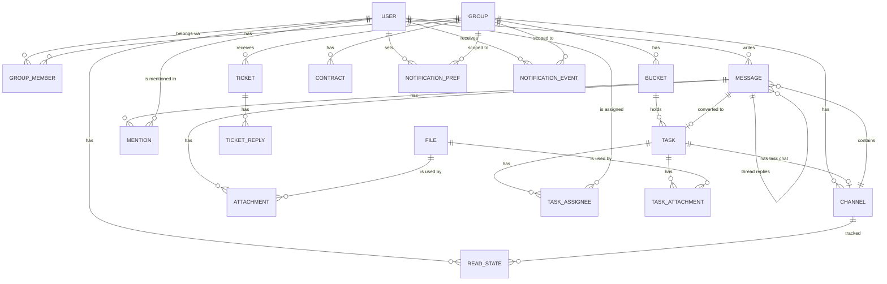

# Data model

Target model for all phases. Fields are indicative until the entity's phase. Status is `built` for the technical `app_meta` table (Phase 1) and for `User` and the auth tables `Session`, `Account`, `Verification` (Phase 2); the file, notification, bucket, task, task assignee and task attachment tables are `built` (Phases 4 and 8); every other entity is `planned`.

`ApiKey` (eGrant ticket ingestion) stands alone and has no relations.

| entity | purpose | phase | status |
|---|---|---|---|
| User | a person who logs in; role `superadmin`, `admin` or `client` | 2 | built |
| Session, Account, Verification | login sessions and one-time codes; tables owned by better-auth (see below) | 2 | built |
| Group | one client organization; has normalized eGrant URL (unique), invite token (unique, 32 chars) and optional logo key; `groups` table | 3 | built |
| GroupMember | links a client to their one group (admins need no rows); `group_members`, `user_id` is the primary key, `group_id` is indexed, both cascade on delete | 3 | built |
| Channel | a chat room; `channels` table: `group_id` (cascade), `kind` (`group` or `task`, CHECK `channels_kind_check`), nullable `task_id` (FK added in Phase 9), `last_seq` bigint (per-channel change counter, incremented under the row lock on every write), `created_at`. Partial unique index `channels_group_unique` on `group_id` where `kind = 'group'`: one group chat per group | 5 | built |
| Message | a post in a channel; `messages` table: `channel_id` (cascade), `author_id` (user, no `ON DELETE` rule), `parent_id` (nullable, cascade; only a top-level message is a parent, a reply's parent is the thread root), `reply_to_id` (nullable, cascade; the message in the same thread a reply answers), `body`, `mentions_all`, `client_id` (unique with `author_id` as `messages_author_client_unique`, makes retries safe), `change_seq` bigint (the channel's `last_seq` at the last change; a new reply also bumps the parent's), `reply_count`, `last_reply_at`, `edited_at`, `deleted_at` (soft delete), `created_at`. Indexes `(channel_id, parent_id, created_at)` and `(channel_id, change_seq)`. All timestamps have millisecond precision | 5 | built |
| ReadState | `read_states` table: `(user_id, channel_id)` primary key (both cascade), `last_read_at`; the top-level, not deleted messages by others created after it are unread (a time, not a seq) | 5 | built |
| ThreadReadState | `thread_read_states` table (migration 0008): one row per person of a thread (its root author and every replier; everyone a reply can quote is one of them), primary key `(root_id, user_id)`, `channel_id`, `last_read_at`, `last_reply_at` (a copy of the thread's newest reply time), all three FKs cascade. A reply writes it in the send transaction: every row of the thread gets the new `last_reply_at`, the replier's `last_read_at` moves to the reply, and the root author gets a row with `last_read_at` = the root's time on the first reply. Opening the thread moves the reader's `last_read_at` to now (a non-person gets no row). The partial index `thread_read_states_unread_idx` on `(user_id, channel_id) where last_reply_at > last_read_at` holds only threads with something new. The migration gives every existing thread's people a row read up to the release | polish C1 | built |
| Mention | an @-tag of a user in a message; `message_mentions`, primary key `(message_id, user_id)`, both cascade | 5 | built |
| Attachment | links a file to a message; `message_attachments`, primary key `(message_id, file_id)`, `position`, both cascade, index on `file_id`. Links to tasks, contracts and tickets come with their phases | 5 | built (messages) |
| File | stored file of one group; `files` table: `group_id` (cascade, indexed), `uploaded_by` (no `ON DELETE` rule: a future hard delete of a user who uploaded files must handle those rows first), `name`, `mime` (sniffed for PNG/JPEG/WebP, else the declared type; a declared png/jpeg/webp whose bytes are not that image is stored as `application/octet-stream`, other declared types are kept and always served as attachments), `size`, `storage_key` (`files/<groupId>/<id>`), optional WebP `preview_key` with `width`/`height`, `attached_at`. Lifecycle: uploaded unattached, attached by the owning module in its transaction, deleted with it; unattached files older than 24 h are cleaned up (partial index on `created_at`). A future group delete cascades the rows but not the storage objects: it must call `deleteFiles` first | 4 | built |
| NotificationEvent | one notification for one recipient; `notification_events` table: `user_id` (cascade), nullable `group_id` (cascade), `kind` (`chat.message`, `chat.mention`, `chat.thread_reply`, `task.moved`, `task.assigned`), `payload` jsonb, `created_at`, `delivered_at` (null until delivered); indexes `(user_id, delivered_at)` and `created_at`; written by `recordNotifications` inside the caller's transaction, purged after 30 days by `notifications.purge-old` | 4 | built |
| NotificationPref | per user per group: `all`, `mentions` or `none` | 6 | planned |
| Bucket | a task board column; `buckets` table: `group_id` (cascade), `kind` (`todo`, `egrant_review`, `client_review`, `done`, `custom`; CHECK `buckets_kind_check`), `name` (custom buckets only, max 60; CHECK `buckets_name_check`), `position` (fractional-index key, `text collate "C"` so it sorts byte-wise), `created_at`. Unique `(group_id, kind)` where `kind <> 'custom'` (one of each fixed bucket) and unique `(group_id, position)`. Fixed keys: To do `a0`, eGrant review `a3`, client review `a6`, Completed `a9`; custom buckets sit strictly between `a0` and `a9`, never on a fixed key | 8 | built |
| Task | a card; `tasks` table: `group_id` (cascade, indexed), `bucket_id` (FK with no action, so a group delete can cascade both tables in one statement), `position` (collated `"C"`, unique per bucket), `title`, `description`, `created_by`, `due_date` (date, no time), `urgent`, `completed_at` (set when moved into Completed), `source_message_id` (no FK until Phase 9), `created_at`, `updated_at` (both written from JS `new Date()`, millisecond precision, so the ISO string round-trips for the 409 check). Partial indexes on `due_date` where not completed and on `urgent` where urgent serve the Phase 6 reminders. Two changes from the first model: a task has zero to ten assignees (rows in `task_assignees`, not a single assignee column) and priority and labels were dropped (the `urgent` flag replaces priority) | 8 | built |
| TaskAssignee | the assignees of a task (zero to ten); `task_assignees`: `(task_id, user_id)` primary key, both cascade, index on `user_id` | 8 | built |
| TaskAttachment | `task_attachments`: `(task_id, file_id)` primary key, both cascade; links a task to its files | 8 | built |
| Ticket | support request from eGrant, status `new`, `in_progress`, `resolved` | 12 | planned |
| ApiKey | secret used by eGrant to send tickets | 12 | planned |
| TicketReply | an admin reply on a ticket | 13 | planned |
| Contract | agreement with a client; admin-only; reminder and draft fields | 14 | planned |
| app_meta | technical table proving migrations work (not a product entity) | 1 | built |

### User and auth tables (built in Phase 2)

`user` (`modules/users/schema.ts`): `id` text PK, `name`, `email` (unique, stored lower-cased and trimmed), `email_verified` (always true for users we create), `image`, `role` (`superadmin | admin | client`, default `client`, indexed, CHECK `user_role_check`; CHECK `user_email_lower_check` enforces `email = lower(email)`), `disabled_at` (set when an admin is removed; blocks login), `created_at`, `updated_at`. Removed admins are kept, not deleted; adding the same email again reactivates them.

`session`, `account`, `verification` (`modules/auth/schema.ts`) match better-auth's expected shape (snake_case columns, timestamptz); `session.user_id` and `account.user_id` reference `user.id` on delete cascade. Only better-auth writes them; expired `verification` rows (login codes) are deleted daily at 03:15 by the pg-boss job `auth.cleanup-verifications` (`modules/auth/jobs.ts`); `account` stays empty with email-code login.

Notes: the superadmin is a `User` with role `superadmin`, created on start from `SUPERADMIN_EMAIL` (name from `SUPERADMIN_NAME`, default the part before `@`); an existing user with that email is promoted and re-enabled. See [glossary](../glossary.md) for terms and [roadmap](../roadmap.md) for phases.
