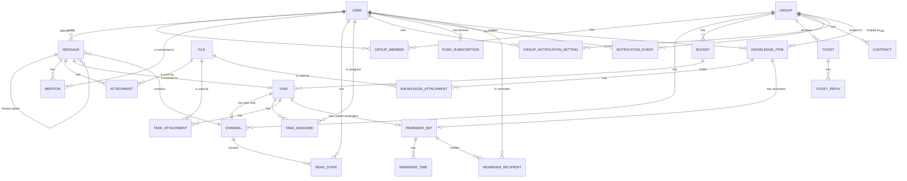

# Data model

Target model for all phases. Fields are indicative until the entity's phase. Status is `built` for the technical `app_meta` table (Phase 1) and for `User` and the auth tables `Session`, `Account`, `Verification` (Phase 2); the file, notification, bucket, task, task assignee and task attachment tables are `built` (Phases 4 and 8); `PushSubscription` and `GroupNotificationSetting` are `built` (Phase 6); the knowledge and reminder tables are `built` (Phase 17, migration 0012); every other entity is `planned`.

`ApiKey` (eGrant ticket ingestion) stands alone and has no relations.

| entity | purpose | phase | status |
|---|---|---|---|
| User | a person who logs in; role `superadmin`, `admin` or `client` | 2 | built |
| Session, Account, Verification | login sessions and one-time codes; tables owned by better-auth (see below) | 2 | built |
| Group | one client organization; has normalized eGrant URL (unique), invite token (unique, 32 chars) and optional logo key; `groups` table | 3 | built |
| GroupMember | links a client to their one group (admins need no rows); `group_members`, `user_id` is the primary key, `group_id` is indexed, both cascade on delete | 3 | built |
| GroupManager | an admin who manages a group (an account manager; a flag, not a role); `group_managers` (migration 0011): `group_id` (cascade), `user_id` (cascade), `created_at`, primary key `(group_id, user_id)`, index `group_managers_user_id_idx` on `user_id`. Many managers per group, many groups per admin. Only active admins and superadmins count: every reader (`modules/groups/managers.ts`) joins `user` on role and `disabled_at is null`, so a disabled admin keeps their rows and counts again when re-enabled. Only `addManager`, which refuses a client, a disabled or an unknown user, writes rows. Migration 0011 seeds it once: each active admin becomes a manager of every group where they are assigned to an open task or wrote a not-deleted message (group or task chat) in the last 60 days; their notification modes are left alone | 18 | built |
| Channel | a chat room; `channels` table: `group_id` (cascade, index `channels_group_id_idx`), `kind` (`group` or `task`, CHECK `channels_kind_check`), `task_id` (FK to `tasks`, cascade, migration 0009; set exactly for task chats, CHECK `channels_task_check` `(kind = 'task') = (task_id is not null)`), `last_seq` bigint (per-channel change counter, incremented under the row lock on every write), `created_at`. Partial unique index `channels_group_unique` on `group_id` where `kind = 'group'`: one group chat per group. Partial unique index `channels_task_unique` on `task_id` where `task_id is not null` (the same rows as `kind = 'task'`, by the check; written this way so the planner also uses it for the cascade from a deleted task): one chat per task. Both chats are created on first use with `insert ... on conflict do nothing` and a select (`ensureGroupChannel`, `ensureTaskChannel`), so parallel first reads still give one row. Deleting a task deletes its chat (cascade: messages, mentions, attachments, read states); `deleteTask` first locks the channel row and lists the chat's files (`taskChatFileIds`), detaches them with the task's own in the transaction and deletes them after the commit (`deleteDetachedFiles`) | 5, 9 | built |
| Message | a post in a channel; `messages` table: `channel_id` (cascade), `author_id` (user, no `ON DELETE` rule), `parent_id` (nullable, cascade; only a top-level message is a parent, a reply's parent is the thread root), `reply_to_id` (nullable, cascade; the message in the same thread a reply answers), `body`, `mentions_all`, `client_id` (unique with `author_id` as `messages_author_client_unique`, makes retries safe), `change_seq` bigint (the channel's `last_seq` at the last change; a new reply also bumps the parent's), `reply_count`, `last_reply_at`, `edited_at`, `deleted_at` (soft delete), `created_at`. Indexes `(channel_id, parent_id, created_at)` and `(channel_id, change_seq)`, and (migration 0015, Phase 20, the dashboard's unread @all mentions) the partial `messages_mentions_all_top_idx` and `messages_mentions_all_reply_idx` on `(channel_id, created_at)` where `mentions_all and deleted_at is null` and `parent_id is null` / `is not null`. All timestamps have millisecond precision | 5, 20 | built |
| ReadState | `read_states` table: `(user_id, channel_id)` primary key (both cascade), `last_read_at`; the top-level, not deleted messages by others created after it are unread (a time, not a seq). Task chats use the same table, and `thread_read_states` for their threads; `markAllRead` (read-all) moves both at once | 5 | built |
| ThreadReadState | `thread_read_states` table (migration 0008): one row per person of a thread (its root author and every replier; everyone a reply can quote is one of them), primary key `(root_id, user_id)`, `channel_id`, `last_read_at`, `last_reply_at` (a copy of the thread's newest reply time), all three FKs cascade. A reply writes it in the send transaction: every row of the thread gets the newest reply time the transaction sees (`max(created_at)` of the thread's replies, so a concurrent reply with a later time that committed first is covered), the replier's `last_read_at` moves to that time, and the root author gets a row with `last_read_at` = the root's time on the first reply. Each person the reply names (Phase 20; never @all, never the replier) gets a row with `last_read_at` = the reply's time minus 1 ms; an existing row keeps its `last_read_at`, so a mention never marks older replies read. Deleting a reply marks every person with nothing unread left in that thread read up to `last_reply_at`, so the row leaves the partial index. Opening the thread moves the reader's `last_read_at` to now (a non-person gets no row). The partial index `thread_read_states_unread_idx` on `(user_id, channel_id) where last_reply_at > last_read_at` holds only threads with something new. The migration gives every existing thread's people a row read up to the release | polish C1 | built |
| Mention | an @-tag of a user in a message; `message_mentions`, primary key `(message_id, user_id)`, both cascade; index `message_mentions_user_message_idx` on `(user_id, message_id)` (migration 0015: the dashboard's mentions of one user) | 5, 20 | built |
| Attachment | links a file to a message; `message_attachments`, primary key `(message_id, file_id)`, `position`, both cascade, index on `file_id`. Links to tasks, contracts and tickets come with their phases | 5 | built (messages) |
| File | stored file of one group; `files` table: `group_id` (cascade, indexed), `uploaded_by` (no `ON DELETE` rule: a future hard delete of a user who uploaded files must handle those rows first), `name`, `mime` (sniffed for PNG/JPEG/WebP, else the declared type; a declared png/jpeg/webp whose bytes are not that image is stored as `application/octet-stream`, other declared types are kept and always served as attachments), `size`, `storage_key` (`files/<groupId>/<id>`), optional WebP `preview_key` with `width`/`height`, `attached_at`. Lifecycle: uploaded unattached, attached by the owning module in its transaction, deleted with it; unattached files older than 24 h are cleaned up (partial index on `created_at`). A future group delete cascades the rows but not the storage objects: it must call `deleteFiles` first. A copy (`copyFile`, a message file kept on a task card) is its own row with its own storage objects, unattached until its owner attaches it; deleting either leaves the other intact. `admins_only` boolean, not null, default false (migration 0012): set on the files of an admins-only knowledge item, it follows the item's visibility, and clients cannot read such a file | 4, 17 | built |
| NotificationEvent | one notification for one recipient; `notification_events` table: `user_id` (cascade), nullable `group_id` (cascade), `kind` (`chat.message`, `chat.mention`, `chat.thread_reply`, `task.moved`, `task.assigned`, `task.deadline`, `task.urgent`, `reminder.due`), `payload` jsonb, `created_at`, `delivered_at` (null until the delivery worker decided the event; set at insert when the recipient can get neither a push nor an email), `email_due_at` (nullable; when the batched email for this event may go out), `emailed_at` (nullable; when it was emailed or skipped), `dedupe_key` (nullable; partial unique index `notification_events_dedupe_unique` on `(user_id, dedupe_key)` where not null, so e.g. a deadline reminder is recorded at most once). Indexes `(user_id, delivered_at)`, `created_at`, partial `notification_events_undelivered_idx` on `created_at` where `delivered_at is null`, and partial `notification_events_email_due_idx` on `email_due_at` where `emailed_at is null and email_due_at is not null` (migration 0010 adds the last three columns and indexes, and marks every event that existed before it as delivered and emailed so the worker never sends that backlog); written by `recordNotifications` inside the caller's transaction. All events of one message are recorded in one transaction and so share `created_at`; delivery finds an event's siblings (same user and `payload->>'messageId'`) through the `created_at` index, so recording one message's events in two transactions would break "one push per message" (pinned by a test in `deliver.test.ts`; an expression index on `payload->>'messageId'` would remove the assumption if ever needed). Purged after 30 days by `notifications.purge-old` | 4, 6 | built |
| GroupNotificationSetting | a user's mode for one group, overriding their own default and the role default; `group_notification_settings`: `(user_id, group_id)` primary key (both cascade), `mode` (`all`, `mentions` or `off`, CHECK `group_notification_settings_mode_check`), index on `group_id` (migration 0010), `origin` (`user` or `manager`, default `user`, CHECK `group_notification_settings_origin_check`, migration 0011). `manager` marks the `all` row written when the user became the group's manager (only when they had no row); stopping deletes the row only while it is still `manager`. Setting a mode with the bell writes `user`, so the user's choice survives stopping; setting the all-groups default deletes every row, manager rows included. Effective mode: this override, else `user.default_group_mode`, else `all` for clients and `mentions` for admins | 6, 18 | built |
| PushSubscription | one browser push subscription (one per device); `push_subscriptions`: `id` text PK, `user_id` (cascade, index `push_subscriptions_user_id_idx`), `endpoint` (unique), `p256dh`, `auth`, nullable `user_agent`, `created_at`, nullable `last_success_at` (migration 0010) | 6 | built |
| Bucket | a task board column; `buckets` table: `group_id` (cascade), `kind` (`todo`, `egrant_review`, `client_review`, `done`, `custom`; CHECK `buckets_kind_check`), `name` (custom buckets only, max 60; CHECK `buckets_name_check`), `position` (fractional-index key, `text collate "C"` so it sorts byte-wise), `created_at`. Unique `(group_id, kind)` where `kind <> 'custom'` (one of each fixed bucket) and unique `(group_id, position)`. The fixed buckets start at `a0` (To do), `a3` (eGrant review), `a6` (client review), `a9` (Completed); admins reorder every bucket afterwards, so any bucket may hold any key (no schema change: the order was already a per-group `position`) | 8 | built |
| Task | a card; `tasks` table: `group_id` (cascade, indexed), `bucket_id` (FK with no action, so a group delete can cascade both tables in one statement), `position` (collated `"C"`, unique per bucket), `title`, `description`, `created_by`, `due_date` (date, no time), `urgent`, `link` (text, null when none: an http(s) URL of at most 2048 characters, checked by the shared schema, not by the database; migration 0014), `completed_at` (set when moved into Completed), `source_message_id` (the chat message the task was made from; FK to `messages`, on delete set null, migration 0009, partial index `tasks_source_message_id_idx` where not null: it serves that cascade and listing a message's tasks; messages are only soft-deleted, so it is cleared only when the message's channel goes with its task), `created_at`, `updated_at` (both written from JS `new Date()`, millisecond precision, so the ISO string round-trips for the 409 check). Partial indexes on `due_date` where not completed and on `urgent` where urgent serve the Phase 6 reminders. `tasks_open_group_idx` on `(group_id, completed_at)` (migration 0015) serves the Phase 20 global task board: the chosen clients' open tasks, or those completed in the last 30 days. Two changes from the first model: a task has zero to ten assignees (rows in `task_assignees`, not a single assignee column) and priority and labels were dropped (the `urgent` flag replaces priority) | 8 | built |
| TaskAssignee | the assignees of a task (zero to ten); `task_assignees`: `(task_id, user_id)` primary key, both cascade, index on `user_id` | 8 | built |
| TaskAttachment | `task_attachments`: `(task_id, file_id)` primary key, both cascade; links a task to its files | 8 | built |
| KnowledgeItem | a knowledge card of one group (note, file, link or reminder); `knowledge_items` table: `group_id` (cascade), `type` (CHECK `knowledge_items_type_check`: `note`, `file`, `link`, `reminder`), `visibility` (default `public`; CHECK `knowledge_items_visibility_check`: `public` or `admins`, admins only), `title` (CHECK `knowledge_items_title_check`, at most 200 characters), `body` (default `''`; the note or reminder body, the file or link description, Markdown, at most 10 000 by the API), `url` (set exactly for links, CHECK `knowledge_items_url_check` `(type = 'link') = (url is not null)`), `created_by` (no `ON DELETE` rule), `created_at` (default `now()`, full precision: items of one transaction share it, so the list cursor carries the database's text of it), `updated_at` (default `now()`, `timestamptz(3)`: millisecond precision, so the ISO string round-trips for the 409 `knowledge_changed` check), `search_text` (not null; title, body as plain text, URL and file names, lower-cased and without diacritics, written by the service). Indexes `knowledge_items_group_created_idx` `(group_id, created_at desc nulls first, id desc nulls first)` (the tab's list and cursor), `knowledge_items_created_idx` `(created_at desc nulls first, id desc nulls first)` (the global list), `knowledge_items_created_by_idx`, and the GIN trigram index `knowledge_items_search_idx` on `search_text gin_trgm_ops` (search with `ILIKE`; the `pg_trgm` extension is created by migration 0012). `NULLS FIRST` is spelled out because it is what `order by created_at desc, id desc` means; drizzle's `.desc()` alone writes `NULLS LAST`, which that order cannot read from the index | 17 | built |
| KnowledgeAttachment | `knowledge_attachments`: `(item_id, file_id)` primary key, both cascade, index on `file_id`; links a note or file item to its files | 17 | built |
| ReminderSet | the reminders of one subject; `reminder_sets` table: `group_id` (cascade), `knowledge_item_id` (FK, cascade, nullable, unique index `reminder_sets_knowledge_item_unique`), `task_id` (FK `tasks.id`, cascade, nullable, unique index `reminder_sets_task_unique`, migration 0013: a task's custom reminders), `created_by`, `created_at`; index `reminder_sets_group_id_idx` on `group_id` (the group cascade and group-scoped lists). CHECK `reminder_sets_subject_check` `num_nonnulls(knowledge_item_id, task_id) = 1`: one FK column per subject kind, so deleting the subject deletes its reminders in the database. The board's per-task count of unfired times (`upcomingReminders`) reads `reminder_sets_task_unique` and `reminder_times_set_at_idx` | 17, 19 | built |
| ReminderTime | one date-time of a set; `reminder_times`: `set_id` (cascade), `at` timestamptz, `fired_at` (nullable; set once the fire job handled it), `updated_at` (when `at` was last set; the `.ics` SEQUENCE and LAST-MODIFIED). Partial index `reminder_times_due_idx` on `at` where `fired_at is null` (the fire job's due query) and `reminder_times_set_at_idx` `(set_id, at)` | 17 | built |
| ReminderRecipient | who a set notifies; `reminder_recipients`: `(set_id, user_id)` primary key (both cascade), `source` (CHECK `reminder_recipients_source_check`: `author`, `added` by the author, `subscribed` by themselves), `added_by` (FK user, no `ON DELETE` rule), index on `user_id` | 17 | built |
| Ticket | support request from eGrant, status `new`, `in_progress`, `resolved` | 12 | planned |
| ApiKey | secret used by eGrant to send tickets | 12 | planned |
| TicketReply | an admin reply on a ticket | 13 | planned |
| Contract | agreement with a client; admin-only; reminder and draft fields | 14 | planned |
| app_meta | technical table proving migrations work (not a product entity) | 1 | built |

### User and auth tables (built in Phase 2)

`user` (`modules/users/schema.ts`): `id` text PK, `name`, `email` (unique, stored lower-cased and trimmed), `email_verified` (always true for users we create), `image`, `role` (`superadmin | admin | client`, default `client`, indexed, CHECK `user_role_check`; CHECK `user_email_lower_check` enforces `email = lower(email)`), `disabled_at` (set when an admin is removed; blocks login), `created_at`, `updated_at`. Phase 6 (migration 0010) adds the notification settings: `default_group_mode` (nullable, `all | mentions | off`, CHECK `user_default_group_mode_check`; null means the role default), `push_enabled` (default true), `email_enabled` (default false), `language` (`sk | en`, default `sk`, CHECK `user_language_check`; the language of emails and pushes) and `email_fallback_at` (nullable; set once when the iOS fallback turned email on, so it never turns it on again after a manual opt-out). Removed admins are kept, not deleted; adding the same email again reactivates them.

`session`, `account`, `verification` (`modules/auth/schema.ts`) match better-auth's expected shape (snake_case columns, timestamptz); `session.user_id` and `account.user_id` reference `user.id` on delete cascade. Only better-auth writes them; expired `verification` rows (login codes) are deleted daily at 03:15 by the pg-boss job `auth.cleanup-verifications` (`modules/auth/jobs.ts`); `account` stays empty with email-code login.

Notes: the superadmin is a `User` with role `superadmin`, created on start from `SUPERADMIN_EMAIL` (name from `SUPERADMIN_NAME`, default the part before `@`); a disabled superadmin with that email is re-enabled, but an existing admin or client with that email is never promoted (`ensureSuperadmin` answers `refused` and the server logs an error). See [glossary](../glossary.md) for terms and [roadmap](../roadmap.md) for phases.
