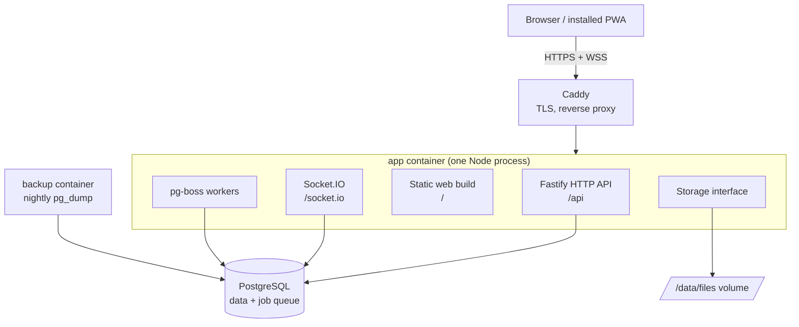

# Architecture overview

Spolu runs as `app`, `postgres` and `caddy`, plus a small `backup` container (nightly `pg_dump` and files archive). A single Node process (`app`) does all the work: API, realtime, background jobs and serving the web build. Redis, BullMQ and MinIO are not used (see [ADR 0002](../decisions/0002-postgres-job-queue-no-redis.md) and [ADR 0003](../decisions/0003-disk-storage-behind-interface.md)).



## The boxes

**Browser / installed PWA.** The React web app. It can be installed on a phone or desktop (see "PWA" below). It talks to the server over HTTPS for all writes and over a WebSocket for live updates.

The scaffold is built (`apps/web`): Vite, React, Tailwind v4 with the egrant theme (`src/styles/theme.css`), shadcn/ui components in `src/components/ui/` (button, card, badge, dropdown-menu, input, label; see [ADR 0009](../decisions/0009-web-client-stack.md)), TanStack Router with a code-based route tree in `src/router.tsx` (every screen is lazy-loaded, so each route is its own chunk) and TanStack Query (one `QueryClient`, `staleTime` 30 s, no refetch on window focus because realtime events keep data fresh). `src/lib/api.ts` has `apiGet(path, schema)`: it fetches `/api<path>` with cookies and `Accept-Language`, parses the body with a zod schema whatever the status (so a 503 health body is returned), and rejects with `ApiError` on non-JSON or a mismatching body; and `apiSend(method, path, body?, schema?)` for `POST`/`PATCH`/`DELETE` and `apiSendRaw` for a raw body (the logo upload), which reject with `ApiError` on any non-2xx status. `ApiError.code` is the `error` (our routes) or `code` (better-auth) string of the body. `src/lib/query-client.ts` creates the one `QueryClient`: no mutation retries, and a 401 from any query or mutation clears the cached session and sends the user to `/login`. `src/lib/socket.ts` has `getSocket()`, the single same-origin Socket.IO connection (WebSocket transport only, not connected until the signed-in layout asks; see [realtime.md](realtime.md)).

**Routes and session (web).** `src/router.tsx` is a code-based tree. Public routes: `/login` (`features/auth/login-page.tsx`: email step, then 6-digit code step, then a safe `redirect` back; it sends a signed-in visitor to `/`) and `/join/$token`. A pathless `authed` layout (`features/auth/authed-layout.tsx`) wraps `/` (redirect only), `/groups` and `/groups/$groupId` (`features/groups/`), `/welcome` (name step), `/settings` (status card) and `/admins` (`features/admins/admins-page.tsx`: list, inline add form, inline remove confirmation; hidden for clients, who get the not-found page; the server answers 403 anyway). Its `beforeLoad` loads the session with `sessionQuery` (`features/auth/use-session.ts`, `GET /api/me`) and redirects to `/login?redirect=...` without one. The header's user menu (`features/auth/user-menu.tsx`) shows the user and logs out. Any other path renders the root route's `notFoundComponent` (`src/routes/not-found.tsx`, lazy).

**Shell (web).** `/` has no screen: it redirects an admin to `/groups` and a client to their own `/groups/<groupId>` (a client with no group goes to `/settings`). The authed layout sends a session with an empty name to `/welcome?redirect=…` (name step); `/join/$token` is the public invite page and shares the `CodeStep` component with login. `src/routes/root.tsx` renders `AppHeader` (`src/components/app-header.tsx`: the egrant.sk header pill with the brand "Spolu by eGrant" — the `app.name` wordmark, a small "by" and the egrant logo, one link named by `app.fullName` — and the language menu) above the routed page. The settings page (`/settings`) shows `StatusCard` (`src/features/system/status-card.tsx`): server version and database status from `GET /api/health` (TanStack Query, refetched every 30 s; `db: down` shows a destructive "Database: unavailable" badge; a failed request shows "Server unreachable" even when an earlier fetch succeeded, since TanStack Query keeps the last good data), and realtime status from `useSocketStatus` (`src/features/system/use-socket-status.ts`), which emits `system:ping` with a 5 s ack timeout on connect and every 30 s: "connected" only after a successful round trip, "disconnected" after a failed ping or a socket disconnect, plus the time of the last ping in the current language's format. The card takes an optional `socket` prop (default `getSocket()`) so tests pass a fake.

**PWA (web).** `vite-plugin-pwa` ([ADR 0011](../decisions/0011-pwa-with-vite-plugin-pwa.md)) generates `dist/manifest.webmanifest` (name "Spolu by eGrant", short name "Spolu", `lang` sk, standalone, `id` `/`, a short description, theme and background `#F5F3F1`) and a Workbox service worker `dist/sw.js` that registers itself (`registerSW.js`) and updates silently (`autoUpdate`). It precaches the app shell (`index.html`, hashed JS/CSS), both fonts, the logo, favicon and manifest icons; screenshots and other brand files are not precached. Navigation requests fall back to the cached `index.html` except `/api/*` and `/socket.io/*`, which always go to the server. Icons live in `public/icons/` (192, 512, maskable 512 with safe-zone padding, apple-touch 180); `pnpm --filter @spolu/web icons` regenerates them with sharp from `public/brand/favicon.svg` (`scripts/generate-icons.mjs`), and the PNGs are committed. The server sends `sw.js` and the manifest with `Cache-Control: no-cache` like every non-hashed file, so a new deploy is picked up on the next visit. `main.tsx` reloads the page on Vite's `vite:preloadError`, so a tab left open across a deploy (its old hashed chunks are gone) recovers instead of failing to open a screen.

**i18n (web).** All UI strings come from `i18next` keys in `src/locales/<code>.json` (nested by feature, e.g. `nav.settings`). The languages are one list, `SUPPORTED_LANGUAGES` in `src/i18n/languages.ts` (code and the language's own name, e.g. `sk` "Slovenčina"; `DEFAULT_LANGUAGE` is `en`). Adding a language = add its locale JSON, one list entry and its import in `src/i18n/index.ts` (the `resources` map is typed `Record<Language, …>`, so a missing one is a type error); a test fails when the locale files and the list differ or when any file's keys differ from `en.json`. `src/i18n/detect.ts` has `isLanguage` and the pure `detectInitialLanguage(stored, navigatorLanguages)`, both driven by the list: a stored choice wins, otherwise the first browser language whose base code is supported, else `en`. `src/i18n/index.ts` initialises i18next at startup (all locale files are bundled, they are small), sets `<html lang>` and exports `setLanguage(lang)`, which switches the language, stores it in `localStorage` under `spolu.lang` and updates `<html lang>`. `LanguageSwitcher` is the egrant.sk-style language menu in the header: a button showing the current code ("SK" and a chevron) opens a Radix dropdown below it with one `menuitemradio` per `SUPPORTED_LANGUAGES` entry (own name, `lang` attribute, check mark on the current one). The button is named by `language.current` ("Jazyk: Slovenčina"), so screen readers announce the current language; Radix names the menu after the button. It ships in the entry chunk (one of the reasons for the 200 kB budget in [performance.md](performance.md)).

**Caddy.** The front door. It gets and renews HTTPS certificates automatically and forwards traffic to the app. Nothing else is exposed to the internet.

**Fastify HTTP API.** The only way to change data. It validates input (zod), checks permissions, writes to the database in a transaction, and then tells Socket.IO what happened. Built so far: `buildApp(deps)` in `apps/server/src/app.ts`, which also attaches Socket.IO (`app.io`, closed by `app.close()` in a `preClose` hook), `GET /api/health` (200 `ok`, or 503 `degraded` when PostgreSQL is unreachable; see `modules/system/`), and one not-found handler: unknown `/api/*`, `/socket.io/*`, non-GET requests and file-like paths (a dot in the last segment, or anything under `/assets/`) answer JSON 404 `{"error":"not_found"}`; other GET/HEAD paths fall back to the web app when static serving is on.

**Admins API.** `modules/users/routes.ts`, admin only (`requireAdmin`), errors as `{ "error": code }`: `GET /api/admins` (active admins, superadmin first), `POST /api/admins` (body `AddAdminBody`; 201 `Admin`, 400 `validation_failed`, 409 `email_taken_admin` / `email_taken_client`; then queues `adminAddedEmail` in the `Accept-Language` language, a queue failure is only logged) and `DELETE /api/admins/:id` (404 unknown id, 403 when `canDeactivate` refuses; otherwise `deactivateUser`, `revokeAllSessions`, `disconnectUser`, 204).

**Groups API.** `modules/groups/routes.ts`, errors as `{ "error": code }`; the policy runs before the service. `GET /api/groups` (admin, `GroupSummary[]`), `POST /api/groups` (201 `Group`, 400 `validation_failed` also for an unparseable eGrant URL, 409 `egrant_url_taken`), `GET /api/groups/:id` (admin or a member of that group; anyone else and unknown ids get 404 `not_found`, never 403; `inviteUrl` = `PUBLIC_URL/join/<token>` for admins only), `PATCH /api/groups/:id`, `POST /api/groups/:id/invite` (new `inviteUrl`), `GET /api/groups/:id/members` (readers, verified active clients), `GET /api/groups/:id/people` (readers; `GroupPerson[]` for mentions and assignees: the group's verified, named, active clients plus every active admin with `isAdmin`, one `unionAll` query ordered by name, 404 for an unreadable or unknown group; `isGroupPerson(db, groupId, userId)` applies the same condition to one user), `GET /api/groups/:id/members/removed` (admin), `DELETE /api/groups/:id/members/:userId` (`deactivateUser`, `revokeAllSessions`, `disconnectUser`; 204) and `POST .../restore` (`reactivateUser`; 204). The manage endpoints answer a client 403 and an unknown group 404; remove/restore answer 404 when the user is not a member of that group and 403 when the target is not a client. Logos live in `modules/groups/logo.ts` (plugin registered by `routes.ts`): `PUT /api/groups/:id/logo` (admin; raw body, route-scoped catch-all buffer parser (also replacing the JSON parser, so `application/json` is 400 `invalid_logo` too) with `bodyLimit` 512 KB, so too large is 413; the type is sniffed from magic bytes by `sniffImageType` and must equal the `Content-Type` header, otherwise 400 `invalid_logo` and nothing changes; stored at `groups/<id>/logo-<random>.<ext>` with the sniffed type; order is put new file, `setLogoKey`, delete the old file, and the new file is deleted if `setLogoKey` fails; 204), `DELETE /api/groups/:id/logo` (admin; 204, idempotent), `GET /api/groups/:id/logo` (readers; same 404 rule) and public `GET /api/join/:token/logo` (an old or unknown token is 404). Both GETs stream from storage with `Cache-Control: private, max-age=86400` and `ETag` = the quoted storage key (`If-None-Match` gives 304); 404 when there is no logo. `hasLogo` is `logo_key is not null`. Cache rule: the logo URL is the same after a change, so `GroupSummary` and `Group` carry `updatedAt` (bumped when the logo key changes) and the web appends `?v=<updatedAt>` to the logo URL (`features/groups/group-logo.tsx`); the `ETag` handles revalidation.

**Chat API.** `modules/chat/routes.ts` (events: `events.ts`, reads: `reads.ts`, writes: `messages.ts`), errors as `{ "error": code }`. Every route requires a session, loads the channel (or the message and its channel) and answers 404 `not_found` when `canReadChannel` says no, so an unreadable chat looks like a missing one. `GET /api/groups/:id/chat` returns the group channel `{ id, lastSeq, lastReadAt, unread }`, creating it on first use. `GET /api/tasks/:id/chat` returns the task's chat in the same shape, creating it on first use (`ensureTaskChannel`; one per task under concurrency); a missing task, a task of a group the user cannot read, or a task deleted while its channel is created (foreign key violation, `TaskGoneError`) answers 404. The task chat is then used through the same channel and message routes as the group chat. A send, edit or delete that waited on the channel row lock while the task (or group) was deleted finds no channel in `nextSeq` (`ChannelGoneError`) and answers 404 `not_found`. Notification events of a message (`chat.message`, `chat.mention`, `chat.thread_reply`) carry `{ channelId, taskId, messageId, groupId, authorName, excerpt }`, `taskId` null in the group chat. `GET /api/channels/:id/messages?before=<cursor>&limit=` returns top-level messages newest first; `?after=<cursor>` pages forward, oldest first; the cursor is `<createdAt ISO>,<id>` taken from a message, `before` and `after` are mutually exclusive and a bad cursor or limit (1..50) is 400 `validation_failed`. Ids must match `^[\w-]{1,64}$` (a malformed path id is 404, a malformed body id 400) and message text may not contain NUL, so nothing Postgres rejects reaches it. `GET /api/channels/:id/changes?afterSeq=N` is the catch-up read (see [realtime.md](realtime.md)). `GET /api/messages/:id/thread` returns the root and its replies; `GET /api/messages/:id/around?limit=` the top-level page containing a message. `POST /api/channels/:id/messages` takes `{ body, parentId?, replyToId?, fileIds?, clientId }` and answers 201 with the message, or 200 with the already stored message when the author repeats a `clientId` (nothing is written or pushed; the response is the idempotency receipt, so the web can retry safely). Every `MessageDto` carries `tasks: { id, title, completed }[]`, the tasks made from it (oldest first; `completed` = in Completed; empty on a deleted message): `toMessageDtos` asks the tasks service (`listTasksForMessages`, one `in (...)` query on `tasks_source_message_id_idx`) once per page, in parallel with mentions and attachments, and not at all when the page has no live message. The pushed `chat:message` carries `isNew`: true for a new message, false for edits, deletes and the parent whose reply count changed. Errors: 400 `invalid_mention` (a mentioned id is not one of the group people; an edit may keep mentions the message already had), 400 `invalid_attachment` (Phase 4 `attachFiles`), 400 `validation_failed` (empty or too long body, bad thread), 429 `rate_limited` after 30 sends per minute per user (`createRateLimiter`, in memory per process). `PATCH /api/messages/:id` (`{ body }`) and `DELETE /api/messages/:id` (soft delete, files removed after commit, 204; deleting again is a no-op 204 that pushes nothing) are for the author only: someone else's message is 403 `forbidden`, an edit of a deleted message 404. `POST /api/channels/:id/read` (`{ at }`, 204) moves the read cursor forward and pushes `chat:read` to the user's sockets. Unread = top-level messages by others after the channel's read cursor, plus replies by others after the thread's read mark in every thread the user started or replied in (`thread_read_states`, see [data-model.md](data-model.md)); the user's own messages and deleted ones never count, and reading the main feed leaves thread replies unread. `GET /api/chat/unread` returns `{ [groupId]: count }` for groups with unread messages: every group for an admin, only their own for a client. Both counts are one query (`unreadPerChannel` in `service.ts`): per channel a lateral subquery adds one index range on `messages` for the top-level part and, for the replies, one range per thread in the partial index `thread_read_states_unread_idx` (only threads with a reply after the reader's mark), each capped at 100, so the cost grows neither with the history nor with the number of threads the user is in (the UI shows "99+"). `GET /api/channels/:id/unread-threads` lists the roots of the channel's threads with unread replies for the reader (at most 100; the dot on "N replies"). `POST /api/messages/:id/thread/read` (root or reply id, 204) marks that thread read up to now and pushes `chat:read` with `rootId`; for someone who is not one of the thread's people it changes and pushes nothing. Task chats never count in the group badges: `GET /api/groups/:id/chat` and `GET /api/chat/unread` count `kind = 'group'` channels only. `GET /api/groups/:id/task-chats` (404 like `GET /api/groups/:id/chat`) returns `{ [taskId]: { count, unread } }` for the board, one statement (`taskChatSummaries`): per task channel of the group, `count` is its live messages (top-level and replies) and `unread` whether it has a top-level message by someone else after the reader's channel mark or a reply by someone else after their mark in one of their threads (the same rules and indexes as the counts above, each part an `exists`); tasks whose chat was never opened are absent. `POST /api/channels/:id/read-all` (204) is opening a task's Chat tab: `markAllRead` moves the channel mark to now and every thread of the reader with unread replies to its newest reply, in one transaction, and pushes `chat:read` with `all: true`; a channel gone meanwhile answers 404. The route is not limited to task chats: on the group channel it reads the whole group chat, threads included, the same way.

**Files API.** `modules/files/routes.ts` (service: `modules/files/service.ts`), errors as `{ "error": code }`. `POST /api/groups/:id/files` streams the raw body (route-scoped catch-all parser, never buffered; headers `content-type`, URL-encoded `x-file-name`) into storage: unreadable group 404, 60 uploads per minute per user (429 `rate_limited`), over 25 MB 413 `file_too_large` (early on `content-length`, else while streaming; no row is kept), 201 `FileInfo`. `PUT /api/files/:id/preview` takes a browser-made WebP of at most 300 KB (`x-image-width`/`x-image-height` 1..20000), uploader only (403), once per file and only before the file is attached (the object is stored under a fresh key, then one conditional `UPDATE ... where preview_key is null and attached_at is null` decides; of two racing PUTs the loser's object is removed); anything else invalid is 400 `invalid_preview`, 204 on success. `GET /api/files/:id` and `/preview` stream with `nosniff` and `cache-control: private, max-age=31536000, immutable`; only sniffed PNG/JPEG/WebP are `inline`, every other type (SVG and HTML included) is `attachment` with an RFC 5987 `filename*`. **Copying.** `Storage.copy(fromKey, toKey)` duplicates an object with its content type (disk: validates both keys, copies the sidecar first, then the data through the temp-file-and-rename path of `put`; a missing source throws `StorageNotFoundError`). `copyFile(deps, { fileId, groupId, userId })` (files service) makes a new unattached `files` row in `groupId`, uploaded by `userId`, with the same name, mime, size and dimensions and its own objects (`files/<groupId>/<newId>`, preview `files/<groupId>/<newId>-preview-<uuid>`); if the insert or a copy fails, the copied objects are deleted and no row remains; a file that is unknown or belongs to another group throws `InvalidAttachmentError`. Used by Phase 9 so a task card keeps its own copy of a message file.

**Tasks API (board and buckets).** `modules/tasks/routes.ts` (service: `service.ts`, events: `events.ts`, permissions: `policy.ts`), errors as `{ "error": code }`. `GET /api/groups/:id/board` returns `BoardDto` (buckets by position, tasks by bucket then position, each with creator, assignees and file count; one query for buckets and one for tasks, no N+1). The board is created lazily on the first read: `ensureBoard` inserts the four fixed buckets (To do, eGrant review, Client review, Completed) in one `insert ... on conflict do nothing`, so two parallel first reads still give exactly four; an unknown group answers 404 before anything is created. `POST /api/groups/:id/buckets` (201 `BucketDto`), `PATCH /api/buckets/:id` (`name` and/or `afterBucketId`) and `DELETE /api/buckets/:id` (204) are admin only. A new custom bucket goes after the last bucket of the group, fixed or custom (where "+ Add column" sits). Admins reorder any bucket, fixed ones included: `afterBucketId` is any other bucket of the group, or `null` for first (itself, another group's bucket or an unknown id answer 400 `validation_failed`); the order is the `position` column, so it is stored per group and sent to the group room as `board:buckets`. A fixed bucket cannot be renamed or deleted (400 `fixed_bucket`). Deleting a custom bucket moves its tasks, in order, to the end of To do in the same transaction. Every bucket write first locks all bucket rows of the group (`select ... for update` ordered by id, then re-reads them), so concurrent writers queue instead of colliding on the unique `(group_id, position)`. Order per route: session (401), rate limit, body (400), resolve the group (a bucket resolves to its group) and `canUseBoard` (404), `canManageBuckets` (403), service, then the event after commit. All board and bucket writes share one budget of 120 per minute per user (429 `rate_limited`, `createRateLimiter`). Names of creators and assignees come from a read-only join on `user` (the same exception as `listGroups`).

**Tasks API (tasks).** `modules/tasks/task-routes.ts` (service: `task-service.ts`), registered by `tasksRoutes` and sharing its write guard. `POST /api/groups/:id/tasks` (body `TaskCreateSchema`; 201 `TaskDetailDto`) adds the task at the end of `bucketId` (default To do; a bucket of another group or one deleted meanwhile answers 404: the bucket row is locked and read again inside the transaction), sets `completedAt` when the bucket is Completed and never takes `sourceMessageId` from the API. `GET /api/tasks/:id` returns `TaskDetailDto` (description, `files` as `FileInfo`, `sourceMessage`). `sourceMessage` is `{ id, channelId, taskId, authorName, excerpt }` of the message the task was made from (`getSourceMessage` in the chat module: one query, mentions shown as names, excerpt 140 characters; `taskId` is the task whose chat holds the message, null in the group chat), or null when there is none or it was deleted. `PATCH /api/tasks/:id` (any reader of the group may edit any task) takes a partial draft plus the `updatedAt` of the version being edited: one conditional `update ... where id = $1 and updated_at = $2`; zero rows answers 409 `task_changed` when the task still exists (404 otherwise), and nothing changes. The new `updatedAt` is `max(now, old + 1 ms)` (always written from JS, millisecond precision), so the returned value can be sent again. `DELETE /api/tasks/:id` (an admin or the creator, else 403; 204). `assigneeIds` and `fileIds` are full lists, at most 10 assignees (more answers 400 `invalid_assignee`, also when the zod `max` fails) and 20 files (400 `validation_failed`); only ids not already on the task are checked: a new assignee must pass `isGroupPerson` (400 `invalid_assignee`), so a removed client stays assigned and never blocks an edit; a new file goes through Phase 4 `attachFiles` (own, unattached file of the group, else 400 `invalid_attachment`). **Files lifecycle:** a removed attachment is unlinked and marked unattached again (`detachFiles`, as the chat does) in the transaction and the file (row and stored object) is deleted with `deleteDetachedFiles` after the commit (only files still unattached, so one the uploader attached again in between, to another task or message, is kept); deleting a task does the same for all its files and for the files of its chat's messages (the chat itself goes by cascade; `deleteTask` returns `{ groupId, sourceMessageId }`; two tasks made from messages in each other's chat and deleted at once can deadlock through the set-null cascade, so the delete transaction is retried once on 40P01). The chat's message delete uses the same pair. If that deletion fails, the daily unattached-files cleanup removes them. That cleanup is best effort: a failure is logged (`onFileCleanupError`, the route passes `request.log.error`, no file names) and never fails the request, and the event is still emitted. `task.assigned` (payload `{ taskId, groupId, title, actorName }`) is recorded with `recordNotifications` in the same transaction, for newly added assignees only and never for the actor. `POST /api/tasks/:id/move` (body `TaskMoveSchema` `{ bucketId, afterTaskId }`, `afterTaskId` null = first; any reader of the group may move any task; 200 `TaskDto`) computes the position on the server in one transaction: it locks the source and target bucket rows (`lockBuckets`), then the task row, re-reads the task and the target bucket (404 if gone; a bucket of another group is 404 too) and places the task with `keyAfter(after.position, the next task after it excluding the moved one)`. Concurrent moves into one bucket queue on its lock, so positions stay unique and ordered and the unique `(bucket_id, position)` is never hit. `afterTaskId` must be another task of the target bucket (else 400 `validation_failed`). Moving a task to where it already sits writes nothing and emits nothing. Entering Completed sets `completedAt`, leaving it clears it. A move never changes `updatedAt` (it guards the content edited in the task form, so a drag never causes a `task_changed` 409). When the bucket changes, `task.moved` (payload `{ taskId, groupId, title, fromBucket, toBucket, actorName }`, buckets as `BucketLabel` `{ kind, name }`: the custom name, the group name for Client review, else null) is recorded in the same transaction for the creator and every assignee, never the actor. Lock order: a transaction locks bucket rows (by id) before any task row; edit and delete lock only the task row. Every write emits `board:task` or `board:task_deleted` after the commit ([realtime.md](realtime.md)). A PATCH, a move that moved and a DELETE of a task with a `sourceMessageId` also push `chat:message_tasks` for that message (`messageTasksEvent` + `emitMessageTasks` from the chat module; nothing when the message is gone or deleted; a failure is logged and never fails the request).

**Join flow (invite link).** `modules/groups/join-routes.ts`, public (no preHandler; the token is the credential). `GET /api/join/:token` returns `{ name, hasLogo, updatedAt }` (`JoinInfo`; the join page appends `?v=<updatedAt>` to the logo URL like the group pages do) or 404 `not_found`. `POST /api/join/:token` with `{ email }`: the token is checked first (old or unknown token: 404), then the body (`JoinBodySchema`; bad email: 400 `validation_failed`), then `joinWithEmail` (groups service): an unknown email becomes a client (`email_verified false`, empty name) plus its membership in ONE transaction; an existing unverified, active client who never signed in is moved to this group (the latest invite wins, so a link cannot reserve someone else's email; one statement: the membership upsert carries the "still an unverified, active client" condition in its `ON CONFLICT DO UPDATE ... WHERE`, so a client who verified in between is never moved), any other existing user (admin, verified client, removed client) is left unchanged, and a concurrent duplicate (unique violation) counts as existing. The answer is `200 {"ok":true}` for every email, so the endpoint reveals nothing about accounts. The web then asks for a code through the normal better-auth endpoint (`disableSignUp` stays on; a removed client gets no code); signing in sets `email_verified` and the name step follows. Rate limit: `createRateLimiter` (`infra/http/rate-limit.ts`, in-memory fixed window, single process per ADR 0005, expired keys dropped on access) allows 10 `POST`s per minute per `request.ip`, then `429 rate_limited`; `GET` is not limited. Known and accepted for now: the limiter keys on the full IP (an IPv6 /64 can rotate addresses), and a new email takes slightly longer than an existing one (a small timing difference).

**Auth.** Email-code login with better-auth ([ADR 0006](../decisions/0006-better-auth-email-otp.md)), in `apps/server/src/modules/auth/`. `buildApp` creates the instance once (`createAuth(deps)`, decorated as `app.auth`) and registers `authRoutes`, which forward an allow-list of three better-auth endpoints (`POST email-otp/send-verification-otp`, `POST sign-in/email-otp`, `POST sign-out` under `/api/auth/`; any other `/api/auth/` path is our JSON 404) and add `GET /api/me` (the signed-in user as `Me`, or `401 {"error":"unauthorized"}`; for a valid user it also forwards a refreshed session cookie). Flow: the browser posts `{ email, type: 'sign-in' }` to `/api/auth/email-otp/send-verification-otp` -> always `200 {"success":true}`; only an existing, not disabled user gets the `email.send` job with the code (`emails.ts` `loginCodeEmail`, language from `Accept-Language` via `language.ts`) -> the browser posts `{ email, otp }` to `/api/auth/sign-in/email-otp` -> a `session` row and the httpOnly cookie `better-auth.session_token` -> later requests carry the cookie. Sign-out is `POST /api/auth/sign-out` with body `{}`. Routes guard themselves with `requireUser` / `requireAdmin` (`session.ts`, see [permissions.md](permissions.md)); `getSessionUser(auth, request)` (and `getSessionFromHeaders`, used by the socket handshake) returns null for a disabled user; `SessionUser` is what `request.user` and the socket carry; it has no group (look it up with `getMembershipGroupId`). `Me` = `SessionUser` plus `groupId` (null for admins) and only `GET`/`PATCH /api/me` return it. `PATCH /api/me` (`{ name }`, 1..100 characters) changes only the caller's own name. Sign-out is detected by the matched route (`request.routeOptions.url`), not by the URL text. `revokeAllSessions(db, userId)` (`service.ts`) deletes the user's sessions. `adminAddedEmail` is the email for a new admin. `buildApp(deps, { logger? })` logs unless `nodeEnv` is `test`; `buildTestApp` always passes `logger: false`. Tests log in with `loginAs(app, email)` (`apps/server/test/login.ts`), which reads the code from Mailpit (`test/mailpit.ts`, `latestLoginCode`).

**Task board (web).** `features/tasks/`. The Tasks tab (`tasks-tab` -> `board.tsx`, one lazy chunk with dnd-kit) loads `GET /api/groups/:id/board` into the TanStack Query cache (`boardQuery`) and renders one `BucketColumn` per bucket with `TaskCard` links. Live updates: `useBoardEvents` applies `board:task`, `board:task_deleted` and `board:buckets` to that cache, ignores other groups' payloads and refetches the board after every rejoin (`useGroupRoomJoins`). Drags are optimistic: `drop.ts` computes the target (`boardCollisions`, `computeTaskDrop`), writes the cache, calls `POST /api/tasks/:id/move` and restores the board on failure; cards are dragged by pointer, touch (long press) or keyboard (Space, arrows, Space); admins drag every column the same way by its grip (`computeBucketDrop`, `handleBucketDrop`, `PATCH /api/buckets/:id`), and "+ Add column" sits after the last column. The done circle on a card and in the panel is a move too (`computeDoneToggle`): to the top of Completed, or from Completed to the top of To do, through the same `POST /api/tasks/:id/move`, so it records the same `task.moved` events and emits the same `board:task`. "+ Add task" opens the create panel, the child route `/groups/$groupId/tasks/new?bucket=<id>` (`task-create-panel.tsx`, lazy): the same `<TaskForm>` empty, the bucket preselected and changeable, `POST /api/groups/:id/tasks` only on "Create"; closing discards the draft, and files uploaded meanwhile stay unattached until the daily cleanup removes them. The task panel is the child route `/groups/$groupId/tasks/$taskId` (its own lazy chunk, no dnd-kit): a right-hand sheet on desktop, full screen on phones, with `<TaskForm>` (title, description, assignees, deadline, urgent, files; the description reuses the chat's `FormatToolbar`, `applyFormat` and `MessageBody`, so it is stored and shown in the chat's Markdown subset), a bucket select, delete and a `children` slot for the Phase 9 task chat. Saves send the `updatedAt` of the version being edited; a 409 shows "someone changed this task" with a reload action. See [design/tokens.md](../design/tokens.md) for the look.

**Socket.IO.** Pushes events to browsers in real time (new message, edited task). Single instance, no Redis adapter. See [realtime.md](realtime.md).

**Static web build.** The built React app, served by the same process with `@fastify/static` (`registerStatic` in `apps/server/src/static.ts`), so there is no separate web server. Built; enabled when `WEB_DIST_DIR` is set (empty in dev, where Vite serves the web). Client routes such as `/settings` return `index.html` so deep links and refreshes work. `index.html` and other non-hashed files are sent with `Cache-Control: no-cache`; files under `/assets/` (Vite fingerprinted names) with `public, max-age=31536000, immutable`.

**pg-boss workers.** Background jobs: sending email (with retries), later push notifications and contract reminders. The queue lives in PostgreSQL (schema `pgboss`, created on first start). Built: `startJobs(databaseUrl, handlers, schedules?)` in `apps/server/src/infra/jobs/` starts pg-boss, creates a queue and a worker for each entry of `handlers` (`Record<jobName, (data) => Promise<void>>`), creates a cron schedule (`boss.schedule(name, cron)`) for each `{ name, cron }` of `schedules` (the name must have a handler) and returns `{ queue, stop }`; modules only see the `JobQueue` (`send(name, data)`). Jobs: `auth.cleanup-verifications` (`modules/auth/jobs.ts`, scheduled daily `15 3 * * *` in `createDeps`; deletes expired `verification` rows), `files.cleanup-unattached` (`modules/files/jobs.ts`, `30 3 * * *`; deletes files never attached after 24 h, rows and stored objects), `notifications.purge-old` (`modules/notifications/jobs.ts`, `45 3 * * *`; deletes notification events older than 30 days) and `email.send` (`emailJobHandlers`, `sendEmailLater` in `infra/email/`), so a slow email provider never blocks a request and pg-boss retries failures. Tests use `createInlineJobs`, which runs the handler inside `send`. In dev and tests SMTP points at `127.0.0.1` (Mailpit), not `localhost`: nodemailer's lookup of `localhost` times out on Node 26.

**Dependencies and modules.** `apps/server/src/deps.ts` defines `AppDeps = { config, db, email, storage, jobs, ai }`; `createDeps(config)` builds the real ones (`ai` is `createAiProvider(config.ai)`, null when AI is off). `buildApp(deps)` registers every module's route plugin (`FastifyPluginAsync<{ deps: AppDeps }>`) with `app.register(plugin, { prefix: '/api', deps })`. Tests build the same app with `buildTestApp()` (`apps/server/test/test-app.ts`: test database, SMTP to Mailpit, temp-dir storage, inline jobs, `ai: null` unless `buildTestApp({ ai })` passes a provider; no logging unless `buildTestApp({ logStream })` captures the info log as JSON lines).

**Email.** `createEmailSender(config.email)` in `apps/server/src/infra/email/` returns an `EmailSender` (`send({ to, cc?, subject, html, text })`). `EMAIL_DRIVER=smtp` uses nodemailer (Mailpit in dev and tests; Elastic Email SMTP when deployed via `SMTP_USER`/`SMTP_PASSWORD`, both or neither, and `SMTP_SECURE`, default true on port 465; the password is never logged, `ConfigError` lists variable names only); `elastic` posts to the Elastic Email v4 transactional API. Failures throw `EmailSendError` (status and response text, never the API key). Built; `sendEmailLater(jobs, msg)` queues a send as the `email.send` job, which pg-boss retries.

**AI client and API.** `modules/ai/`. A `TaskSplitProvider` (`provider.ts`: `split(request, signal)` returning raw cards and token usage; any failure, abort included, is `AiFailedError`) is chosen by `createAiProvider(config.ai)` (`index.ts`): `AI_PROVIDER=openai` (default) uses `OPENAI_API_KEY` and `OPENAI_MODEL` (default `gpt-5-mini`) and is off (null) without a key; `AI_PROVIDER=fake` is a canned list-line splitter for dev and e2e, never on a server (in production `loadConfig` refuses it unless `AI_ALLOW_FAKE=1`, set only by the Playwright web server). `openai-provider.ts` posts to the Chat Completions API with `fetch` (no SDK) and a strict JSON schema (`response_format: json_schema`, `strict: true`); `max_completion_tokens` 8000; a non-2xx (its body is cancelled, never read), a refusal, unparsable content or content failing zod is `AiFailedError` (the error body is dropped: it can echo part of the key). Only the message text with mentions as `@Name`, the quoted reply-to message, the message's file names (`id — name`), the group people (`id — name`) and today's date in Europe/Bratislava leave the server; file contents never do. `split.ts`: `buildSplitRequest`, `sanitizeProposals` (trims and cuts titles to 200 and descriptions to 5000 code points, drops blank titles, unknown assignee and file ids and dates that do not exist, keeps at most 10 cards) and `proposeTasks` (30 s `AbortSignal.timeout`, also enforced against a provider that ignores the signal, no retry). Routes (`routes.ts`, any signed-in user): `GET /api/ai/status` returns `AiStatus` (`{ taskSplit }`); `POST /api/messages/:id/task-split` answers 503 `ai_unavailable` (no provider), 404 `not_found` (message missing, deleted or in a channel the caller cannot read), 400 `validation_failed` (no text), 502 `ai_failed` (failure or timeout), 422 `ai_no_tasks` (nothing usable) or 200 `TaskProposals`. There is no per-user limit (owner decision); the global API limit still applies. Every call that reaches the provider logs `ai task split` at info with `{ userId, messageId, durationMs, outcome: ok | no_tasks | failed | timeout, usage }`; the key is never logged.

**Storage.** An interface (put, get, delete, exists, signed URL) in `apps/server/src/infra/storage/`, built. `createDiskStorage(filesDir, appSecret)` writes files to a disk volume, with the content type in a `<key>.meta.json` sidecar; keys are `[a-z0-9/_.-]+` with no `..`, empty or absolute segments, and a bad key throws `InvalidStorageKeyError` before any disk access. `get` streams the file (never buffers it) and throws `StorageNotFoundError` when missing. Signed URLs are `/files/<key>?expires=<unix>&sig=<HMAC-SHA256 hex>`; no route serves them yet (group logos are streamed by their own API routes with a session or invite check; a signed file route arrives with attachments in Phase 5); switching to S3-compatible storage later means swapping the implementation.

**PostgreSQL.** The single source of truth: all data plus the job queue. See [data-model.md](data-model.md).

Splitting workers into their own container later is a config change, not a rewrite. See [ADR 0005](../decisions/0005-single-process-deployment.md).

**Boot and shutdown.** `apps/server/src/main.ts` runs: `loadConfig` (a `ConfigError` prints its message and exits 1) -> `runMigrations` -> `createDeps` (database, email, storage, jobs) -> `buildApp` (includes Socket.IO) -> `registerStatic` (if `WEB_DIST_DIR`) -> listen on `0.0.0.0:PORT`. On SIGTERM or SIGINT it runs `app.close()` (Socket.IO and the HTTP server), then stops pg-boss and closes the database pool; a second signal forces exit 1. `pnpm --filter @spolu/server build` bundles `src/main.ts` with tsup into `dist/main.js` (ESM, node24; `@spolu/shared` inlined, npm dependencies external) and copies the SQL migrations to `dist/migrations`, which is where `runMigrations` looks relative to the running file in both layouts. Run with `node dist/main.js`.

**Production image and compose.** The root `Dockerfile` builds in three stages on `node:24-bookworm-slim`: `deps` (`pnpm fetch`, cached until the lockfile changes), `build` (`pnpm -r build`, then `pnpm --filter @spolu/server deploy --prod /out` for server production dependencies only) and `runtime` (non-root `node` user, `/app/server/main.js` + `migrations`, web at `/app/web`, `FILES_DIR=/data/files`, `APP_VERSION` from the build arg, a `HEALTHCHECK` using Node's built-in fetch on `/api/health`). `deploy/docker-compose.yml` runs `app`, `postgres:17` (not published), `caddy:2` (the only service with published ports: 80, 443, 443/udp; `deploy/Caddyfile` proxies `{$DOMAIN}` to `app:3000`, WebSockets included, TLS automatic) and `backup` (`deploy/backup/backup.sh`: nightly `pg_dump -Fc` and a `files-<timestamp>.tar.gz` of the read-only mounted `files` volume at `BACKUP_HOUR` (default 03:30) in `BACKUP_TZ` to the `backups` volume, 14 newest of each kept). All services restart `unless-stopped`, logs rotate (10 MB x 3) and `app` gets a 30 s stop grace period. Compose builds `DATABASE_URL` from `POSTGRES_PASSWORD`; the other variables come from the `.env` next to the compose file (on a server `/opt/spolu/<env>/.env`, template `deploy/test.env.example`).

**CI/CD.** All build, test and deploy logic is in `scripts/` ([ADR 0004](../decisions/0004-scripts-first-ci.md)); any CI only calls them. `scripts/ci.sh` runs every check (install, shellcheck, script tests, lint, typecheck, tests, e2e, docs check). `scripts/build-image.sh <sha>` builds the image for amd64 and arm64 and pushes `$IMAGE:<sha>` with `APP_VERSION=<sha>`. `scripts/deploy.sh <env> <sha>` copies the compose files and env file to `/opt/spolu/<env>/` over SSH, pulls and starts the new image, and waits until `/api/health` reports the new version. `scripts/server-setup.sh` prepares a fresh VM once. How to run them: [runbooks/deploy.md](../runbooks/deploy.md), [runbooks/server-setup.md](../runbooks/server-setup.md).

**Proxy trust.** The server trusts exactly one proxy hop (Fastify `trustProxy` as a function `hop < 1`; a plain number would mean "trust nothing" in Fastify 5), so `request.ip` is the last `X-Forwarded-For` entry, the one Caddy adds; entries a client prepends are ignored. This is safe only because the app port is reachable solely through Caddy in deployed environments. Dotfiles in the web dist are never served, and unknown `/api` and `/socket.io` paths (with or without a trailing path) answer JSON 404.

**Dev and e2e runs.** `pnpm dev` runs the server (tsx watch) and Vite in parallel; the browser uses :5173 and Vite proxies `/api` and `/socket.io` to :3000. `pnpm test:e2e` (Playwright, Chromium, root `playwright.config.ts`, specs in `e2e/`) builds all packages and starts `node apps/server/dist/main.js` with an absolute `WEB_DIST_DIR=apps/web/dist` on :3000 against its own PostgreSQL database (`spolu_e2e` by default, or the name in `DATABASE_URL`; `e2e/create-db.mjs` creates it before the server starts and refuses a name without "e2e", so dev data is never touched; `ADMIN_DATABASE_URL` overrides the admin connection) and the dev Mailpit, so it tests the same layout as production. The browser locale is fixed to `sk-SK`, so the default language is Slovak. `e2e/auth.setup.ts` logs the superadmin in once (code read from Mailpit, `e2e/mailpit.ts`) and saves the session as the default storage state. The suites cover the status card (DB and realtime), the language menu and its persistence, a deep link falling back to the SPA, the web manifest, the redirect of an anonymous visitor to `/login`, the admins flow (add an admin, the new admin logs in, remove them), the group flow (create, invite, join, remove) and the chat (`e2e/chat.spec.ts`: one serial test with an admin and a client in two browser contexts: live messages, thread, mention picker (also opened in edit mode on the top message, to catch clipping), image attachment, edit and delete, the Chat tab unread badge, and a forced WebSocket drop with catch-up of a missed message, edit and delete). An already running server on :3000 is reused outside CI.

## Where code lives

```
apps/web/             React + Vite app (src/routes, src/features/<name> (system, auth, admins, groups, join), src/components(/ui), src/lib, src/i18n, src/locales, src/styles; scripts/, public/icons)
apps/server/src/
  modules/            one folder per feature
    system/           (exists: health and socket ping)
    users/            (exists: user table, admin service and policy, admins API; the first worked example for new modules)
    auth/             (exists: better-auth, email-code login, session guards, login and admin emails)
    groups/           (exists: groups, members, invite link, join flow, logos; the second worked example)
    files/            (exists: file upload, download and previews; other modules attach files through its service)
    notifications/    (exists: notification events table, `recordNotifications`, purge job; delivery comes later)
    chat/             (exists: group chat, threads, mentions, attachments, read states; HTTP API and realtime events)
    (planned) dm/ tasks/ tickets/ contracts/
  infra/              db/ email/ storage/ jobs/ realtime/ config/
packages/shared/      zod schemas and types used by both sides (source-only: server and web import `@spolu/shared` straight from `src/`; health response schema and socket event names live here)
```

Each module owns its routes, service logic, DB tables, socket events and tests.

**Module boundary rule.** Modules talk to each other only through exported service functions. A module never reads or writes another module's tables. Three deliberate exceptions: the auth adapter gets the users `user` table, and the groups service and the chat message loader (`modules/chat/dto.ts`, author name and role) join `user` read-only to list members or authors in one query (no N+1); the chat schema also references `user.id` for foreign keys, and the chat and tasks schemas reference each other (`channels.task_id`, `tasks.source_message_id`; lazy `AnyPgColumn` references, since the two files import each other); the tasks service asks the chat service for a task chat's files (`taskChatFileIds`) and a task's source message (`getSourceMessage`), the task routes ask it for the `chat:message_tasks` event (`messageTasksEvent`, `emitMessageTasks`), the chat routes ask the tasks service for a task's group (`getTaskRef`) and the chat DTO asks it for the tasks made from each message (`listTasksForMessages`), never reading the tasks table itself; `getSourceMessage` joins `user` read-only for the author's and the mentioned people's names, like the message loader; writes to users always go through the users service.

**Writes via HTTP, sockets push.** Every change goes through the HTTP API (validation, permissions, transaction). After the commit the server emits an event to the right room. Sockets never accept writes. This keeps one write path to test.

**Configuration.** The server reads all settings from environment variables once at boot (`apps/server/src/infra/config/config.ts`). `loadConfig(env)` validates them with zod and throws a `ConfigError` naming every invalid variable, so a bad deployment fails at startup, not later. Every variable is listed in `.env.example` at the repo root.

**CSRF guard.** `registerCsrfGuard` in `apps/server/src/app.ts` is one `onRequest` hook for every non-`GET`/`HEAD`/`OPTIONS` request under `/api/` except `/api/auth/*` (better-auth checks `Origin` itself). It answers `403 {"error":"forbidden"}` when `Sec-Fetch-Site` is present and not `same-origin`/`none`, or when `Origin` is present and is not `PUBLIC_URL`'s origin (in development also `http://localhost:5173`, the Vite proxy, like better-auth's `trustedOrigins`). Requests with neither header (curl, `app.inject`) pass: browsers always send them, and the session cookie is `SameSite=Lax` as well.

See also: [permissions.md](permissions.md), [roadmap](../roadmap.md), [glossary](../glossary.md).
