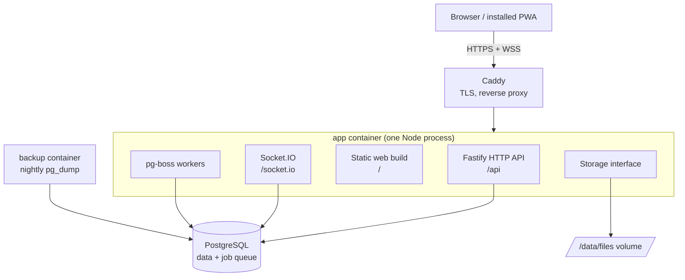

# Architecture overview

eHub runs as `app`, `postgres` and `caddy`, plus a small `backup` container (nightly `pg_dump`). A single Node process (`app`) does all the work: API, realtime, background jobs and serving the web build. Redis, BullMQ and MinIO are not used (see [ADR 0002](../decisions/0002-postgres-job-queue-no-redis.md) and [ADR 0003](../decisions/0003-disk-storage-behind-interface.md)).



## The boxes

**Browser / installed PWA.** The React web app. It can be installed on a phone or desktop. It talks to the server over HTTPS for all writes and over a WebSocket for live updates.

**Caddy.** The front door. It gets and renews HTTPS certificates automatically and forwards traffic to the app. Nothing else is exposed to the internet.

**Fastify HTTP API.** The only way to change data. It validates input (zod), checks permissions, writes to the database in a transaction, and then tells Socket.IO what happened.

**Socket.IO.** Pushes events to browsers in real time (new message, edited task). Single instance, no Redis adapter. See [realtime.md](realtime.md).

**Static web build.** The built React app, served by the same process, so there is no separate web server.

**pg-boss workers.** Background jobs: sending email (with retries), later push notifications and contract reminders. The queue lives in PostgreSQL.

**Storage.** An interface (put, get, delete, signed URL). Today it writes files to a disk volume; switching to S3-compatible storage later means swapping the implementation.

**PostgreSQL.** The single source of truth: all data plus the job queue. See [data-model.md](data-model.md).

Splitting workers into their own container later is a config change, not a rewrite. See [ADR 0005](../decisions/0005-single-process-deployment.md).

## Where code lives

```
apps/web/             React + Vite app
apps/server/src/
  modules/            one folder per feature
    auth/ users/ groups/ chat/
    (later) dm/ tasks/ tickets/ contracts/ notifications/
  infra/              db/ email/ storage/ jobs/ realtime/ config/
packages/shared/      zod schemas and types used by both sides (source-only: server and web import `@ehub/shared` straight from `src/`; health response schema and socket event names live here)
```

Each module owns its routes, service logic, DB tables, socket events and tests.

**Module boundary rule.** Modules talk to each other only through exported service functions. A module never reads or writes another module's tables.

**Writes via HTTP, sockets push.** Every change goes through the HTTP API (validation, permissions, transaction). After the commit the server emits an event to the right room. Sockets never accept writes. This keeps one write path to test.

**Configuration.** The server reads all settings from environment variables once at boot (`apps/server/src/infra/config/config.ts`). `loadConfig(env)` validates them with zod and throws a `ConfigError` naming every invalid variable, so a bad deployment fails at startup, not later. Every variable is listed in `.env.example` at the repo root.

See also: [permissions.md](permissions.md), [roadmap](../roadmap.md), [glossary](../glossary.md).
