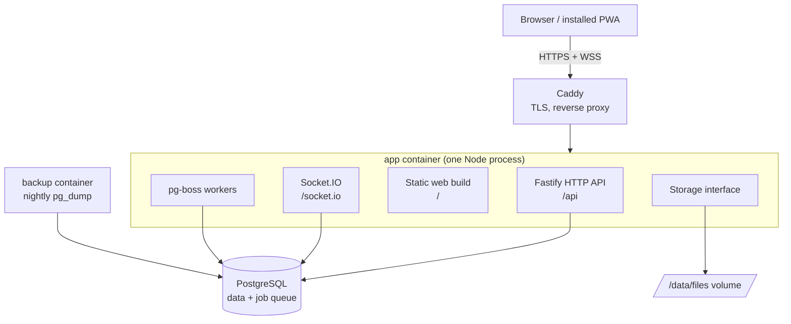

# Architecture overview

Spolu runs as `app`, `postgres` and `caddy`, plus a small `backup` container (nightly `pg_dump`). A single Node process (`app`) does all the work: API, realtime, background jobs and serving the web build. Redis, BullMQ and MinIO are not used (see [ADR 0002](../decisions/0002-postgres-job-queue-no-redis.md) and [ADR 0003](../decisions/0003-disk-storage-behind-interface.md)).



## The boxes

**Browser / installed PWA.** The React web app. It can be installed on a phone or desktop (see "PWA" below). It talks to the server over HTTPS for all writes and over a WebSocket for live updates.

The scaffold is built (`apps/web`): Vite, React, Tailwind v4 with the egrant theme (`src/styles/theme.css`), shadcn/ui components in `src/components/ui/` (button, card, badge, dropdown-menu; see [ADR 0009](../decisions/0009-web-client-stack.md)), TanStack Router with a code-based route tree in `src/router.tsx` (every screen is lazy-loaded, so each route is its own chunk) and TanStack Query (one `QueryClient`, `staleTime` 30 s, no refetch on window focus because realtime events keep data fresh). `src/lib/api.ts` has `apiGet(path, schema)`: it fetches `/api<path>` with cookies and parses the body with a zod schema whatever the status (so a 503 health body is returned), and rejects with `ApiError` on non-JSON or a mismatching body. `src/lib/socket.ts` has `getSocket()`, the single same-origin Socket.IO connection. Routes so far: `/` (the shell page) and `/settings` (placeholder); any other path renders the root route's `notFoundComponent` (`src/routes/not-found.tsx`, lazy) inside the layout.

**Shell (web).** `src/routes/root.tsx` renders `AppHeader` (`src/components/app-header.tsx`: the egrant.sk header pill with the egrant logo, the product name from `app.name` and the language switcher) above the routed page. The home page shows `StatusCard` (`src/features/system/status-card.tsx`): server version and database status from `GET /api/health` (TanStack Query, refetched every 30 s; `db: down` shows a destructive "Database: unavailable" badge; a failed request shows "Server unreachable" even when an earlier fetch succeeded, since TanStack Query keeps the last good data), and realtime status from `useSocketStatus` (`src/features/system/use-socket-status.ts`), which emits `system:ping` with a 5 s ack timeout on connect and every 30 s: "connected" only after a successful round trip, "disconnected" after a failed ping or a socket disconnect, plus the time of the last ping in the current language's format. The card takes an optional `socket` prop (default `getSocket()`) so tests pass a fake.

**PWA (web).** `vite-plugin-pwa` ([ADR 0011](../decisions/0011-pwa-with-vite-plugin-pwa.md)) generates `dist/manifest.webmanifest` (name "Spolu by eGrant", short name "Spolu", `lang` sk, standalone, `id` `/`, a short description, theme and background `#F5F3F1`) and a Workbox service worker `dist/sw.js` that registers itself (`registerSW.js`) and updates silently (`autoUpdate`). It precaches the app shell (`index.html`, hashed JS/CSS), both fonts, the logo, favicon and manifest icons; screenshots and other brand files are not precached. Navigation requests fall back to the cached `index.html` except `/api/*` and `/socket.io/*`, which always go to the server. Icons live in `public/icons/` (192, 512, maskable 512 with safe-zone padding, apple-touch 180); `pnpm --filter @spolu/web icons` regenerates them with sharp from `public/brand/favicon.svg` (`scripts/generate-icons.mjs`), and the PNGs are committed. The server sends `sw.js` and the manifest with `Cache-Control: no-cache` like every non-hashed file, so a new deploy is picked up on the next visit. `main.tsx` reloads the page on Vite's `vite:preloadError`, so a tab left open across a deploy (its old hashed chunks are gone) recovers instead of failing to open a screen.

**i18n (web).** All UI strings come from `i18next` keys in `src/locales/en.json` and `sk.json` (nested by feature, e.g. `nav.settings`; a test fails when the two key sets differ). `src/i18n/detect.ts` has the pure `detectInitialLanguage(stored, navigatorLanguages)`: a stored choice wins, otherwise `sk` if the browser prefers Slovak, else `en`. `src/i18n/index.ts` initialises i18next at startup (both locale files are bundled, they are small), sets `<html lang>` and exports `setLanguage(lang)`, which switches the language, stores it in `localStorage` under `spolu.lang` and updates `<html lang>`. `LanguageSwitcher` is a two-button "SK | EN" toggle in the header (an ARIA radio group: arrow keys move the choice, each option is named by the full language name in its own language); it has no dependencies, so it ships in the entry chunk.

**Caddy.** The front door. It gets and renews HTTPS certificates automatically and forwards traffic to the app. Nothing else is exposed to the internet.

**Fastify HTTP API.** The only way to change data. It validates input (zod), checks permissions, writes to the database in a transaction, and then tells Socket.IO what happened. Built so far: `buildApp` in `apps/server/src/app.ts`, `GET /api/health` (200 `ok`, or 503 `degraded` when PostgreSQL is unreachable; see `modules/system/`), and one not-found handler: unknown `/api/*`, `/socket.io/*`, non-GET requests and file-like paths (a dot in the last segment, or anything under `/assets/`) answer JSON 404 `{"error":"not_found"}`; other GET/HEAD paths fall back to the web app when static serving is on.

**Socket.IO.** Pushes events to browsers in real time (new message, edited task). Single instance, no Redis adapter. See [realtime.md](realtime.md).

**Static web build.** The built React app, served by the same process with `@fastify/static` (`registerStatic` in `apps/server/src/static.ts`), so there is no separate web server. Built; enabled when `WEB_DIST_DIR` is set (empty in dev, where Vite serves the web). Client routes such as `/settings` return `index.html` so deep links and refreshes work. `index.html` and other non-hashed files are sent with `Cache-Control: no-cache`; files under `/assets/` (Vite fingerprinted names) with `public, max-age=31536000, immutable`.

**pg-boss workers.** Background jobs: sending email (with retries), later push notifications and contract reminders. The queue lives in PostgreSQL (schema `pgboss`, created on first start). Built: `startJobs(databaseUrl)` in `apps/server/src/infra/jobs/` starts pg-boss and returns it; queues are created with `boss.createQueue(name)` before `send`/`work`. No real jobs yet.

**Email.** `createEmailSender(config.email)` in `apps/server/src/infra/email/` returns an `EmailSender` (`send({ to, cc?, subject, html, text })`). `EMAIL_DRIVER=smtp` uses nodemailer (Mailpit in dev and tests); `elastic` posts to the Elastic Email v4 transactional API. Failures throw `EmailSendError` (status and response text, never the API key). Built; the job queue that retries sends comes later.

**Storage.** An interface (put, get, delete, exists, signed URL) in `apps/server/src/infra/storage/`, built. `createDiskStorage(filesDir, appSecret)` writes files to a disk volume, with the content type in a `<key>.meta.json` sidecar; keys are `[a-z0-9/_.-]+` with no `..`, empty or absolute segments, and a bad key throws `InvalidStorageKeyError` before any disk access. `get` streams the file (never buffers it) and throws `StorageNotFoundError` when missing. Signed URLs are `/files/<key>?expires=<unix>&sig=<HMAC-SHA256 hex>`; the route that serves them arrives with the first upload feature (Phase 3); switching to S3-compatible storage later means swapping the implementation.

**PostgreSQL.** The single source of truth: all data plus the job queue. See [data-model.md](data-model.md).

Splitting workers into their own container later is a config change, not a rewrite. See [ADR 0005](../decisions/0005-single-process-deployment.md).

**Boot and shutdown.** `apps/server/src/main.ts` runs: `loadConfig` (a `ConfigError` prints its message and exits 1) -> `runMigrations` -> `createDb` -> `startJobs` -> `buildApp` -> `registerStatic` (if `WEB_DIST_DIR`) -> `attachSocket` -> listen on `0.0.0.0:PORT`. On SIGTERM or SIGINT it closes Socket.IO and the HTTP server, stops pg-boss and closes the database pool; a second signal forces exit 1. `pnpm --filter @spolu/server build` bundles `src/main.ts` with tsup into `dist/main.js` (ESM, node24; `@spolu/shared` inlined, npm dependencies external) and copies the SQL migrations to `dist/migrations`, which is where `runMigrations` looks relative to the running file in both layouts. Run with `node dist/main.js`.

**Production image and compose.** The root `Dockerfile` builds in three stages on `node:24-bookworm-slim`: `deps` (`pnpm fetch`, cached until the lockfile changes), `build` (`pnpm -r build`, then `pnpm --filter @spolu/server deploy --prod /out` for server production dependencies only) and `runtime` (non-root `node` user, `/app/server/main.js` + `migrations`, web at `/app/web`, `FILES_DIR=/data/files`, `APP_VERSION` from the build arg, a node-fetch `HEALTHCHECK` on `/api/health`). `deploy/docker-compose.yml` runs `app`, `postgres:17` (not published), `caddy:2` (the only service with published ports: 80, 443, 443/udp; `deploy/Caddyfile` proxies `{$DOMAIN}` to `app:3000`, WebSockets included, TLS automatic) and `backup` (`deploy/backup/backup.sh`: nightly `pg_dump -Fc` at `BACKUP_HOUR` in `BACKUP_TZ` to the `backups` volume, 14 newest kept). All services restart `unless-stopped`, logs rotate (10 MB x 3) and `app` gets a 30 s stop grace period. Compose builds `DATABASE_URL` from `POSTGRES_PASSWORD`; the other variables come from `deploy/.env` (template: `deploy/test.env.example`). Built; the CI/CD scripts that build, push and deploy arrive in Phase 1 Task 16-17.

**Dev and e2e runs.** `pnpm dev` runs the server (tsx watch) and Vite in parallel; the browser uses :5173 and Vite proxies `/api` and `/socket.io` to :3000. `pnpm test:e2e` (Playwright, Chromium, root `playwright.config.ts`, specs in `e2e/`) builds all packages and starts `node apps/server/dist/main.js` with an absolute `WEB_DIST_DIR=apps/web/dist` on :3000 against the dev PostgreSQL and Mailpit, so it tests the same layout as production. The browser locale is fixed to `sk-SK`, so the default language is Slovak. The smoke suite covers status card (DB and realtime), the language switch and its persistence, a deep link falling back to the SPA, and the web manifest. An already running server on :3000 is reused outside CI.

## Where code lives

```
apps/web/             React + Vite app (src/routes, src/features/<name>, src/components(/ui), src/lib, src/i18n, src/locales, src/styles; scripts/, public/icons)
apps/server/src/
  modules/            one folder per feature
    auth/ users/ groups/ chat/
    (later) dm/ tasks/ tickets/ contracts/ notifications/
  infra/              db/ email/ storage/ jobs/ realtime/ config/
packages/shared/      zod schemas and types used by both sides (source-only: server and web import `@spolu/shared` straight from `src/`; health response schema and socket event names live here)
```

Each module owns its routes, service logic, DB tables, socket events and tests.

**Module boundary rule.** Modules talk to each other only through exported service functions. A module never reads or writes another module's tables.

**Writes via HTTP, sockets push.** Every change goes through the HTTP API (validation, permissions, transaction). After the commit the server emits an event to the right room. Sockets never accept writes. This keeps one write path to test.

**Configuration.** The server reads all settings from environment variables once at boot (`apps/server/src/infra/config/config.ts`). `loadConfig(env)` validates them with zod and throws a `ConfigError` naming every invalid variable, so a bad deployment fails at startup, not later. Every variable is listed in `.env.example` at the repo root.

See also: [permissions.md](permissions.md), [roadmap](../roadmap.md), [glossary](../glossary.md).
