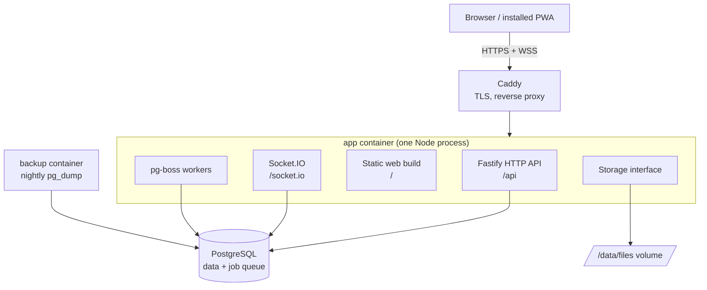

# Architecture overview

Spolu runs as `app`, `postgres` and `caddy`, plus a small `backup` container (nightly `pg_dump` and files archive). A single Node process (`app`) does all the work: API, realtime, background jobs and serving the web build. Redis, BullMQ and MinIO are not used (see [ADR 0002](../decisions/0002-postgres-job-queue-no-redis.md) and [ADR 0003](../decisions/0003-disk-storage-behind-interface.md)).



## The boxes

**Browser / installed PWA.** The React web app. It can be installed on a phone or desktop (see "PWA" below). It talks to the server over HTTPS for all writes and over a WebSocket for live updates.

The scaffold is built (`apps/web`): Vite, React, Tailwind v4 with the egrant theme (`src/styles/theme.css`), shadcn/ui components in `src/components/ui/` (button, card, badge, dropdown-menu, input, label; see [ADR 0009](../decisions/0009-web-client-stack.md)), TanStack Router with a code-based route tree in `src/router.tsx` (every screen is lazy-loaded, so each route is its own chunk) and TanStack Query (one `QueryClient`, `staleTime` 30 s, no refetch on window focus because realtime events keep data fresh). `src/lib/api.ts` has `apiGet(path, schema)`: it fetches `/api<path>` with cookies and `Accept-Language`, parses the body with a zod schema whatever the status (so a 503 health body is returned), and rejects with `ApiError` on non-JSON or a mismatching body; and `apiSend(method, path, body?, schema?)` for `POST`/`PATCH`/`DELETE` and `apiSendRaw` for a raw body (the logo upload), which reject with `ApiError` on any non-2xx status. `ApiError.code` is the `error` (our routes) or `code` (better-auth) string of the body. `src/lib/query-client.ts` creates the one `QueryClient`: no mutation retries, and a 401 from any query or mutation clears the cached session and sends the user to `/login`. `src/lib/socket.ts` has `getSocket()`, the single same-origin Socket.IO connection (WebSocket transport only, not connected until the signed-in layout asks; see [realtime.md](realtime.md)).

**Routes and session (web).** `src/router.tsx` is a code-based tree. Public routes: `/login` (`features/auth/login-page.tsx`: email step, then 6-digit code step, then a safe `redirect` back; it sends a signed-in visitor to `/`; `?notice=linkExpired` shows the expired-link line), `/t` (`features/auth/ticket-link-page.tsx`: posts the token from the fragment of a ticket email's link, then `/tickets/<id>`, or `/login` with the notice and the email; [ADR 0022](../decisions/0022-one-click-ticket-sign-in-link.md); its own lazy chunk with the `login` namespace), `/join/$token` and `/unsubscribe/$token` (`features/bulk-email/unsubscribe-page.tsx`, the bulk email unsubscribe page, lazy with the `unsubscribe` locale namespace; Phase 23.4). A pathless `authed` layout (`features/auth/authed-layout.tsx`) wraps `/` (the admin dashboard, `features/admin-home/home-page.tsx`; a redirect for clients), `/tasks` (the admins' global task board, `features/global-board/`; the admin guard; filters in the search params), `/groups` and `/groups/$groupId` (`features/groups/`), `/welcome` (name step), `/settings` (profile, notifications and status cards) and `/admins` (`features/admins/admins-page.tsx`: list, inline add form, inline remove confirmation; hidden for clients, who get the not-found page; the server answers 403 anyway), `/bulk-email` and `/bulk-email/$campaignId` (admins only, Phase 23.6: the campaign list and the editor of a draft, one lazy `screens` chunk in `features/bulk-email/` with the `bulkEmail` locale namespace), and `/knowledge` (`features/knowledge/knowledge-page.tsx`, the admins' global knowledge list with `components/client-filter.tsx`; the same admin guard; search params validated by `features/knowledge/search.ts`). Its `beforeLoad` loads the session with `sessionQuery` (`features/auth/use-session.ts`, `GET /api/me`) and redirects to `/login?redirect=...` without one. The header's user menu (`features/auth/user-menu.tsx`) shows the user, links to `/settings` and logs out. Any other path renders the root route's `notFoundComponent` (`src/routes/not-found.tsx`, lazy).

**Shell (web).** `/` is the admin dashboard (Phase 20); it redirects a client to their own `/groups/<groupId>` (a client with no group goes to `/settings`). For an admin from 1024 px the authed layout's `SignedInFrame` puts the client sidebar (`AdminSidebar`, the lazy `admin-shell` chunk with the `adminHome` texts) to the left of every page; the page keeps its place in the tree, so it never remounts when the sidebar loads. The sidebar refetches its one query (`GET /api/me/home/sidebar`) through `useAdminActivityRefetch`: on `admin:activity` and `chat:read`, debounced 2 s, only while the page is visible (a hidden page refetches once it is visible again), and on window focus. The authed layout sends a session with an empty name to `/welcome?redirect=…` (name step); `/join/$token` is the public invite page and shares the `CodeStep` component with login. `src/routes/root.tsx` renders `AppHeader` (`src/components/app-header.tsx`: the egrant.sk header pill with the brand "Help by eGrant" — the `app.name` wordmark, a small "by" and the egrant logo, one link named by `app.fullName` — the sections from `nav-sections.ts` as links where they fit or folded into `SectionMenu` (a native `<dialog>` sheet, lazy `section-sheet` chunk), the account menu and the language menu, both loading Radix on first use through `deferred-menu.tsx`) above the routed page. The authed layout and the group layout wrap their outlets in `RouteFade`, which fades a new screen or tab in. The settings page (`/settings`, `src/routes/settings.tsx`, lazy) shows three cards in order. `ProfileSection` (`features/profile/profile-section.tsx`): the name with Save (`updateName`, then the session cache is replaced) and the email row, `EmailChange` (`email-change.tsx`), an inline flow address → code → done over `requestEmailChange` and `confirmEmailChange` (`features/profile/api.ts`), which replaces and refetches `sessionQuery`; the superadmin gets no Change. `NotificationsSection` (`features/notifications/notifications-section.tsx`): one row per group in `visibleCategories`, each with the shared `Select` (Email, Push, Email and push, None) saved with `PATCH /api/notifications/preferences { category, channel }`, optimistic per group (a success or a failure touches only that group's value); above the rows, while some group wants push, this device from `getDeviceState` (`on`, `off` with "Turn on for this device", `blocked` with the unblock line, the iOS hint for `needs-home-screen`); choosing a push channel with the device `off` starts `subscribeThisDevice` inside the change (the permission prompt needs the gesture); no VAPID key means a note instead of the device line, and Push and Email and push are disabled options. Then `StatusCard` (`src/features/system/status-card.tsx`): server version and database status from `GET /api/health` (TanStack Query, refetched every 30 s; `db: down` shows a destructive "Database: unavailable" badge; a failed request shows "Server unreachable" even when an earlier fetch succeeded, since TanStack Query keeps the last good data), and realtime status from `useSocketStatus` (`src/features/system/use-socket-status.ts`), which emits `system:ping` with a 5 s ack timeout on connect and every 30 s: "connected" only after a successful round trip, "disconnected" after a failed ping or a socket disconnect, plus the time of the last ping in the current language's format. The card takes an optional `socket` prop (default `getSocket()`) so tests pass a fake.

**PWA (web).** `vite-plugin-pwa` ([ADR 0011](../decisions/0011-pwa-with-vite-plugin-pwa.md)) generates `dist/manifest.webmanifest` (name "Help by eGrant", short name "Help", `lang` sk, standalone, `id` `/`, a short description, theme and background `#F5F3F1`) and a Workbox service worker `dist/sw.js` that registers itself (`registerSW.js`) and updates silently (`autoUpdate`). It precaches the app shell (`index.html`, hashed JS/CSS), both fonts, the logo, favicon and manifest icons; screenshots and other brand files are not precached. The texts of the seven languages beyond sk and en are left out of the precache (`globIgnores` from `apps/web/pwa-precache.ts`: 140 chunks, 145 kB gzip of 759 kB, Phase 27) and cached on first use instead (runtime `CacheFirst`, cache `lazy-languages`, at most 400 entries); a user of such a language gets them on the first visit and offline from then on. Navigation requests fall back to the cached `index.html` except `/api/*` and `/socket.io/*`, which always go to the server. Icons live in `public/icons/` (192, 512, maskable 512 with safe-zone padding, apple-touch 180); `pnpm --filter @spolu/web icons` regenerates them with sharp from `public/brand/favicon.svg` (`scripts/generate-icons.mjs`), and the PNGs are committed. The server sends `sw.js` and the manifest with `Cache-Control: no-cache` like every non-hashed file, so a new deploy is picked up on the next visit. `main.tsx` reloads the page on Vite's `vite:preloadError`, so a tab left open across a deploy (its old hashed chunks are gone) recovers instead of failing to open a screen. `main.tsx` also imports `lib/install-prompt.ts` eagerly (a few lines): it keeps Chromium's one-time `beforeinstallprompt` event (`canInstall()`, `promptInstall()`, cleared on `appinstalled`) for the lazy `<AppPrompt>` (`features/notifications/app-prompt.tsx`, mounted by the signed-in layout as an inline banner above the page). Its rules are the pure `choosePrompt` in `prompt-rules.ts`: iOS-fallback notice, install (phone browser), enable (installed app or desktop), each dismissal kept 6 hours in `localStorage`, re-checked at mount and whenever the page becomes visible again (`visibilitychange`), so a resumed PWA prompts again; a failing device check shows nothing and never triggers the fallback; a failing `beforeinstallprompt.prompt()` falls back to the menu steps (`spolu.prompt.install.dismissedAt`, `spolu.prompt.enable.dismissedAt`, `spolu.prompt.iosFallback.done`); see [notifications.md](../product/notifications.md).

**i18n (web).** All UI strings come from `i18next` keys, nested by feature (e.g. `nav.settings`): the eager shell's in `src/locales/<code>.json`, each feature's in a lazy namespace `src/locales/<name>/<code>.json` (below). The languages are one list, `SUPPORTED_LANGUAGES` in `src/i18n/languages.ts` (code and the language's own name, e.g. `sk` "Slovenčina"; nine since [ADR 0019](../decisions/0019-nine-languages-and-one-email-design.md): sk, en, cs, bg, et, hr, it, sl, uk, the codes of `UserLanguages` in shared; `DEFAULT_LANGUAGE` is `en`). Only `EAGER_LANGUAGES` (sk, en) ship their main file in the entry chunk (statically imported by `src/i18n/index.ts`, `resources` typed by them); the other languages' main and namespace files are mapped in `src/i18n/lazy-files.ts`, a chunk of its own loaded on the first use of such a language (`lazyFiles()` in `main-locales.ts`). `loadMainLocale(lang)` adds a lazy main file (deep merge, never overwriting namespaces already loaded); `changeLanguage` awaits it before the namespaces when it is missing. On start, a lazy language is initialised as `en` and switched by `i18nReady`, which `main.tsx` awaits before rendering (a failed load stays in `en`). Adding a language = one list entry, its main locale JSON and its file in every namespace folder (plus its code in `UserLanguages`, its server texts and the migration); tests fail when the locale files and the list differ, when any file's keys differ from its `en.json`, when a plural key lacks a form its language uses (`Intl.PluralRules`), when a main file reads mostly like `en`, or when the lazy file maps and `EAGER_LANGUAGES` disagree (`main-locales.test.ts`). `src/i18n/detect.ts` has `isLanguage` and the pure `detectInitialLanguage(stored, navigatorLanguages)`, both driven by the list: a stored choice wins, otherwise the first browser language whose base code is supported, else `en`. `src/i18n/index.ts` initialises i18next at startup (the eager main locale files are bundled in the initial JS), sets `<html lang>` and exports `setLanguage(lang)`, which switches the language, stores it in `localStorage` under `spolu.lang` and updates `<html lang>`. **Lazy locale namespaces.** The main locale files hold only the texts of the eager shell (app, nav, user menu, language menu, toasts, errors, files, not found); the sign-in and welcome texts are the `login` and `welcome` namespaces since [ADR 0019](../decisions/0019-nine-languages-and-one-email-design.md). Every feature's texts are a namespace: `src/locales/<name>/<code>.json` (today `admins`, `chat`, `forms`, `group`, `groups`, `join`, `knowledge`, `notifications`, `reminders`, `settings`, `system`, `taskSplit`, `tasks`), holding the keys without the `<name>` wrapper. `loadNamespace(name)` in `src/i18n/namespaces.ts` loads the file of the current language through `import.meta.glob` (each file is its own small chunk, precached by the service worker for sk and en, cached on first use for the other languages) and merges it with `addResourceBundle` (deep) into the default `translation` namespace under the key `<name>`, so components keep calling `t('chat.composer.send')`. It is idempotent and concurrency-safe: one shared promise per language and namespace; a failed fetch is forgotten so the next caller retries; an unknown name rejects. Screens never render before their texts: each route's lazy component is wrapped, `lazyRouteComponent(withNamespaces(['chat', 'tasks', 'taskSplit'], () => import('@/features/chat/chat-tab')), 'ChatTab')`, so the chunk and its namespaces load in parallel (also on hover preload) and the component resolves only once both are there. The route map is in `router.tsx`: the signed-in layout loads `notifications` (bell, `<AppPrompt>`); the groups list `groups` and `chat` (unread counts); the group layout `group`, `groups`, `chat` and `tasks` (header form, tabs, badges); the Chat tab, the board and the task panel `chat`, `tasks` and `taskSplit`; a new task `tasks` and `chat`; Members `group` and `admins`; the Knowledge tab and the global knowledge list `knowledge`, `reminders` and `forms` (through the route's `loader`, the component being a plain `lazyRouteComponent`); Settings `settings`, `notifications` and `system`; Admins `admins`; the join page `join` and `login`; the sign-in page `login`; the welcome page `welcome`; Admins also `login` (the email error). A component rendered outside such a route calls `useNamespaces([...])`, which suspends (under a `<Suspense>`) until the namespaces are loaded; an unknown name or a failed load throws to the nearest error boundary, and a failed load stays failed (no new fetch on every render) until `retryFailedNamespaces()`, while `loadNamespace` itself tries again on its next call. `setLanguage` switches through `changeLanguage(lang)` in the same module: it first loads every namespace asked for so far in the new language (and a namespace asked for meanwhile in both), then calls `i18next.changeLanguage`, so no text ever turns into a raw key; when nothing is missing it switches in the same tick. Each call takes a sequence number and only the latest one switches: an earlier call still loading resolves `false` and changes nothing, so sk→en then en→sk in quick succession ends in sk. `pendingLanguage()` is the language being switched to (or the current one). A failed load rejects and keeps the language; `setLanguage` stores the choice (`localStorage`, `<html lang>`) only after a switch that took effect. Tests: `src/i18n/locales.test.ts` checks that the namespace folders are exactly its `NAMESPACES` list, that each has one file per language with the same keys, that no namespace is also a top-level key of the main files or wraps itself, and that every plural key (namespaces included) has an `_other` form. `src/router-i18n.test.tsx` renders every route from a fresh module registry with no namespace loaded and fails on any missing-key lookup (i18next `missingKey`) or raw key in the DOM, and covers a switch to Slovak on a lazy screen. `src/test/setup.ts` loads every namespace up front for the component tests, which render screens in parts. `LanguageSwitcher` is the egrant.sk-style language menu in the header: a button showing the current code ("SK" and a chevron) opens a Radix dropdown below it with one `menuitemradio` per `SUPPORTED_LANGUAGES` entry (own name, `lang` attribute, check mark on the current one). The button is named by `language.current` ("Jazyk: Slovenčina"), so screen readers announce the current language; Radix names the menu after the button. It ships in the entry chunk (one of the reasons for the 200 kB budget in [performance.md](performance.md)). A choice is compared with `pendingLanguage()`, not the shown language, so picking the shown language while another switch is loading cancels that switch. If the switch fails, the language stays and the `errors.generic` toast shows. For a signed-in user a choice that took effect also calls `saveLanguage` (`PUT /api/me/language`, best effort), and the authed layout stores the shown language once per user id, so emails and pushes use the language the user sees.

The `forms` namespace holds the texts of the shared form parts in `src/components/` (`PanelHeader`, `FilesField`, `PeopleSelect`); the Chat tab and the task panel load it with the task form and the review dialog. A new namespace folder is invisible to Vitest until `pnpm --filter @spolu/web exec vitest --clearCache` (its module cache keeps the old `import.meta.glob` result of `namespaces.ts`).

**Caddy.** The front door. It gets and renews HTTPS certificates automatically and forwards traffic to the app. Nothing else is exposed to the internet.

**Fastify HTTP API.** The only way to change data. It validates input (zod), checks permissions, writes to the database in a transaction, and then tells Socket.IO what happened. Built so far: `buildApp(deps)` in `apps/server/src/app.ts`, which also attaches Socket.IO (`app.io`, closed by `app.close()` in a `preClose` hook), `GET /api/health` (200 `ok`, or 503 `degraded` when PostgreSQL is unreachable; see `modules/system/`), and one not-found handler: unknown `/api/*`, `/socket.io/*`, non-GET requests and file-like paths (a dot in the last segment, except `/unsubscribe/<token>` whose token has dots, or anything under `/assets/`) answer JSON 404 `{"error":"not_found"}`; other GET/HEAD paths fall back to the web app when static serving is on.

**Admins API.** `modules/users/routes.ts`, admin only (`requireAdmin`), errors as `{ "error": code }`: `GET /api/admins` (active admins, superadmin first), `POST /api/admins` (body `AddAdminBody`; 201 `Admin`, 400 `validation_failed`, 409 `email_taken_admin` / `email_taken_client`; then queues `adminAddedEmail` in the `Accept-Language` language, a queue failure is only logged) and `DELETE /api/admins/:id` (404 unknown id, 403 when `canDeactivate` refuses; otherwise `deactivateUser`, `revokeAllSessions`, `disconnectUser`, 204).

**Groups API.** `modules/groups/routes.ts`, errors as `{ "error": code }`; the policy runs before the service. `GET /api/groups` (admin, `GroupSummary[]`, every group by name and id; 2026-10-18: optional `?limit=1..200` answers one page `GroupPage` = `{ items, nextCursor }`, continued with `&cursor=<nextCursor>` (null on the last page; a bad cursor is 400, also one whose name or id holds a NUL byte or is longer than 200 characters, which PostgreSQL would answer with a 500), keyset by `(name, id)` on `groups_name_id_idx`; optional `?q=` keeps the names that contain it, paged or not; `GroupListQuerySchema` in `packages/shared/src/groups.ts`; without `limit` the answer stays the whole array the filter lists use), `POST /api/groups` (201 `Group`, 400 `validation_failed` also for an unparseable eGrant URL, 409 `egrant_url_taken`), `GET /api/groups/:id` (admin or a member of that group; anyone else and unknown ids get 404 `not_found`, never 403; `inviteUrl` = `PUBLIC_URL/join/<token>` for admins only), `PATCH /api/groups/:id`, `POST /api/groups/:id/invite` (new `inviteUrl`), `GET /api/groups/:id/members` (readers, verified active clients), `GET /api/groups/:id/people` (readers; `GroupPerson[]` of the readers: the group's verified, named, active clients plus every active admin, each with `isAdmin` and `isManager`, one `unionAll` query ordered by name, 404 for an unreadable or unknown group. Mentions, @all and assignees use the pickable subset, `listPickablePeople` (clients and active managers)), `GET /api/groups/:id/members/removed` (admin), `DELETE /api/groups/:id/members/:userId` (`deactivateUser`, `revokeAllSessions`, `disconnectUser`; 204) and `POST .../restore` (`reactivateUser`; 204). The manage endpoints answer a client 403 and an unknown group 404; remove/restore answer 404 when the user is not a member of that group and 403 when the target is not a client. Logos live in `modules/groups/logo.ts` (plugin registered by `routes.ts`): `PUT /api/groups/:id/logo` (admin; raw body, route-scoped catch-all buffer parser (also replacing the JSON parser, so `application/json` is 400 `invalid_logo` too) with `bodyLimit` 512 KB, so too large is 413; the type is sniffed from magic bytes by `sniffImageType` and must equal the `Content-Type` header, otherwise 400 `invalid_logo` and nothing changes; stored at `groups/<id>/logo-<random>.<ext>` with the sniffed type; order is put new file, `setLogoKey`, delete the old file, and the new file is deleted if `setLogoKey` fails; 204), `DELETE /api/groups/:id/logo` (admin; 204, idempotent), `GET /api/groups/:id/logo` (readers; same 404 rule) and public `GET /api/join/:token/logo` (an old or unknown token is 404). Both GETs stream from storage with `Cache-Control: private, max-age=86400` and `ETag` = the quoted storage key (`If-None-Match` gives 304); 404 when there is no logo. `hasLogo` is `logo_key is not null`. Cache rule: the logo URL is the same after a change, so `GroupSummary` and `Group` carry `updatedAt` (bumped when the logo key changes) and the web appends `?v=<updatedAt>` to the logo URL (`features/groups/group-logo.tsx`); the `ETag` handles revalidation.

**Chat API.** Phase 34: the send body also takes `taskIds` and `ticketIds` (at most 5 each); the picker's searches are `GET /api/groups/:id/tasks/search?q=&after=` (tasks module, 20 a page, open first, keyset cursor) and `q` on `GET /api/groups/:id/tickets` (number, subject, body start). In the admin group (P34-D) the picker uses `GET /api/tasks/search?clients=&q=&after=` (tasks module, admins only, every group or the comma list of chosen group ids, at most 200; same paging), `GET /api/tickets/global?q=` with `clients` or `scope=all|none`, and `GET /api/knowledge?q=` with `clients` or `scope=all`; a send there accepts any group's tasks, tickets and knowledge items. `modules/chat/routes.ts` (events: `events.ts`, reads: `reads.ts`, writes: `messages.ts`, Phase 28 reactions: `reactions.ts`, attached knowledge items: `knowledge-links.ts`, attached tasks and tickets: `work-links.ts`), errors as `{ "error": code }`. Every route requires a session, loads the channel (or the message and its channel) and answers 404 `not_found` when `canReadChannel` says no, so an unreadable chat looks like a missing one. `GET /api/groups/:id/chat` returns the group channel `{ id, lastSeq, lastReadAt, unread }`, creating it on first use. `GET /api/tasks/:id/chat` returns the task's chat in the same shape, creating it on first use (`ensureTaskChannel`; one per task under concurrency); a missing task, a task of a group the user cannot read, or a task deleted while its channel is created (foreign key violation, `TaskGoneError`) answers 404. The task chat is then used through the same channel and message routes as the group chat. A send, edit or delete that waited on the channel row lock while the task (or group) was deleted finds no channel in `nextSeq` (`ChannelGoneError`) and answers 404 `not_found`. Notification events of a message (`chat.message`, `chat.mention`, `chat.thread_reply`) carry `{ channelId, taskId, messageId, groupId, authorName, excerpt }`, `taskId` null in the group chat. `GET /api/channels/:id/messages?before=<cursor>&limit=` returns top-level messages newest first; `?after=<cursor>` pages forward, oldest first; the cursor is `<createdAt ISO>,<id>` taken from a message, `before` and `after` are mutually exclusive and a bad cursor or limit (1..50) is 400 `validation_failed`. Ids must match `^[\w-]{1,64}$` (a malformed path id is 404, a malformed body id 400) and message text may not contain NUL, so nothing Postgres rejects reaches it. `GET /api/channels/:id/changes?afterSeq=N` is the catch-up read (see [realtime.md](realtime.md)). `GET /api/messages/:id/thread` returns the root and its replies; `GET /api/messages/:id/around?limit=` the top-level page containing a message. `POST /api/channels/:id/messages` takes `{ body, parentId?, replyToId?, fileIds?, clientId }` and answers 201 with the message, or 200 with the already stored message when the author repeats a `clientId` (nothing is written or pushed; the response is the idempotency receipt, so the web can retry safely). Every `MessageDto` carries `tasks: { id, title, completed }[]`, the tasks made from it (oldest first; `completed` = in Completed; empty on a deleted message): `toMessageDtos` asks the tasks service (`listTasksForMessages`, one `in (...)` query on `tasks_source_message_id_idx`) once per page, in parallel with mentions and attachments, and not at all when the page has no live message. The pushed `chat:message` carries `isNew`: true for a new message, false for edits, deletes and the parent whose reply count changed. Errors: 400 `invalid_mention` (a mentioned id is not one of the group people; an edit may keep mentions the message already had), 400 `invalid_attachment` (Phase 4 `attachFiles`), 400 `validation_failed` (empty or too long body, bad thread), 429 `rate_limited` after 30 sends per minute per user (`createRateLimiter`, in memory per process). `PATCH /api/messages/:id` (`{ body }`) and `DELETE /api/messages/:id` (soft delete, files removed after commit, 204; deleting again is a no-op 204 that pushes nothing) are for the author only: someone else's message is 403 `forbidden`, an edit of a deleted message 404. `POST /api/channels/:id/read` (`{ at }`, 204) moves the read cursor forward and pushes `chat:read` to the user's sockets. Unread = top-level messages by others after the channel's read cursor, plus replies by others after the thread's read mark in every thread the user started or replied in (`thread_read_states`, see [data-model.md](data-model.md)); the user's own messages and deleted ones never count, and reading the main feed leaves thread replies unread. `GET /api/chat/unread` returns `{ [groupId]: count }` for groups with unread messages: every group for an admin, only their own for a client. Both counts are one query (`unreadPerChannel` in `service.ts`): per channel a lateral subquery adds one index range on `messages` for the top-level part and, for the replies, one range per thread in the partial index `thread_read_states_unread_idx` (only threads with a reply after the reader's mark), each capped at 100, so the cost grows neither with the history nor with the number of threads the user is in (the UI shows "99+"). `GET /api/channels/:id/unread-threads` lists the roots of the channel's threads with unread replies for the reader (at most 100; the dot on "N replies"). `POST /api/messages/:id/thread/read` (root or reply id, 204) marks that thread read up to now and pushes `chat:read` with `rootId`; for someone who is not one of the thread's people it changes and pushes nothing. Task chats never count in the group badges: `GET /api/groups/:id/chat` and `GET /api/chat/unread` count `kind = 'group'` channels only. `GET /api/groups/:id/task-chats` (404 like `GET /api/groups/:id/chat`) returns `{ [taskId]: { count, unread } }` for the board, one statement (`taskChatSummaries`): per task channel of the group, `count` is its live messages (top-level and replies) and `unread` whether it has a top-level message by someone else after the reader's channel mark or a reply by someone else after their mark in one of their threads (the same rules and indexes as the counts above, each part an `exists`); tasks whose chat was never opened are absent. `POST /api/channels/:id/read-all` (204) is opening a task's Chat tab: `markAllRead` moves the channel mark to now and every thread of the reader with unread replies to its newest reply, in one transaction, and pushes `chat:read` with `all: true`; a channel gone meanwhile answers 404. The route is not limited to task chats: on the group channel it reads the whole group chat, threads included, the same way. Phase 28: `PUT /api/messages/:id/reactions` (`{ emoji, on }`, idempotent, 60 a minute per user) answers `{ messageId, changeSeq, reactions }` and pushes `chat:reactions` when it changed something (a non-emoji or a 21st different emoji is 400, a deleted message 404); `GET /api/messages/:id/reactions` lists who reacted with what; `POST /api/channels/:id/messages` takes `knowledgeIds` (up to 5; 400 `invalid_knowledge_item`, 403 for a reader who does not read the group); `GET /api/messages/:id/knowledge/:itemId` is the read-only view of an attached item. Every `MessageDto` carries `reactions` and `knowledge` (cards, or `{ id, available: false }`), loaded for a page in batched queries.

**Group managers (cross-module API).** `modules/groups/managers.ts` is the one place that reads or writes `group_managers`; other modules (Phase 17 knowledge list, Phase 20 sidebar and board, the pickers) use these helpers and never the table. A manager counts only while they are an active admin or superadmin.

| helper                                                                   | what                                                                                                                                                                                                                                                                                                                                                                                                                              |
| ------------------------------------------------------------------------ | --------------------------------------------------------------------------------------------------------------------------------------------------------------------------------------------------------------------------------------------------------------------------------------------------------------------------------------------------------------------------------------------------------------------------------- |
| `isGroupManager(db, groupId, userId)`                                    | whether the user is an active manager of the group (one indexed lookup)                                                                                                                                                                                                                                                                                                                                                           |
| `managedGroupIds(db, userId)`                                            | the groups the user actively manages; empty for clients and disabled admins                                                                                                                                                                                                                                                                                                                                                       |
| `managedGroupsSql(userId)`                                               | the same as a parenthesized subquery fragment for single-statement queries: ``sql`${groups.id} in ${managedGroupsSql(userId)}` ``. The only sanctioned read of `group_managers` outside the groups module                                                                                                                                                                                                                         |
| `managedGroupsOfSql(userIds)` | the groups any of these users actively manages, as a parenthesized subquery (the bulk email audience's managers filter); an empty list matches no group |
| `listGroupManagers(db, groupId)`                                         | `GroupManager[]` (`{ id, name }`) of the active managers, by name, then id                                                                                                                                                                                                                                                                                                                                                        |
| `addManager(db, groupId, userId)` / `removeManager(db, groupId, userId)` | one transaction each, idempotent, return `{ changed, managers }`. `addManager` throws `NotAnAdminError` for a client, a disabled or an unknown user, and `GroupNotFoundError` for an unknown group. On a change they call the notifications module's `startManagerMode` (insert `all` with origin `manager`, on conflict do nothing) or `stopManagerMode` (delete the row only where origin is `manager`) in the same transaction |

`canBeManager(actor)` (`modules/groups/policy.ts`) is `isAdmin`: managing is self-service, each admin only for themselves. `getEffectiveGroupMode(db, actor, groupId)` (`modules/notifications/modes.ts`) gives one user's effective mode for one group, and `GET /api/notifications/modes` returns `managerSet`, the groups whose override has origin `manager`.

**Notifications API (settings).** `modules/notifications/routes.ts` (modes: `modes.ts`, devices: `push-subscriptions.ts`), behind `requireUser`, each route acts only on the caller, errors as `{ "error": code }`. `GET /api/notifications/preferences` (`channels` per notification group, defaults filled in; `visibleCategories`, the groups the profile shows, from `visibleCategoriesFor`; `vapidPublicKey`, null when push is off) and `PATCH` with `{ category, channel }` (one group; an unknown group or channel, a group not visible to the caller or any other key answer `400 validation_failed`); `GET /api/notifications/modes`; `PUT /api/notifications/modes/default` (admin only, clears per-group overrides); `PUT /api/groups/:groupId/notification-mode` (204; `404 not_found` for an unreadable group); `POST /api/push/subscriptions` (204; `503 push_unavailable` without VAPID config, `400 invalid_subscription`, also for an endpoint host outside `PUSH_ENDPOINT_HOSTS` (SSRF guard); the endpoint moves to the caller if another user had it; user agent truncated to 300 characters) and `DELETE /api/push/subscriptions { endpoint }` (204, own rows only); `POST /api/me/notification-fallback` (the iOS-without-push fallback: once per user `applyEmailFallback` turns every visible group on push into both and records `email_fallback_at`, so a repeat call never undoes a later change; answers the preferences plus `turnedOn`, true only when a group changed, `NotificationFallbackSchema`).

**Files API.** `modules/files/routes.ts` (service: `modules/files/service.ts`), errors as `{ "error": code }`. `POST /api/groups/:id/files` streams the raw body (route-scoped catch-all parser, never buffered; headers `content-type`, URL-encoded `x-file-name`) into storage: unreadable group 404, 60 uploads per minute per user (429 `rate_limited`), over 25 MB 413 `file_too_large` (early on `content-length`, else while streaming; no row is kept), 201 `FileInfo`. `PUT /api/files/:id/preview` takes a browser-made WebP of at most 300 KB (`x-image-width`/`x-image-height` 1..20000), uploader only (403), once per file and only before the file is attached (the object is stored under a fresh key, then one conditional `UPDATE ... where preview_key is null and attached_at is null` decides; of two racing PUTs the loser's object is removed); anything else invalid is 400 `invalid_preview`, 204 on success. `GET /api/files/:id` and `/preview` stream with `nosniff` and `cache-control: private, max-age=31536000, immutable`; only sniffed PNG/JPEG/WebP are `inline`, every other type (SVG and HTML included) is `attachment` with an RFC 5987 `filename*`. **Copying.** `Storage.copy(fromKey, toKey)` duplicates an object with its content type (disk: validates both keys, copies the sidecar first, then the data through the temp-file-and-rename path of `put`; a missing source throws `StorageNotFoundError`). `copyFile(deps, { fileId, groupId, userId })` (files service) makes a new unattached `files` row in `groupId`, uploaded by `userId`, with the same name, mime, size and dimensions and its own objects (`files/<groupId>/<newId>`, preview `files/<groupId>/<newId>-preview-<uuid>`); if the insert or a copy fails, the copied objects are deleted and no row remains; a file that is unknown or belongs to another group throws `InvalidAttachmentError`. Used by Phase 9 so a task card keeps its own copy of a message file. **Received files** (the ticket intake's base64 `files`, Phase 21): `sniffAllowedType(bytes, name)` (`files/sniff.ts`) is the allowlist of an integration's files: PNG, JPEG, WebP, GIF and PDF by their bytes alone, Office/OpenDocument/ZIP by their container bytes plus the extension, RTF, UTF-8 `.txt`/`.csv`; null for anything else. `createReceivedFile(deps, { groupId, name, mime, bytes })` stores checked bytes as an unattached file with no uploader (`groupId` null: a ticket without a client, key `files/no-group/<id>`), removing the object if the insert fails; the owner attaches it in its transaction with `attachReceivedFiles(tx, ids)` (only unattached files without an uploader). `getFilesForGroup(db, null, ids)` reads the files of no group. The tickets intake route decodes and sniffs every file first, then stores them one by one, then `createTicket` attaches them with the ticket; any failure or a lost `request_id` race deletes them (`deleteFiles`).

**Tasks API (board and buckets).** `modules/tasks/routes.ts` (service: `service.ts`, events: `events.ts`, permissions: `policy.ts`), errors as `{ "error": code }`. `GET /api/groups/:id/board` returns `BoardDto` (buckets by position, tasks by bucket then position, each with creator, assignees and file count; no N+1). The Completed column is paged (Phase 27 S8): the board has every open task (`tasks_open_group_idx`) but only the first `BOARD_DONE_PAGE` = 15 completed ones in column order (`tasks_bucket_position_unique`), plus `done: { total, next }`; `?done=N` (1 to `BOARD_DONE_MAX` = 300, else 400) asks for more, which the web uses on a refetch to keep the pages already shown. `GET /api/groups/:id/board/done?after=<position>` (same group check; a missing `after` is 400) is "Show more": the next 15 after that position and the next cursor (null on the last page). Four queries on a warm board (buckets, open tasks, the Completed page, its count), however many tasks were ever completed. The board is created lazily on the first read: a read that finds no Completed bucket runs `ensureBoard`, which inserts the four fixed buckets (To do, eGrant review, Client review, Completed) in one `insert ... on conflict do nothing`, so two parallel first reads still give exactly four; later reads write nothing; an unknown group answers 404 before anything is created. `POST /api/groups/:id/buckets` (201 `BucketDto`), `PATCH /api/buckets/:id` (`name` and/or `afterBucketId`) and `DELETE /api/buckets/:id` (204) are admin only. A new custom bucket goes after the last bucket of the group, fixed or custom (where "+ Add column" sits). Admins reorder any bucket, fixed ones included: `afterBucketId` is any other bucket of the group, or `null` for first (itself, another group's bucket or an unknown id answer 400 `validation_failed`); the order is the `position` column, so it is stored per group and sent to the group room as `board:buckets`. A fixed bucket cannot be renamed or deleted (400 `fixed_bucket`). Deleting a custom bucket moves its tasks, in order, to the end of To do in the same transaction. Every bucket write first locks all bucket rows of the group (`select ... for update` ordered by id, then re-reads them), so concurrent writers queue instead of colliding on the unique `(group_id, position)`. Order per route: session (401), rate limit, body (400), resolve the group (a bucket resolves to its group) and `canUseBoard` (404), `canManageBuckets` (403), service, then the event after commit. All board and bucket writes share one budget of 120 per minute per user (429 `rate_limited`, `createRateLimiter`). Names of creators and assignees come from a read-only join on `user` (the same exception as `listGroups`).

**Notification groups.** `modules/notifications/categories.ts`: `NOTIFICATION_GROUP_OF` maps every kind to its group (chat.* → chat, task.* and `reminder.due` → tasks, ticket.* → tickets) and `notificationGroupOf(kind, payload)` refines it (a `chat.*` event with `ticketId`, a mention in a ticket chat → tickets; with `taskId` → tasks; `reminder.due` with `subjectKind: 'knowledge'` → knowledge, or → meetings when the payload has `meeting: true`; `meeting.*` → meetings (2026-10-17); a kind not in the map → null, never a throw). `visibleCategoriesFor(db, user)` lists the groups a user can set (all five; only `tickets` for a requester-only person) and `audienceAmong(db, items)` who belongs to an event's client group, for a whole delivery batch in one query (`groupPeopleAmong` in the groups module: `listGroupPeople`'s rule, plus the group's active `ziadatel` members for `tickets` only).

**Notification decision and push content (pure).** `modules/notifications/decide.ts`: `passesMode(kind, group, mode)` is the spec filter (`chat.message`, `meeting.scheduled` and `meeting.rescheduled` pass only `all`; every other kind passes `all` and `mentions`; `reminder.due`, `meeting.summary_ready`, `meeting.summary_failed` and every `tickets` event pass `off` too). `follows.ts` mirrors these rules in SQL for the dashboard (2026-10-17: it shows only what would notify): `groupModeSql(userId, groupId)` (the effective mode: per-group row, else `all` in the admin group (as `effectiveGroupMode`; `follows.test.ts` ties the two together, 2026-10-18), else the user's default, else the role's), `channelOnSql(userId, category)` (channel not `none`), `mentionNotifiesSql` (ticket chat: tickets channel only; task chat: tasks channel and not Off; group chat: chat channel and not Off), `groupChatNotifiesSql` (chat channel and not Off) and `meetingNotifiesSql` (meetings channel, and All or the meeting's reminder); a change of `passesMode` or `notificationGroupOf` changes them too, `KIND_RANK` (`chat.message` and `ticket.message` 1, others 2) with `isOutranked(event, siblings)` (siblings = same user and `messageId`; a higher rank wins, equal rank keeps the smaller `id`, so a user gets one notification per message) and `decideEvent` (both false unless group person, unread, not outranked and the mode passes; then `push = wantsPush(channel) && pushAvailable && hasSubscriptions`, `email = wantsEmail(channel)`, where `channel` is the user's channel for the event's group). `push-content.ts`: `buildPushPayload` makes `{ title, body, url, tag, renotify?, actions? }` from the event payload (`renotify: true` only for the `RENOTIFY` kinds, what is addressed to the person or due now; the service worker `push-sw.js` passes it to `showNotification`, so a replacement of another kind is silent, 2026-10-18; `actions` from `pushActions`, N6a and [ADR 0047](../decisions/0047-push-actions-through-the-session-api.md): `done` with `taskId` on `task.assigned|deadline|urgent|overdue|due_changed` and a task's `reminder.due`, `time` with the `?time=1` url on `task.time_missing`/`ticket.time_missing`, `reply` with `channelId`, `parentId` and the chat url plus `&c=<channel>&reply=1` on `chat.message|mention|thread_reply` and `ticket.message`; none on finance, meeting or knowledge pushes. `apps/web/public/push-actions.js`, imported before `push-sw.js`, validates them and handles a button click: `done` posts `POST /api/tasks/:id/done` (and opens the task with `?time=1` when the answer has `askTime`), `time` opens its url, `reply` posts `event.reply` to `POST /api/channels/:id/messages` with a fresh `clientId` or opens the url; every call is same-origin with the session cookie, and any failure opens the item): title is the group name, or `<task title> · <group>` when the payload has a `taskId` (or for task events); body is `Author: first 120 characters…` (empty excerpt reads "sent a file") or the task text; chat URL `/groups/:id/chat?[thread=:parent&]message=:id`, task chat `/groups/:id/tasks/:taskId?tab=chat&[thread=…&]message=:id&c=:channelId` (`c` scopes the params to the task chat, as the web's `chatMessageHref` does; the task panel ignores unscoped ones), task events `/groups/:id/tasks/:taskId`; tag `chat:<channel>`, `thread:<parent>` or `task:<id>`. A ticket event (`isTicketEvent`: a `ticket.*` kind, or a payload with `ticketId`) is built by `ticketPush`: a message or a mention is titled `#123 <subject>` with `Author: text`; `ticket.created` "New ticket #123 · <client>", `ticket.unassigned` "New ticket #123 without client", `ticket.status` "#123 is now In progress", `ticket.resolved` "Ticket #123 resolved", `ticket.updated` "#123 was changed", `ticket.tasks` "#123 turned into 2 tasks", each with the subject as body; url `/tickets/<id>`, tag `ticket:<id>`. A `meeting.*` event is built by `meetingPush`: "<title> · <group>" with `meetingBody` ("New meeting: <Bratislava time>", "Meeting moved to …", "AI summary is ready", "AI processing failed"), url `/groups/:id/knowledge?k=<item>`, tag `knowledge:<item>` (shared with the meeting's reminder); its digest entry is "<title>: <body>" with "Open meeting" to the item, so each meeting gets its own email. Ids go through `encodeURIComponent`. `texts.ts`: `texts(lang)` server copy in every user language, from `infra/i18n` (push strings, bucket names matching the board, email digest subject and button).

**Notification delivery.** `modules/notifications/deliver.ts`, run by pg-boss.

1. **Event.** A write records its events with `recordNotifications(tx, …)` inside its transaction, one `INSERT … SELECT` joined to `user` (`recordManyNotifications(tx, inputs)` records many inputs, one statement per notification group, for the jobs' batches) (it returns the ids of the events actually recorded, one per recipient; an optional `dedupeKey` skips a recipient who already has that key). A recipient the event never notifies gets no row at all (Phase 27 S5): a disabled user, or one whose channel for the event's group is `none`; nothing reads an event but its own delivery and digest (the dashboard cards and unread counts read the chat, tasks and tickets tables), so such a row was only ever purged. Only a kind with no group gets `delivered_at` at insert; every other event waits for the worker, also on Push without a device (UX review N7, 2026-10-18: the worker lists it in the notification centre and holds it for a device, see below). After the commit the module calls `requestDelivery(jobs, eventIds)` with those ids, which sends `notifications.deliver` and only logs a failure. The deliver queue is `stately` (at most one job waiting and one running), so a burst of requests coalesces into one job, and that job delivers everyone's pending events: the `{ eventIds }` in its data are used only by the tests' inline queue (`notificationsJobHandlers(deps, { scopedDelivery: true })`, where a job delivers exactly the events it names and a job without ids delivers nothing). Test files run at once on one database and every admin is a person of every group, so they share recipients; scoping by event id (not by user, as before Phase 27 T3) means no file ever delivers another file's events, and a test can check an admin's pushes right after the request without waiting. Chat send (`chat/messages.ts`; a task chat event carries `taskId`; a task chat's plain `chat.message` goes only to `taskChatPeople`: `taskPeopleIds` of the tasks module (creator and assignees) plus the chat's authors and mentioned people, owner 2026-10-18) and task create, update (an edit of an open task's due date records `task.due_changed` for the assignees, 2026-10-18), move and cards from a message (`tasks/task-service.ts`) do this; the deadline job also records `task.overdue` (`recordOverdueReminders`, `tasks/reminders.ts`). In a chat of another module's kind (a ticket's), the kind's `messageNotice` (`chat/access.ts`) replaces `chat.message` and `chat.thread_reply`: every message, reply or not, goes to its recipients (the ticket's audience, `ticketAudienceIds` in `tickets/audience.ts`) as its kind (`ticket.message`), and its payload additions (`ticketId`, `number`, `subject`) go on the mentions too; `@all` reaches the kind's `allRecipients`. Ticket changes are recorded after their commit by `notifyTicketChange` (`tickets/notify.ts`, an `onTicketChange` hook): `created` and `moved` → to the ticket's owners (`ticketOwnerIds` in `tickets/audience.ts`): while it has no riešiteľ `ticket.created` to the people who watch the client's tickets (`ticketWatcherIds` in `tickets/watch.ts`: the group's readers from `listGroupPeople` whose choice, else default, is on; two queries), or `ticket.unassigned` to every active admin with `groupId` null when the ticket has no client; with riešitelia `ticket.updated` to them; `status` to resolved → `ticket.resolved` to `ticketResolvedAudienceIds` (the audience below plus the client's watchers, 2026-10-18); a ticket's first client (`created` with `previousGroupId` null) first marks it seen for every admin (`clearTicketUnseenForAdmins`, UX review X35); `status`, `updated`, `tasks` → `ticket.status`, `ticket.updated`, `ticket.tasks` to the ticket's audience (`ticketAudienceIds`: the owners, that is the riešitelia, or the watchers, or every admin without a client, while they have none, plus the initiator; only people who can still read the ticket, `readingIds`, three queries; owner decision 2026-10-17, ADR 0021 amendment); `assigned` → `ticket.assigned` to the new riešiteľ; never to the actor. All events of one message are recorded in one transaction, so they share `created_at`.
2. **Job.** `deliverPending(deps, { userIds?, eventIds?, limit = 200 })` runs two passes (`passWhere`): `fresh`, the undecided rows (`delivered_at is null and in_centre is null`, partial index `notification_events_undelivered_idx`), then `held`, the rows held for a device that may go now (`delivered_at is null and in_centre`, partial index `notification_events_held_idx`, and the person has a push subscription or the event is older than 24 hours, `HOLD_MS`; every held row when the server has no push). Each pass loops over batches: one transaction selects up to 200 rows (scoped to `userIds` and `eventIds` when given) `ORDER BY created_at, id FOR UPDATE SKIP LOCKED`, so concurrent workers take disjoint rows and no event is delivered twice; it stops when a batch comes back short.
3. **Decision.** Context is loaded in bulk per batch: notification profiles first (a disabled user, or a channel of `none`, is decided without the rest), then subscriptions, the snoozed users (`snoozedAmong`, `centre.ts`), effective modes, `audienceAmong` once for the batch (membership now: someone removed after the event gets nothing; a `tickets` event without a client group skips this, any other event without one is logged and dropped), group names, `unreadForNotify` (`chat/notify.ts`, one query: not deleted, not the user's own, past the channel read mark for a top-level message or the thread read mark for a reply; a reply with no thread row is unread), sibling events of the same user and message (any delivery state, unlocked, found through the shared `created_at`) and `getTaskTitles`. Then per event `listedInCentre` (audience, unread, rank and mode: the notification centre's verdict, whatever the channel) and `decideEvent`. A listed event on Push only, with no device yet, younger than 24 hours, on a server with push, is **held**; a snoozed person gets no push (email and the centre go on).
4. **Stamp.** Every row of the batch gets `in_centre` (kept from the first pass for a held row) and `delivered_at = now()`, except a held row, which keeps `delivered_at` null; rows whose decision includes email also get `email_due_at = now() + EMAIL_BATCH_DELAY_MS` (for the email digest). Then the transaction commits.
5. **Push job.** After the commit, one `notifications.push` job per (event, device), all of a batch queued in one statement (`JobQueue.sendMany`, pg-boss `insert`; if that fails, one by one, each failure only logged), with `{ subscriptionId, payload }` (`buildPushPayload`) and `{ retryLimit: 3, retryDelay: 30, deleteAfterSeconds: 3600, expireInSeconds: 30 }`; the web-push request itself times out after 10 s, so a hanging push service never holds a push worker. `sendPush`: a missing subscription is a no-op, `'gone'` (404/410) deletes the device, `'sent'` sets `last_success_at`, any other failure is logged and rethrown so pg-boss retries.
6. **Sweep.** `notifications.deliver` with `{}` runs every minute (`notificationSchedules`) and delivers everyone's leftovers, e.g. after a crash between commit and `requestDelivery`.

**Email digest.** `modules/notifications/digest.ts`. The job `notifications.email-digest` is sent by `deliverPending` after the commit with `{ userIds }` and `startAfter = ceil(EMAIL_BATCH_DELAY_MS / 1000)`, and runs every minute as a sweep (`{}`). `sendDueDigests` works in one transaction: it finds the users with a row where `emailed_at is null and email_due_at <= now` (2026-10-18: per user, it was per (user, group) pair), takes one advisory lock per user, locks every pending row of those users (`email_due_at is not null`, every group and ticket) with `FOR UPDATE SKIP LOCKED`, stamps `emailed_at`, keeps the events whose group still wants email and that are still unread (`unreadForNotify` for chat events, task events always; deduplicated by `messageId`), turns each into an entry with `digestEntry` (`digest-entries.ts`: `{ line, url, button, topic }`; a chat, task or reminder entry opens `/groups/<id>/chat` with "Open <group>" and names the group; a ticket entry is `<push title>: <push body>` ("#123 Subject: Jana: text"), opens `/tickets/<id>` with "Open ticket" and names "Ticket #123", so each ticket gets its own section; an unknown kind gives null), groups the entries into sections by `url` (`splitByUrl`, first-seen order) and queues one `email.send` job per user after the commit. Rows are therefore never emailed twice. `digestEmail` builds the message with the shared `buildEmail` layout (`infra/email/layout.ts`, also used by the auth emails; its `sections` add a divider, a heading, paragraphs and a button each): one section is its newest 5 lines and its button; several are a section each (at most 10, then "And N more in Help."); the subject from `texts(lang)`: "N new messages – <topic>" (one place, only messages), the line itself (one other change, cut to 120 characters), "<topic>: N updates" (one place), "N updates: <topic>, <topic> and K more" (several).

`notificationsJobHandlers({ db, config, push, jobs })` needs the queue that is built from it, so `createDeps` and `buildTestApp` pass a forwarding `jobs` (`{ send: (...a) => queue.send(...a) }`). In tests jobs run inline, so a chat send delivers before the request answers; `deliver.test.ts` writes through a copy with a no-op `jobs` to control when delivery runs.

**Tasks API (tasks).** `modules/tasks/task-routes.ts` (service: `task-service.ts`), registered by `tasksRoutes` and sharing its write guard. `POST /api/groups/:id/tasks` (body `TaskCreateSchema`; 201 `TaskDetailDto`) adds the task at the end of `bucketId` (default To do; a bucket of another group or one deleted meanwhile answers 404: the bucket row is locked and read again inside the transaction), sets `completedAt` when the bucket is Completed and never takes `sourceMessageId` from the API. (`tasks/mine-count` and its yellow Tasks tab pill were removed on 2026-10-17: the tab counts `board/unseen`.) `link` (in the draft, the patch and each card from a message) is an http(s) URL, trimmed, at most 2048 characters (`isHttpUrl` in `packages/shared/src/urls.ts`, shared with knowledge links); `''` or null stores null, omitted in a PATCH keeps it; any other value answers 400 `invalid_url`. Both `TaskDto` (the board card and `board:task`) and `TaskDetailDto` carry it. `GET /api/tasks/:id` returns `TaskDetailDto` (description, `files` as `FileInfo`, `sourceMessage`, `sourceTicket`). `sourceTicket` (Phase 21) is `{ id, number, subject }` of the ticket the task was made from (`getTicketRef` in `modules/tickets/refs.ts`, only a ticket of the task's group, whose readers read all its tickets), else null. `sourceMessage` is `{ id, channelId, taskId, authorName, excerpt }` of the message the task was made from (`getSourceMessage` in the chat module: one query, mentions shown as names, excerpt 140 characters; `taskId` is the task whose chat holds the message, null in the group chat), or null when there is none or it was deleted. `PATCH /api/tasks/:id` (any reader of the group may edit any task) takes a partial draft plus the `updatedAt` of the version being edited: one conditional `update ... where id = $1 and updated_at = $2`; zero rows answers 409 `task_changed` when the task still exists (404 otherwise), and nothing changes. The new `updatedAt` is `max(now, old + 1 ms)` (always written from JS, millisecond precision), so the returned value can be sent again. `DELETE /api/tasks/:id` (an admin or the creator, else 403; 204). `assigneeIds` and `fileIds` are full lists, at most 10 assignees (more answers 400 `invalid_assignee`, also when the zod `max` fails) and 20 files (400 `validation_failed`); only ids not already on the task are checked: a new assignee must pass `checkAssignees` (`getGroupPeopleRoles` + `canAssignTaskTo`; 400 `invalid_assignee`), so a removed client stays assigned and never blocks an edit; a new file goes through Phase 4 `attachFiles` (own, unattached file of the group, else 400 `invalid_attachment`). **Files lifecycle:** a removed attachment is unlinked and marked unattached again (`detachFiles`, as the chat does) in the transaction and the file (row and stored object) is deleted with `deleteDetachedFiles` after the commit (only files still unattached, so one the uploader attached again in between, to another task or message, is kept); deleting a task does the same for all its files and for the files of its chat's messages (the chat itself goes by cascade; `deleteTask` returns `{ groupId, sourceMessageId }`; two tasks made from messages in each other's chat and deleted at once can deadlock through the set-null cascade, so the delete transaction is retried once on 40P01). The chat's message delete uses the same pair. If that deletion fails, the daily unattached-files cleanup removes them. That cleanup is best effort: a failure is logged (`onFileCleanupError`, the route passes `request.log.error`, no file names) and never fails the request, and the event is still emitted. `task.assigned` (payload `{ taskId, groupId, title, actorName }`) is recorded with `recordNotifications` in the same transaction, for newly added assignees only and never for the actor. `POST /api/tasks/:id/move` (body `TaskMoveSchema` `{ bucketId, afterTaskId }`, `afterTaskId` null = first; any reader of the group may move any task; 200 `TaskDto`) computes the position on the server in one transaction: it locks the source and target bucket rows (`lockBuckets`), then the task row, re-reads the task and the target bucket (404 if gone; a bucket of another group is 404 too) and places the task with `keyAfter(after.position, the next task after it excluding the moved one)`. `POST /api/tasks/:id/done` (N6a, the push button "Hotovo", ADR 0047; bodyless, the same write guard and `canUseBoard`) is that move to the top of the group's Completed column with the same events (`moveAndAnnounce`); a task already in Completed is answered as it is (`getTaskDto`, `askTime: false`) with no reorder and no event, so a repeated click is harmless. Concurrent moves into one bucket queue on its lock, so positions stay unique and ordered and the unique `(bucket_id, position)` is never hit. `afterTaskId` must be another task of the target bucket (else 400 `validation_failed`). Moving a task to where it already sits writes nothing and emits nothing. Entering Completed sets `completedAt`, leaving it clears it. A move never changes `updatedAt` (it guards the content edited in the task form, so a drag never causes a `task_changed` 409). When the bucket changes, `task.moved` (payload `{ taskId, groupId, title, fromBucket, toBucket, actorName }`, buckets as `BucketLabel` `{ kind, name }`: the custom name, the group name for Client review, else null) is recorded in the same transaction for the creator and every assignee, never the actor. Lock order: a transaction locks bucket rows (by id) before any task row; edit and delete lock only the task row. Every write emits `board:task` or `board:task_deleted` after the commit ([realtime.md](realtime.md)). A PATCH, a move that moved and a DELETE of a task with a `sourceMessageId` also push `chat:message_tasks` for that message (`messageTasksEvent` + `emitMessageTasks` from the chat module; nothing when the message is gone or deleted; a failure is logged and never fails the request). **Cards from a message.** `POST /api/groups/:id/tasks/from-message` (body `TasksFromMessageSchema` `{ messageId, tasks }`, 1 to 10 cards, each a `TaskDraft` plus `messageFileIds`, at most 20 files per card in `fileIds` and `messageFileIds` together; 201 `{ tasks: TaskDetailDto[] }` in input order; shares the board write budget). Order: session (401), rate limit, body (400, `invalid_assignee` for more than 10 assignees on a card), `canOpenGroup` (404), then the message: `findReadableMessage` must find a live message the actor can read whose channel (group chat or a task chat) belongs to `:id`; a message of another group, a deleted, unknown or unreadable one all answer 404 and nothing is created. The message's files come from `getMessageFiles(db, groupId, messageId)`; a `messageFileIds` entry that is not one of them answers 400 `invalid_attachment` before anything is copied, as does a review upload given to two cards. `createTasksFromMessage` copies each (card, message file) pair with `copyFile` (in parallel, owned by the actor), then in one transaction locks the To do row, puts the cards before its first task in input order (`keysBefore(first, n)`), with `sourceMessageId`, `createdAt` 1 ms apart, assignees (`checkAssignees`), files (`attachFiles` on review uploads and copies) and `task.assigned` per card. All or nothing: if a copy or the transaction fails, the copies made so far are deleted (`deleteFiles`, best effort; leftovers stay unattached for the daily cleanup) and the error is answered as for a create. After the commit: `board:task` per card in order, then one `chat:message_tasks` for the message.

**Search API.** `modules/search/routes.ts`: `GET /api/search` (global search, 2026-10-18, [ADR 0046](../decisions/0046-global-search-module-functions-and-fold-index.md)) composes each module's search function in `service.ts`; `GET /api/search/messages` (2026-10-19, [ADR 0057](../decisions/0057-message-search-stored-fold-column-trigram.md)) pages message hits from `chat/search.ts` (`searchMessages`, snippets from `chat/snippet.ts`, highlights from `infra/text/highlight.ts`). Both share one rate limiter (120 a minute per user); the request log drops their query string (`infra/http/log-redact.ts`).

**Knowledge API.** `modules/knowledge/routes.ts` (service: `service.ts`, events: `events.ts`, Phase 17; chat files: `chat-files.ts`, Phase 25, registered at start-up with the chat's hooks in `modules/chat/file-hooks.ts`, which the chat calls inside the send's transaction, inside a ticket chat's move, after a send and before a delete; the chat never imports knowledge). Both lists take `chats=all` (also the task and ticket chats' files; otherwise the group chat's only); with `folder` set chat files are never listed. `GET /api/groups/:id/knowledge?type&q&cursor` (the tab, 30 newest first; clients get public items only; `type` is one type, a comma list `note,link` or repeated params, read by the shared `KnowledgeTypeListSchema`: deduplicated, empty means every type, an unknown type is 400 `validation_failed`; the service filters with `k.type in (…)` on top of the `(group_id, created_at)` and `(created_at)` indexes), `POST /api/groups/:id/knowledge` (201 `KnowledgeItemDto`), `GET|PATCH|DELETE /api/knowledge/:id` (PATCH carries `updatedAt`, stale: 409 `knowledge_changed`; files taken off the item are deleted after the commit), `POST /api/knowledge/:id/to-file` (a chat file becomes a normal file item, one way: `KnowledgeToFileSchema` title, body, folderId, visibility, updatedAt; `convertChatFile` copies the file with `copyFile` before the transaction, then in it clears the four `chat_*` columns, sets `type = file`, attaches the copy and rewrites `search_text`; 400 for an item that is no chat file, 403 for a reader who is neither its author nor an admin, 409 stale; pushes `knowledge:item` with the previous visibility), and for admins only (`requireAdmin`) `GET /api/knowledge?clients&scope&type&q&cursor` (the global list, `type` as above; `clients` is at most 200 comma-separated group ids, without it `managedGroupIdsOf` (the admin's managed groups, Phase 18) gives the scope and `[]` means every group; `scope=all` is every group whatever the admin manages and cannot be combined with `clients`) and `GET /api/knowledge/scope`. Unknown or unreadable groups and items answer 404. Body errors: a `url` issue is `invalid_url`, `reminder.times` `invalid_reminder`, `reminder.recipientIds` `invalid_recipient`, the rest `validation_failed`; the service errors map to 404, 403, 409 and 400 (`invalid_visibility`, `invalid_url`, `invalid_attachment`, `invalid_reminder`, `reminder_in_past`, `invalid_recipient`). Writes share a budget of 120 per minute per user (429 `rate_limited`).

**Knowledge of the admin group (Phase 34 P34-C).** `isShareableInto` (`knowledge/policy.ts`) replaces Phase 28's `isShareable` in `shareableItemCards` (`knowledge/chat-items.ts`, which reads the admin group's id in the same query through `adminGroupIdSql` of `groups/admin-group.ts`) and `getSharedItem`; cards (`MessageKnowledge`) and summaries carry `source: 'admin_group'`. New: `GET /api/knowledge-links/:kind/:subjectId/:itemId` (`knowledge/link-routes.ts`, kinds task, project, event, knowledge; it reads the subjects' groups through `getTaskRef`, `projectGroupId`, `eventOwner` and `getItemRef`) with the file read rule `fileOfLinkedKnowledge` it registers; `source=admin_group` on `GET /api/groups/:id/knowledge` (admins). The web's `KnowledgeCardList` takes the card's place (`subject`: a message, ticket, task, project, event or item) so a non-admin opens an admin-group card through it (`sharedKnowledgeQuery`). Rules: [permissions.md](permissions.md#knowledge-of-the-admin-group-phase-34-p34-c).

**Reminders API.** `modules/reminders/routes.ts` registers, for every subject adapter registered before it (`app.ts` calls `registerKnowledgeReminderSubject()` and `registerTaskReminderSubject()` first, and `deps.ts` registers both for the fire job). The subjects are knowledge reminder items and tasks (Phase 19: `modules/tasks/reminder-subject.ts`, read by everyone who uses the board, inactive while the task is in Completed, with the deadline as `dueDate` for the calendar file), `GET /api/<routePrefix>/:id/reminders` (`ReminderSetDto`; the empty set for a readable subject without reminders), `PUT /api/<routePrefix>/:id/reminders` (only for adapters with `standaloneEdit`, so tasks: `ReminderPutSchema` `{ times, recipientIds?, baseTimeIds }` saved by `saveReminderSet` in one transaction after `canRead` and `canEdit`, then `notifyTimesChanged`, answering the set; a knowledge item's times are saved with the item, so the route does not exist for it and Fastify's not-found handler answers 404; for a task the save drops a moment that is already an upcoming time, deletes the set when no upcoming time is left (a new set gets a new author), and maps a task deleted during the save, a foreign key violation, to 404), `POST|DELETE /api/<routePrefix>/:id/reminders/subscription` (204; the author's unsubscribe is 400 `author_recipient`, a readable subject without a set 404 `no_reminder_set`) and `GET /api/<routePrefix>/:id/reminders/calendar.ics` (`text/calendar; charset=utf-8`, an attachment named after the title; a task's deadline as an all-day event titled in the requester's saved language; 404 with no deadline and no upcoming time). An unreadable subject (for `PUT`, one the actor cannot edit) is 404 `not_found` on every route. Subscription changes and `PUT`s share the knowledge writes' limit (the same 120 per minute as the tasks module's writes, but a separate budget) (one limiter created in `app.ts` and passed to both plugins): 120 per minute per user. Firing: the pg-boss cron `reminders.fire` (every minute, `modules/reminders/jobs.ts`) locks due times with `FOR UPDATE SKIP LOCKED` in batches of 200, records one `reminder.due` event per recipient (`dedupeKey` `reminder:<timeId>`) and requests delivery after the commit, then tells the subjects' adapters (`notifyTimesChanged`: tasks push `reminders:task`); a time more than 24 h late, or of an inactive subject, is marked fired silently. A task reminder's payload carries `taskId`, so its push shows the current task title, with the task URL and the tag `task:<taskId>` of the automatic task reminders. Knowledge search uses the `pg_trgm` extension (created by migration 0012) with a GIN trigram index on the accent-free `search_text` column ([ADR 0015](../decisions/0015-trigram-search.md)).

**Projects API (Phase 33).** `modules/projects/routes.ts` (`projectsRoutes`), errors as `{ "error": code }`; every route needs a session, then the project's client must pass `canReadProjects` and the route's rule (`404` otherwise). `GET /api/groups/:id/projects?status=active|archived&after=` (the card's page, 30 by `name_key, id`, with event count, next coming event, open task and ticket counts from the tasks and tickets modules' `openTaskCountsByProject` / `openTicketCountsByProject`, pending eGrant changes), `GET /api/groups/:id/projects/picker` (every project: id, name, colour, status), `POST /api/groups/:id/projects` (201 `ProjectDto`; 409 `project_name_taken` with `name`), `GET`/`PATCH`/`DELETE /api/projects/:id` (`updatedAt` check: 409 `project_changed`; delete 204), `POST /api/projects/:id/archive` and `/restore`, `DELETE /api/projects/:id/aliases/:key` (400 for the current name), `GET /api/projects/:id/events/picker`, `POST /api/projects/:id/events`, `GET`/`PATCH`/`DELETE /api/project-events/:id`. Files upload through `POST /api/groups/:id/files` and are attached by `fileIds` (400 `invalid_attachment`). Other modules use `modules/projects/refs.ts`: `getProjectRef` (validates a pair in a write transaction, `InvalidProjectError` → 400 `invalid_project`), `projectRefs` (names and colours of a page in one query), `listPickerProjects`, `lockGroupProjects`, `colorOf`. Part P1 also wrote the interfaces of the later parts as stubs that throw `NotImplementedError`: `projects/{timeline,overview}.ts`, `tasks/{by-event,open-of-group}.ts`, `tickets/{by-event,active-of-group}.ts` (P4); `projects/{egrant-match,egrant-delivery,merge}.ts`, `tickets/egrant-link.ts` (P3); `tasks/project-links.ts`, `tickets/project-links.ts` (`reassign…Project`, P2 or P3); `knowledge/links.ts` (P5). `TaskDto`, `TicketDto` and `TicketListItem` carry `project` and `event` (null until P2).

**Tasks and tickets on projects (Phase 33 part P2).** Bodies: `projectId`, `eventId` in `POST /api/groups/:id/tasks`, `PATCH /api/tasks/:id` (an absent field keeps its value; a new project without an event drops the old event; `projectId: null` clears both), the review cards of `…/tasks/from-message|from-ticket` (cards from a ticket that name neither take the ticket's pair, decision 12) and `POST /api/tickets`; `PUT /api/tickets/:id/project { projectId, eventId }` sets a ticket's pair (200 `TicketDto`, 400 `invalid_project`, 409 `no_client`; emits `ticket:updated`, runs no ticket hook, so nobody is notified, decision 26). Filters `project=<id>|none` and `event=<id>|none` (an event needs a chosen project, else 400 `invalid_filter`; `packages/shared/src/projects/filters.ts`) on `GET /api/groups/:id/board`, `/board/done` and `/api/groups/:id/tickets`; `GET /api/tasks/global` and `GET /api/tickets/global` take `project` only with exactly one client in `clients` (400 `invalid_filter` otherwise), never `event`; `/api/tickets/mine` takes neither. The DTOs' refs come from one `projectRefs` query per page: `selectTasks` (board, Completed page, panel), the global board and `listTickets`. `tasks/project-links.ts` and `tickets/project-links.ts` hold the filters and `reassign…Project` (the merge's move of the rows without an event, used by part P3).

**eGrant projects API (Phase 33 part P3).** `modules/projects/egrant-routes.ts` (`egrantProjectRoutes`): `PUT /api/egrant/projects/:project_id` (no session: in `onRequest` `503` without a key, then 120 a minute per IP (`429`), then the Bearer key `EGRANT_PROJECTS_API_KEY` or `TICKETS_API_KEY` (`egrantWebhookKey`, `401`); optional HMAC signing `...egrantSignature(config, 'projects')`; body ≤ 1 MiB; `201 created`, `200 unchanged|pending|stale` with `pending` and `skipped`, `202 stored`, `400 validation_failed` with `fields`, `409 group_inactive` for a deactivated client), `GET`/`POST /api/projects/:id/egrant-changes` (`EgrantChangeList`; `{ accept, dismiss }` → `ProjectDto`, `409 change_outdated`, `409 project_name_taken`) and `POST /api/projects/:id/merge { into }` (→ the survivor's `ProjectDto`). The logic: `egrant-delivery.ts` (`receiveProjectDelivery`, `processInboxFor` called by the groups service's create and update in their transaction, `storeInboxDelivery`, `listEgrantChanges`, `reviewEgrantChanges`, `dropOldInboxDeliveries` for the daily job `projects.egrant-inbox-cleanup` in `jobs.ts`), `egrant-match.ts` (`findEgrantProject`, `findProjectByName`, `pendingEgrantChangesSql`, `projectEgrantFlags`, used by the tickets module), `merge.ts`. The tickets module's `egrant-link.ts` links tickets (`linkTicketProject`, `linkIntakeTicket`, `relinkTicket` on assignment and move, `linkWaitingTickets`, `linkTicketByProgramme`, `ticketEgrantFields` for the DTO); `tasks/project-links.ts` and `tickets/project-links.ts` move a merged project's tasks and tickets. The intake body takes `project_id`; `TicketListQuerySchema` takes `egrant=pending`. Config: `TICKETS_PROJECT_FIELD` (`programme` or unset), read only by `intakeProjectLink`.

**Prehľad tab (web, Phase 33).** `features/projects/`. The route `/groups/$groupId/overview` (`groupOverviewRoute`, the first pill of `group-tabs.tsx`) is the lazy `overview-tab` chunk with the `projects`, `chat` and `forms` namespaces. `overview-tab.tsx` lays out `OverviewGrid` with the slots `timeline` and `active` (filled by part P4) and `projects-card.tsx`; `project-sheet.tsx`, `project-dialog.tsx` and `event-dialog.tsx` are `SheetDialog`s; `api.ts` keys every query `['projects', groupId, kind, …]`; `use-project-events.ts` refetches them on `project:changed`; `project-dot.tsx` draws the colour dot and formats an event's day. Part P3: `egrant-changes.tsx` (the review section of the sheet, and the sheet's event marks), `merge-panel.tsx` ("Merge into…"); the route takes `?sheet=<id>` to open a project's sheet (the ticket page's "Review" link). The tickets feature adds `ticket-egrant.tsx` (the ticket page's eGrant lines and the move hint in the edit form), the row badge and the "eGrant changes" pill (`?egrant=1`).

**Timeline and active cards (Phase 33 part P4).** Server: `modules/projects/timeline-routes.ts` (`timelineRoutes`; every route needs a session and `canReadProjects` on the client, else `404`): `GET /api/groups/:id/timeline?project=&around=today|YYYY-MM-DD&before=&after=&limit=15` (`TimelineResponse`: events around the anchor, 15 each way, or the next 15 before or after a cursor; `before`/`after` are the cursors of more events that way, a one-direction page answers only its own; a bad cursor or both cursors `400 validation_failed`), `GET /api/project-events/:id/items?kind=tasks|tickets|done&after=` (`EventItemsPage`, 20 a page; `done` merges completed tasks and resolved tickets newest first) and `GET /api/groups/:id/overview/active` (`ActiveCards`). `timeline.ts` keysets events on `(occurs_on, created_at, id)` (`project_events_group_occurs_idx`, one project `project_events_project_occurs_idx`; all projects joins `projects` for `status = 'active'`) and reads the rows through the tasks and tickets modules: `tasks/by-event.ts` (`tasksByEvents`: up to 5 open tasks and the open and done counts of each event in one windowed query on `tasks_event_project_idx`; `openTasksOfEvent`, `doneTasksOfEvent` for the sheet's pages; `doneBefore` builds the done pile's keyset), `tickets/by-event.ts` (`ticketsByEvents`, `openTicketsOfEvent`, `resolvedTicketsOfEvent`), and the assignees' names from `getUserNames`: at most four queries a page. `overview.ts` builds the cards from `tasks/open-of-group.ts` (`openTasksOf`) and `tickets/active-of-group.ts` (`activeTicketsOf`), each one query with window totals and an `exists` for "mine", plus `projectRefs` and one names batch. Web: `timeline.tsx` (the card; each loaded page is its own query, so a refetch keeps every page's cursor), `timeline-event.tsx`, `timeline-model.ts` (merging pages, Today's place, gaps), `event-rows.tsx`, `done-pile.tsx`, `event-sheet.tsx` (lazy), `active-cards.tsx`, `timeline-api.ts` (keys `['projects', groupId, 'timeline' | 'items' | 'active', …]`), `use-work-events.ts` (task and ticket events refetch them), `overview-task-panel.tsx` (lazy, with the `tasks` texts: the task panel over `?task=`). The overview route validates `?project=` and `?task=`.

**Calendar feed (2026-10-19).** `modules/calendar` ([ADR 0051](../decisions/0051-personal-calendar-feed.md)) owns `calendar_feeds`, the signed-in routes `/api/me/calendar-feed*` (`routes.ts`) and the public `GET /api/public/calendar/<token>/help.ics` (`public-routes.ts`), both registered in `app.ts`. A fetch builds the feed in `feed.ts` from the exported feed reads of other modules (`feedEvents` in `projects/feed.ts`, `feedAssignedDeadlines` in `tasks/feed.ts`, `feedCalls` in `knowledge/feed.ts`, `meetingDurations` in `teams/service.ts`, `activeGroupLabels` in `groups/service.ts`, `mentionNames` in `knowledge/service.ts`) and serialises it with `buildIcsFeed` (`reminders/ics.ts`); the body is deterministic, so its SHA-256 is the ETag (304 on a match). No realtime and no job: calendar apps pull. `deactivateUser` deletes the person's feed. The web card is the lazy `features/calendar-feed` chunk on `/settings` with the lazy `calendarFeed` namespace.

**Finance API (Phase 32).** `modules/finance/routes.ts` (`financeRoutes`, registered in `app.ts`): `PUT` / `DELETE /api/admins/:id/finance-access` (the superadmin's grant switch, `access.ts`; 204), the task and ticket time routes (`task-time-routes.ts`, part A2, outside the finance gate), and one plugin behind `requireFinance` holding the routes of parts B (`documents-routes.ts`), C (`log-routes.ts`) and D (`system-routes.ts`), each part editing only its file. Shared pieces: `policy.ts`, `events.ts` (`FINANCE_ROOM`, `emitFinanceChanged`, `emitTimeRequests`, `moveFinanceSockets`), `scope.ts` (`FinanceScope` `group` / `groups` / `all`, `scopeSql`, month helpers), `schema.ts`. Part A2 (built): `task-time.ts` (the task hooks the tasks module calls in its transactions, `listMyTimeRequests` / `myTimeRequests`, `getTaskTime`, `fillTaskTime`, `announceTimeChange`), `ticket-time.ts` (the ticket hooks, called through `modules/tickets/time.ts`, `getTicketTime`, `fillTicketTime`); neither imports the tasks or tickets module, the routes read the task or ticket through their services. Part C is built (see below). Part D is built: `system-routes.ts` (`GET /api/finance/overview?clients=&from=&to=`, `/api/finance/work-log?clients=&from=&to=&before=`, `/api/finance/contracts?clients=&sort=start|end|amount&dir=&q=&from=&to=&after=` (`from`/`to`: contracts whose period overlaps those months, ignored by a search), `/api/finance/rankings/paid?from=&to=&currency=&clients=&after=` (or the older `year=&month=`), `/api/finance/rankings/hours?from=&to=&admin=&sort=hours|cost&clients=&after=` (both rankings: no months means all time; the web sends the page period of `/finance`); no `clients` means every client, which also covers the time without a client; a bad filter or cursor answers `400 invalid_filter`), `rankings.ts` (`paidRanking`, `hoursRanking`: one query each, `rank()` with a keyset on `(value desc, client)`, 20 a page; names and logos in one batch from the groups module's `getGroupLabels`), and `workLogPage` names each entry's client and the months' top clients (`topClientsSql`) for a `groups` or `all` scope. Part B (documents and contracts) is built: `documents.ts` (`listItems(db, scope, filter)` and `listContracts` — the same page with each item's client — for part D, `getItem`, `createItem`, `updateItem` with `409 finance_changed`, `deleteItem` with file cleanup), `folders.ts` (`lockGroupFinance`, folder CRUD, moves without cycles, delete moves contents up, `folderPaths`), `files.ts` (`uploadFinanceFile`), `reminder-subject.ts` (kind `finance`), `errors.ts`, `documents-routes.ts`: `GET /api/groups/:id/finance/items?folder=&type=&q=&after=` (30 a page; a type or a search lists flat with folder paths), `GET /api/groups/:id/finance/folders`, `POST /api/groups/:id/finance/items`, `GET`/`PATCH`/`DELETE /api/finance/items/:id`, `POST /api/groups/:id/finance/folders`, `PATCH`/`DELETE /api/finance/folders/:id`, `POST /api/groups/:id/finance/files` (raw body, 25 MB, 60 a minute), `GET /api/finance/recipients` (the finance admins), and through the reminders module `GET`/`PUT /api/finance-items/:id/reminders`, `…/subscription`, `…/calendar.ics`. Writes 120 a minute per user. The pure helpers shared with knowledge moved to `infra/text/search.ts` and `infra/tree.ts`. Schemas in `packages/shared/src/finance/` (one file per part) with `money.ts` and `duration.ts`. Web: `features/finance/` (`finance-tab.tsx`, `finance-page.tsx`, `finance-grid.tsx`, the card files of each part, `documents/` for B's list, sheet, form and reminders, `system/` for D), see `product/finance.md`.

**Finance in the admin group (Phase 34 part P34-E).** "Every client" on `/api/finance/overview`, `/work-log` and `/contracts` includes the admin group (owner decision of 2026-10-18); `internal=0` leaves it out (`FinanceScope` `{ kind: 'all', except }`, `scope.ts`); chosen clients are exactly the `clients=` ids (the admin group when named). The rankings never hold it (`withoutGroup`). The admin group's `GET /api/groups/:id/finance/items`, `/folders` (and their `POST`) and `POST /files` answer `409 admin_group`; its overview carries the organisation's expenses (`organisation: true`).

**Finance overview, work log and rates (Phase 32 part C).** `log-routes.ts`, inside `requireFinance`: `GET /api/groups/:id/finance/overview?from=&to=` (both months or neither, "all time" from the data, at most 120 months; `400 invalid_filter` otherwise), `GET /api/groups/:id/finance/work-log?from=&to=&before=` (200 entries a page, newest first, keyset on `(worked_on, id)`), `POST /api/groups/:id/finance/time-entries` (a manual entry; `400 invalid_assignee` for a non-admin, `400 validation_failed` for a future day), `POST /api/finance/time-entries { groupId | null, … }` (the same from `/finance`'s client picker; null is "Bez klienta", migration 0041), `PATCH` / `DELETE /api/finance/time-entries/:id` (a task or ticket entry takes minutes only; only manual entries and requests are deleted), `GET` / `POST /api/finance/rates` and `DELETE /api/finance/rates/:id`; an unknown client or id answers 404. Services: `aggregates.ts` (`costSql`, the rate lookup as day ranges of `finance_rates` joined by admin and day; `timeTotalsSql`, hours, tasks, tickets and cost in one pass over grouping sets; `moneySql`; `overview`; `dataMonthRange`), `work-log.ts` (`workLogPage`, `workLogEntriesSql`), `rates.ts`, `manual-entries.ts`. Part D calls `overview`, `workLogPage` and `timeTotalsSql` with a `groups` or `all` scope. Ticket numbers and live subjects come from the tickets module's `getTicketRefs` (`tickets/refs.ts`), task titles from `getTaskTitles`, names from `getUserNames`, each one batch per page. Web: `features/finance/overview-card.tsx`, `work-log-card.tsx` (`work-log-groups.ts` builds the chronology and the ticket units), `manual-entry-dialog.tsx`, `rates-dialog.tsx`, `log-api.ts`, `period.ts`, `charts/` ([ADR 0028](../decisions/0028-finance-charts-own-svg.md)).

**Admin home API.** `modules/home` (Phase 20) is read-only: it writes nothing and every route is `requireAdmin` (clients get 403). `GET /api/me/home/sidebar` (`getSidebar`, `SidebarClient[]`; 2026-10-18: `?groups=<id>,<id>` (1 to 50, `SidebarQuerySchema`) answers only those rows, for the web's row patches, 400 otherwise; already ordered: managed first, then inside each section those with a badge, then the rest, by name; each row has `unread`, `unseenTasks` and `unseenTickets`, the web shows their sum as one badge, and `nameRank`, its place among all groups by `name, id` in the database collation (2026-10-18), the same in a `?groups=` answer, so the web puts a patched row back without comparing names itself) and `GET /api/me/home/tasks` (`getAssignedTasks`, `{ total, urgent, items, timeRequests, timeRequestCount }`, the first 20 open tasks assigned to me: urgent first, then by deadline, then no deadline oldest first; since Phase 32 also my first 20 open time requests, oldest first, through the finance module's `myTimeRequests`), `GET /api/me/home/tickets` (`getDashboardTickets` in `modules/tickets/dashboard.ts`, `HomeTickets` = `{ total, fresh, noAssignee, items }`, each item with `hasAssignee`: the active tickets (`new`, `in_progress`) I am a riešiteľ of, those without a riešiteľ of the groups whose tickets I watch (`watchedGroupsSql` in `modules/tickets/watch.ts`: my own choices, else the groups I manage), and those without a client (except one already listed as mine), as a `union all` of three disjoint branches so each reads its index (`ticket_assignees_user_idx`, `tickets_group_status_created_idx`, `tickets_unassigned_created_idx`); New first, then newest; the first 20, the totals from window counts), `GET /api/me/home/counts` (`NavCounts` = `{ tasks, tickets }` for the header: `countUnseenTasks` and `countUnseenTickets` (2026-10-17: the tasks and tickets with an unseen change, `unseenTaskIdsSql` / `unseenTicketIdsSql` from `modules/notifications/unseen.ts` joined to `tasks` / `tickets`), in parallel). Unseen changes (2026-10-17, [spec](../superpowers/specs/2026-10-17-unseen-changes-design.md)): the sidebar's per-group counts, the My tasks and Tickets items' `unseen`, the global board cards' `unseen`, the global ticket list's `unseen` and `GET /api/groups/:id/board/unseen` (`{ taskIds }`, tasks module) all come from the fragments of `modules/notifications/unseen.ts` (per row after the page's limit, or the id list), which read the caller's events on the partial indexes `notification_events_unseen_task_idx` / `_ticket_idx` and `task_seen` / `ticket_seen`; `POST /api/tasks/:id/seen` and `POST /api/tickets/:id/seen` write the marks (`markTaskSeen`, `markTicketSeen`) and emit `seen:changed`; since 2026-10-18 each row's `unseen` is the mark (`change`, or `message` when a chat message is among the changes), and `GET /api/tasks/:id/unseen-summary` / `GET /api/tickets/:id/unseen-summary` (`UnseenSummary`, `taskUnseenSummary` / `ticketUnseenSummary` with `unseen-summary.ts`) list what changed for the markers' tooltips and the open item's banner; a ticket without a client that gets its first riešiteľ is marked seen for every active admin (`clearTicketUnseenForAdmins`, from `tickets/notify.ts`) and `GET /api/me/home/mentions` (`getMentions`, `{ total, items }`: my unread mentions, newest first, the first 20, `total` capped at 100). A mention is a message that names me, or says @all in a group I manage, by someone else, not deleted, from the last 90 days, newer than my read mark of its channel (a top-level message) or of its thread (a reply; the channel's mark when I have no thread row, as for an @all reply); task and ticket chats count too (each item carries `taskId` and `ticketId`, so the web links a ticket chat's message to `/tickets/<id>`). Since 2026-10-18 each item has a `source`: `chat` for those messages, `description` for a mention in a task, ticket, project or knowledge item description (`DescriptionMentionItem`: the notification's `id`, `subjectKind`, `subjectId`, the subject's current `title`, a ticket's `ticketNumber`); the same statement adds the notifications module's `unreadDescriptionMentionsSql` (my `description.mention` events of the last 90 days on `notification_events_description_mention_idx`, that would notify me, `descriptionMentionNotifiesSql`, and are newer than my last open of the subject in `task_seen`, `ticket_seen`, `project_seen` or `knowledge_seen`), keeps those whose subject exists (one primary key lookup each, which also gives the title), merges both lists newest first and counts both in `total`; `POST /api/projects/:id/seen` and `POST /api/knowledge/:id/seen` write the two new marks (`markProjectSeen`, `markKnowledgeSeen`, no socket event), called by the web when a project's sheet or the timeline on it, or a knowledge item, is open (`useMarkOpened`). A task's and a ticket's description mention is also an unseen change of it (`TASK_UNSEEN_KINDS`, `TICKET_UNSEEN_KINDS`). The candidates are a `union` (so a message that names me and says @all is one item) of my `message_mentions` rows of the last 90 days (`message_mentions_user_created_idx` on `(user_id, created_at desc)`; each row carries its message's `created_at`, so older mentions are never looked up) and the @all messages of my managed groups' channels after the read mark (`messages_mentions_all_top_idx`, `_reply_idx`); the excerpt (80 characters) is made in code with `plainExcerpt`. Only mentions that would notify me are listed and counted (`mentionNotifiesSql` from `modules/notifications/follows.ts`), and the sidebar's `unread` is 0 for a group whose chat never notifies me (`groupChatNotifiesSql`: mode Off or chat channel None); both stay one statement (the user's defaults read once, the per-group mode one primary key lookup per row). `GET /api/me/home/reminders` reads the reminders module through a slot, `registerReminderSource(source)` (`modules/home/reminder-source.ts`), so `modules/home` never imports it: a `ReminderSource` has `upcoming(db, actor, { from, limit })` (my next reminder times, earliest first, as `HomeReminder`) and `countNextWeek(db, actor, from)` (the count of the next 7 days, capped at 100); it takes the actor because the reminders service checks each subject is still readable. `app.ts` registers a thin wrapper over `listUpcomingForUser` and `countUpcomingForUser` (Phase 17's module was already merged when Phase 20 was built, so Phase 20 registered it); Phase 19's task reminders arrive through the same source with no change here. Without a source the answer is `{ available: false }` and the web hides the card; otherwise `{ available: true, nextWeek, items }` (the next 10, both calls in parallel), and a throwing source is logged and answers 200 `{ available: true, nextWeek: 0, items: [], error: true }`. `GET /api/tasks/global` (`getGlobalBoard`) is the global task board: the query string is `GlobalBoardFilterSchema` (`clients` (at most 200 ids, or `all` for every client; absent: `resolveClientIds` gives the groups I manage, or every group when I manage none), `assignee` (`me`, `anyone`, `none`, a person id), `urgent=1`, `mine=1` (only tasks the viewer created or is an assignee of: `created_by` or an `exists` on `task_assignees`, ANDed with `assignee`), `due` (`overdue`, `week`, `none`, against Bratislava's date, `bratislavaToday`), `q` (title `ilike` with `%`, `_` and `\` escaped, at least 2 characters), `completed=1` (adds Completed, the last 30 days), and `column` with `after` for "Show 50 more"); a bad value or cursor answers 400 `invalid_filter`. The answer is `{ columns: { id, kind, name, total, items, next }[], people }`: `todo`, then one `custom` column per custom bucket name of the client scope (`id` `custom:<key>`, `name` the most common spelling; the key is the name trimmed, inner spaces collapsed, Slovak/Czech/German/Hungarian diacritics removed by a fixed `translate`, then lower-cased; ordered by the average rank of the merged buckets on their boards, then by name; the `HOME_LIMITS.customColumns` (12) with the most tasks in the scope before the filters keep a column, the rest go to `other`, which is sent only then), `egrant_review`, `client_review`, `done` only with `completed`; `column` takes a column id. 50 cards each, sorted and paged by the keyset `(not urgent, deadline with none last, client name, created_at, id)`; `next` is a base64url JSON cursor of the last card's key (at most 1000 characters, as it carries the client's name); `people` are the assignees of the client scope (for the assignee menu). Cards are `GlobalTaskDto` (the board's `TaskDto` plus the client's name, logo flag and `updatedAt`, the bucket kind and name). Each block is ONE SQL statement with a `*Sql` builder exported beside it (`sidebarSql`, `assignedSql`, `assignedCountSql`, `mentionsSql`, `globalBoardSql`, and the tickets module's `dashboardTicketsSql` and `dashboardTicketCountsSql`), so `explain.test.ts` runs under `EXPLAIN` exactly what the endpoint runs, on a seeded volume (`test-volume.ts`: 100 groups with one custom bucket each named "Step <n>" (15 names), 20 000 tasks, 20 000 tickets (a tenth active, a fiftieth without a client; the ticket queries must not scan `tickets`), 200 000 messages plus 5 000 older than 90 days that name the admin (the mentions plan must read `message_mentions_user_created_idx` with a `created_at` bound), rolled back; the global board is checked for its first page, with `mine`, and for a custom column's next page); the check fails on a sequential scan of `messages` or `message_mentions` or, with `RUN_BENCH=1` only, a run over 50 ms (best of three warm runs; no retry, see performance.md). It is not part of the main Vitest run: `pnpm --filter @spolu/server test` runs it afterwards with `vitest.explain.config.ts`, alone and on a fresh database of its own (`<test database>_explain`, recreated by `test/setup-explain-db.ts`), because the shared test database keeps thousands of groups from earlier runs and the per-client sidebar would measure those. The queries driven by "my assignments" may scan `tasks` and `task_assignees`: the seed assigns a third of all tasks to the one admin, where a hash join is the cheaper plan. `GET /api/me/home/workload` (2026-10-19, `getWorkload` in `modules/home/workload.ts`, `HomeWorkload` = `{ today, week, admins }`): the Team workload card, every active admin (`role in ('admin', 'superadmin')`, not disabled; at most `WORKLOAD_LIMITS.admins`, 100) with `openTasks`, `overdueTasks` (due before `bratislavaToday`), `openTickets` (New, In progress, as riešiteľ) and `unseen`, and `clients` (their breakdown, at most 20, already ordered, `groupId` null for "Bez klienta", `internal` for the admin group) plus `moreClients` (the rest summed, with their `count`, or null); deactivated groups count nowhere. ONE statement (`workloadSql`): the active admins as a CTE, a `union all` of four disjoint parts (assigned open tasks by `task_assignees_user_id_idx`, active riešiteľ tickets by `ticket_assignees_user_idx`, and the notifications module's `unseenTaskIdsSql` / `unseenTicketIdsSql` run per admin in a `cross join lateral` with the admin's id as an SQL expression, which those fragments, `groupModeSql` and `channelOnSql` accept since 2026-10-19 besides a bound id), summed per (admin, group), ranked with `row_number()` per admin and the totals as window sums, then `admins left join` the cells so an admin without work has a row. For a finance holder (`canSeeFinance`) one more read, the finance module's `weekMinutesByUser` (`modules/finance/workload-time.ts`: filled minutes per user in `[from, until)` of `bratislavaWeek`, one grouped query on `finance_time_entries_user_day_idx` through `countedEntriesSql({ kind: 'all' })`), and `week` plus each admin's `minutesThisWeek`; for anyone else `week` is null and the key is absent. `explain.test.ts` checks the statement on its own `workload` volume (`test-volume-workload.ts`: 10 active admins and a disabled one, 100 groups of which two deactivated, 20 000 tasks two thirds assigned, 20 000 tickets, 200 000 events half the admins').

To stay at one statement per block, `modules/home` reads the chat, tasks and groups tables directly, a documented read-only exception like `listGroups`: it joins the chat module's `unreadByGroupSql(userId)` (the per-group unread counts, the same numbers as `unreadByGroup`) and the groups module's `managedGroupsSql(userId)` as subqueries, and counts `task_assignees` and `tasks` itself.

**Join flow (invite link).** `modules/groups/join-routes.ts`, public (no preHandler; the token is the credential). `GET /api/join/:token` returns `{ name, hasLogo, updatedAt }` (`JoinInfo`; the join page appends `?v=<updatedAt>` to the logo URL like the group pages do) or 404 `not_found`. `POST /api/join/:token` with `{ email }`: the token is checked first (old or unknown token: 404), then the body (`JoinBodySchema`; bad email: 400 `validation_failed`), then `joinWithEmail` (groups service): an unknown email becomes a client (`email_verified false`, empty name) plus its membership in ONE transaction; an existing unverified, active client who never signed in is moved to this group (the latest invite wins, so a link cannot reserve someone else's email; one statement: the membership upsert carries the "still an unverified, active client" condition in its `ON CONFLICT DO UPDATE ... WHERE`, so a client who verified in between is never moved), any other existing user (admin, verified client, removed client) is left unchanged, and a concurrent duplicate (unique violation) counts as existing. The answer is `200 {"ok":true}` for every email, so the endpoint reveals nothing about accounts. The web then asks for a code through the normal better-auth endpoint (`disableSignUp` stays on; a removed client gets no code); signing in sets `email_verified` and the name step follows. Rate limit: `createRateLimiter` (`infra/http/rate-limit.ts`, in-memory fixed window, single process per ADR 0005, expired keys dropped on access) allows 10 `POST`s per minute per `request.ip`, then `429 rate_limited`; `GET` is not limited. Known and accepted for now: the limiter keys on the full IP (an IPv6 /64 can rotate addresses), and a new email takes slightly longer than an existing one (a small timing difference).

**Member invites (admin).** `modules/groups` (Phase 22b). `POST /api/groups/:id/members` calls `inviteMember` (`service.ts`): `findUserByEmail`; no account → `createUnverifiedClient(tx, email, name)` and `addMembership(tx, …, 'client')` in one transaction (a unique violation from a concurrent add re-reads the account and goes on as below); an admin → `EmailTakenError('admin')`; a removed membership (also when `addMembership` returns `removed`) → `MemberRemovedError(userId)`; an active client membership → `resent` while unverified, `AlreadyMemberError` once verified; otherwise `addMembership` (a ziadatel is promoted). A disabled client is reactivated (`reactivateUser`), a given name fills only an empty one (`setNameIfEmpty`, users service). The outcome is `invited` (unverified), `resent` or `added` (verified). The route then joins an `added` member to the group room and queues `memberInvitedEmail` (login link `/login?email=`) or `memberAddedEmail` (group link) in `pickLanguage(accept-language)`; the login link carries the signed invitation context (`inviteLoginUrl`, `invite-token.ts`, [ADR 0043](../decisions/0043-signed-invitation-context-in-the-login-link.md)) that the public `GET /api/invitations/context?token=&email=` turns into `{ groupName, invitedBy }` for an active member of a group that is not deactivated, else 404; a queue failure is logged, never an error. `GET /members/invited` is `listInvitedMembers` (active client memberships of unverified, not disabled users, by email; `listMembers` shows verified users only, so nobody is in both). `DELETE /members/invited/:userId` is `cancelInvitedMembership` (`memberships.ts`): in one transaction, one statement deletes the membership, or sets it back to `ziadatel` when the person initiated a ticket of the group (`hasInitiatedTicketIn`, `modules/tickets/initiators.ts`, kept apart from the tickets service to avoid an import cycle), conditional on `role = 'client'`, `removed_at is null` and `email_verified = false`; then the person's pending link invite for this group goes. No socket event, as for removal and restore.

**Auth.** Email-code login with better-auth ([ADR 0006](../decisions/0006-better-auth-email-otp.md)), in `apps/server/src/modules/auth/`. `buildApp` creates the instance once (`createAuth(deps)`, decorated as `app.auth`) and registers `authRoutes`, which forward an allow-list of four better-auth endpoints (`POST email-otp/send-verification-otp`, `POST sign-in/email-otp`, `POST sign-out` and our plugin's `POST ticket-link/sign-in` under `/api/auth/`; any other `/api/auth/` path is our JSON 404) and add `GET /api/me` (the signed-in user as `Me`, or `401 {"error":"unauthorized"}`; for a valid user it also forwards a refreshed session cookie). Flow: the browser posts `{ email, type: 'sign-in' }` to `/api/auth/email-otp/send-verification-otp` -> always `200 {"success":true}`; only an existing, not disabled user gets the `email.send` job with the code (`emails.ts` `loginCodeEmail`, language from `Accept-Language` via `language.ts`: the first of the nine `UserLanguages`, else sk) -> the browser posts `{ email, otp }` to `/api/auth/sign-in/email-otp` -> a `session` row and the httpOnly cookie `better-auth.session_token` -> later requests carry the cookie. Sign-out is `POST /api/auth/sign-out` with body `{}`. Routes guard themselves with `requireUser` / `requireAdmin` (`session.ts`, see [permissions.md](permissions.md)); `getSessionUser(auth, request)` (and `getSessionFromHeaders`, used by the socket handshake) returns null for a disabled user; `SessionUser` is what `request.user` and the socket carry; it has no group (look it up with `getMembershipGroupId`). `Me` = `SessionUser` plus `groupId` (null for admins) and only `GET`/`PATCH /api/me` and the email-change confirmation return it. `PATCH /api/me` (`{ name }`, 1..100 characters) changes only the caller's own name. `PUT /api/me/language` (`{ language: 'sk' | 'en' }`, 204) stores the user's language. `PUT /api/me/phone-nav` (`{ phoneNav: 'classic' | 'bottom' }`, 204; 400 `validation_failed` otherwise) stores the phone navigation; `Me.phoneNav` carries it (optional in the schema, always sent by the server; the web treats a missing value as `classic`). Email change (`email-change.ts`, both routes `requireUser`): `POST /api/me/email-change` (`{ newEmail }`, 204; 400 `validation_failed` for an invalid or the current address, the superadmin's account or `SUPERADMIN_EMAIL` as the target; 429 `rate_limited` after 10 a minute per user (`createRateLimiter`), 20 in a rolling 24 hours per user, or 5 an hour per target address across users (`createSlidingRateLimiter`); the limits are in memory, one process, and reset on restart) replaces the user's `verification` row `email-change:<userId>` with `<hmacSha256(APP_SECRET, code)>:<newEmail>:<attempts>`, expiring after `LOGIN_CODE_TTL_SECONDS` (300), and queues `emailChangeCodeEmail` to the new address in the stored language with the login code's short job options, even when the address is taken. `POST /api/me/email-change/confirm` (`{ newEmail, code }`, 429 after 10 a minute per user) answers 200 `Me`, 400 `invalid_code` (no request, another address, expired, `CODE_ATTEMPTS` (3) used up, or a wrong code, which counts an attempt; hashes compared with `timingSafeEqual`, the user's requests serialised by a transaction advisory lock) or 409 `email_taken` (from `changeUserEmail`, which runs in a savepoint inside the same locked transaction that deletes the code, so a failed update keeps the code); sessions stay, and after commit `emailChangedNoticeEmail` is queued to the old address (a queue failure is logged, the answer is still 200). Sign-out is detected by the matched route (`request.routeOptions.url`), not by the URL text. **Ticket sign-in link** ([ADR 0022](../decisions/0022-one-click-ticket-sign-in-link.md), `ticket-link.ts`): the tickets module's "Ticket created" email asks `ticketEmailUrl(db, publicUrl, account, ticketId)` for its button, a `/t#<token>` link for a žiadateľ (no admin, no active `client` membership; a new `ticket_sign_in_links` row) or the login page for anyone else; `ticketLinkPlugin(db)` is a better-auth plugin with `POST /api/auth/ticket-link/sign-in` `{ token }` (`200 { ticketId }` with the session cookie, `400 TICKET_LINK_INVALID` with `email` when known; the handler adds `429` after `LOGIN_CODES_PER_MINUTE` a minute per address, logs only `ticketTokenLogId` (12 hex characters of the hash) and disconnects the sockets of a session the link replaced). `revokeAllSessions(db, userId)` (`service.ts`) deletes the user's sessions. `adminAddedEmail` is the email for a new admin. `buildApp(deps, { logger? })` logs unless `nodeEnv` is `test`; `buildTestApp` always passes `logger: false`. Tests log in with `loginAs(app, email)` (`apps/server/test/login.ts`), which reads the code from the in-memory mail capture (`test/mail.ts`, `latestLoginCode`; [ADR 0037](../decisions/0035-in-memory-mail-capture-for-server-tests.md)).

**Task board (web).** `features/tasks/`. The Tasks tab (`tasks-tab` -> `board.tsx`, one lazy chunk with dnd-kit) loads `GET /api/groups/:id/board` into the TanStack Query cache (`boardQuery`) and renders one `BucketColumn` per bucket with `TaskCard` links. Completed shows its server total and, while `done.next` is set, a "Show 15 more" button (the global board's look) that loads `GET …/board/done?after=` into the same cache (`appendDonePage`); the board's `queryFn` asks a refetch for as many completed tasks as the cache shows (`doneToKeep`, `?done=N`), so a rejoin never folds the column back. `upsertTask` and `removeTask` keep `done.total` in step with tasks entering and leaving Completed, and leave out an unknown completed task below the loaded pages. Live updates: `useBoardEvents` applies `board:task`, `board:task_deleted` and `board:buckets` to that cache, ignores other groups' payloads and refetches the board after every rejoin (`useGroupRoomJoins`). Drags are optimistic: `drop.ts` computes the target (`boardCollisions`, `computeTaskDrop`), writes the cache, calls `POST /api/tasks/:id/move` and restores the board on failure; cards are dragged by pointer, touch (long press) or keyboard (Space, arrows, Space); admins drag every column the same way by its grip (`computeBucketDrop`, `handleBucketDrop`, `PATCH /api/buckets/:id`), and "+ Add column" sits after the last column. The done circle on a card and in the panel is a move too (`computeDoneToggle`): to the top of Completed, or from Completed to the top of To do, through the same `POST /api/tasks/:id/move`, so it records the same `task.moved` events and emits the same `board:task`. "+ Add task" opens the create panel, the child route `/groups/$groupId/tasks/new?bucket=<id>` (`task-create-panel.tsx`, lazy): the same `<TaskForm>` empty, the bucket preselected and changeable, `POST /api/groups/:id/tasks` only on "Create" (the first "Create" with an empty link only shows the empty-link warning and focuses the field: `useEmptyLinkWarning` in `task-form.tsx`); closing discards the draft, and files uploaded meanwhile stay unattached until the daily cleanup removes them. The task panel is the child route `/groups/$groupId/tasks/$taskId` (its own lazy chunk, no dnd-kit): a right-hand sheet on desktop, full screen on phones, with `<TaskForm>` (title, description, link, assignees, deadline, urgent, files; the description reuses the chat's `FormatToolbar` and `MessageBody` (through `features/editor/description-field.tsx`), so it is stored and shown in the chat's Markdown subset), a bucket select, delete and a `children` slot for the Phase 9 task chat. Saves send the `updatedAt` of the version being edited; a 409 shows "someone changed this task" with a reload action. See [design/tokens.md](../design/tokens.md) for the look.

**Knowledge tab (web).** `features/knowledge/`. The route `/groups/$groupId/knowledge` (`groupKnowledgeRoute`, the lazy `knowledge-tab` chunk) validates its search: `type` (the ticked types as one comma list in `KnowledgeTypes` order; `normalizeTypes` in `features/knowledge/search.ts` reads a comma list, an old single value or an array and drops unknown and repeated types) and `q` (trimmed, from 2 characters) are the list filter, `k` the open item (`k=new` with `kind=<type>` is create mode; a bare `k=new` is dropped). The validator sets every key, an invalid one to `undefined`, because TanStack Router keeps the raw params under the validated ones. `KnowledgeTab` renders the header with `NewItemMenu` (the dropdown from 641 px, an `ActionSheet` below), the type pills ("All" as an `aria-pressed` reset button, then one `role="checkbox"` toggle per type), the search field (written to `?q` 300 ms after typing stops, from 2 characters), `KnowledgeList` over `groupKnowledgeQuery(groupId, { types, q })` (the API client sends `types` as `type=note,link`; the query key treats no types and an empty list alike), and `KnowledgeDialog` for `?k`; after a create the dialog's `onClose(createdId)` opens the new item, and `onUnavailable` drops `k` and shows "This item is no longer available.". Live updates: `useKnowledgeEvents` applies `knowledge:item` and `knowledge:item_deleted` of its group to the cached list with `upsertSummary` / `removeSummary` (`knowledge-cache.ts`): without a search an item of a ticked type (any type when none is ticked) is upserted (new first, a known one in place) and another type is removed or dropped; with a search the list is invalidated; a deletion of the open item calls `onOpenGone`; for a client (`canSeeAdmins` false) an admins-only item is removed instead of upserted, as defence in depth (the server never sends one to the group room); after every later rejoin the cache keeps only its first page and refetches it.

**Socket.IO.** Pushes events to browsers in real time (new message, edited task). Single instance, no Redis adapter. See [realtime.md](realtime.md).

**Static web build.** The built React app, served by the same process with `@fastify/static` (`registerStatic` in `apps/server/src/static.ts`), so there is no separate web server. Built; enabled when `WEB_DIST_DIR` is set (empty in dev, where Vite serves the web). Client routes such as `/settings` return `index.html` so deep links and refreshes work. `index.html` and other non-hashed files are sent with `Cache-Control: no-cache`; files under `/assets/` (Vite fingerprinted names) with `public, max-age=31536000, immutable`.

**pg-boss workers.** Background jobs: sending email (with retries), notification delivery and push (see Notification delivery), later contract reminders. The queue lives in PostgreSQL (schema `pgboss`, created on first start). Built: `startJobs(databaseUrl, handlers, schedules?, queues?)` in `apps/server/src/infra/jobs/` starts pg-boss with LISTEN/NOTIFY on (`useListenNotify`, queues `notify: true` by default: a sent job wakes its worker at once, polling stays as the fallback, but only every 30 s on a notify queue; a delayed job (`startAfter`) sends no NOTIFY when due, so queues of delayed jobs set `notify: false` and poll every `pollingIntervalSeconds`), creates a queue and a worker for each entry of `handlers` (`Record<jobName, (data) => Promise<void>>`), set up by `queues[name]` (`QueueSettings`: `policy`, `localConcurrency`, `pollingIntervalSeconds`, `notifyPollingIntervalSeconds`, `notify`; defaults standard, 1, 2 s, 30 s, true). Settings in `createDeps`: `notifications.deliver` stately, `notifications.push` 8 at once with a 0.5 s poll and a 1 s backstop poll while NOTIFY is up (a burst of more than 16 pushes sends its NOTIFYs while every worker is busy; with the default 30 s backstop the rest would wait 30 s), `notifications.email-digest` `notify: false` (its jobs run 10 minutes after a delivery) (`notificationQueues`), `email.send` 2 at once (`emailQueues`). pg-boss cannot change a queue's policy, so `startJobs` deletes and recreates a queue whose stored policy differs (its waiting jobs are dropped; only the deliver queue has a policy, and the sweep recovers its work). creates a cron schedule (`boss.schedule(name, cron)`) for each `{ name, cron }` of `schedules` (the name must have a handler) and returns `{ queue, stop }`; modules only see the `JobQueue` (`send(name, data)`). Jobs: `auth.cleanup-verifications` (`modules/auth/jobs.ts`, scheduled daily `15 3 * * *` in `createDeps`; deletes expired `verification` rows), `files.cleanup-unattached` (`modules/files/jobs.ts`, `30 3 * * *`; deletes files never attached after 24 h, rows and stored objects), `mcp.cleanup-audit` (`modules/mcp/jobs.ts`, `20 3 * * *`; deletes `mcp_audit_log` rows older than 180 days), `teams.transcript-poll` (`modules/teams/jobs.ts`, every 5 minutes `*/5 * * * *`, stately, only while Teams is configured: looks at the due rows of `teams_meeting_links`, see Microsoft Teams), `teams.series` (same file, every 5 minutes, stately, only while Teams is configured; also sent once after a create with "Also for the following meetings": one Outlook event per later call of a recurring series, ADR 0049), `knowledge.meeting-series` (`modules/knowledge/meeting-series.ts`, hourly `7 * * * *`, stately: creates the calls of recurring series up to 60 days ahead, each series in its own transaction under its group's knowledge lock, then announces the new rows; ADR 0049), `notifications.deliver` (every minute `* * * * *` as the sweep, and on request after writes), `notifications.push` (one device, retried), `notifications.purge-old` (`modules/notifications/jobs.ts`, `45 3 * * *`; deletes notification events older than 30 days), `tasks.deadline-reminders` (`modules/tasks/jobs.ts`, `0 9 * * *`) and `tasks.urgent-reminders` (`0 8,11,14,17,20 * * *`), both scheduled with `tz: 'Europe/Bratislava'` (`JobSchedule.tz`); they record `task.deadline` and `task.urgent` events for every task in one statement through `recordManyNotifications` with a `dedupeKey` (`deadline:<taskId>:<day>`, `urgent:<taskId>:<day>T<HH>`, Bratislava day and hour) so a rerun records nothing, then call `requestDelivery` (`taskSchedules`), `bulk-email.provider-resubscribe` and `bulk-email.sync-suppressions` (`modules/bulk-email/jobs.ts`, Phase 23.4, see Bulk email unsubscribe), `bulk-email.batch`, `bulk-email.test` and `bulk-email.sweep` (same file, Phase 23.5, see Bulk email sending; the batch queue is `localConcurrency: 1`, `notify: false`, 2 s poll, `bulkEmailQueues`), `reminders.fire` (`modules/reminders/jobs.ts`, every minute `* * * * *`, `reminderSchedules`; `fireDueReminders` selects unfired `reminder_times` with `at <= now` in batches of 200 with `for update skip locked`, so parallel workers never take the same time, loads the subjects once per kind through `getReminderSubject(kind).loadMany`, records `reminder.due` for the whole batch in one savepoint through `recordManyNotifications` with `dedupeKey` `reminder:<timeId>` (the non-admin recipients of an `adminsOnly` subject are dropped; a time older than 24 h, a missing subject or an inactive subject is only marked fired; if the batch's insert fails it records time by time, each in its own savepoint, and a time that fails is logged), marks every time of the batch fired in one update, then calls `requestDelivery` after the commit; `registerKnowledgeReminderSubject()` runs in `createDeps`), and `email.send` (`emailJobHandlers`, `sendEmailLater` in `infra/email/`), so a slow email provider never blocks a request and pg-boss retries failures. Tests use `createInlineJobs`, which runs the handler inside `send`. In dev and tests SMTP points at `127.0.0.1` (Mailpit), not `localhost`: nodemailer's lookup of `localhost` times out on Node 26.

**Weekly client summaries (2026-10-19).** `modules/weekly-summary/`: the tables (`schema.ts`), the policy, the week and window (`week.ts`), the facts (`facts.ts`, through `tasks/weekly-facts.ts`, `tickets/weekly-facts.ts`, `projects/weekly-facts.ts`, `chat/weekly-facts.ts`), the factual draft (`facts-draft.ts`), the AI draft (`modules/ai/weekly-summary.ts`, `WeeklySummaryProvider` from `config.ai`, a fake for dev and e2e), rows and revisions (`service.ts`), the archive (`archive.ts`), recipients (`recipients.ts`, through `listGroupPeople` and `getNotificationProfiles`), the email (`email.ts`, with `List-Unsubscribe` headers through `EmailMessage.headers`), the token (`token.ts`), Send (`send.ts`), the jobs (`jobs.ts`: `weekly-summary.prepare` Friday 07:00, `.draft` two at a time, `.send` 20 recipients a run, `.remind` Friday 09:00, `.sweep` every 5 minutes, `.purge` daily 04:10, Bratislava time) and the routes (`routes.ts`, `me-routes.ts`, `unsubscribe-routes.ts`). The eligibility query and the recipients read groups' members and managers only through the groups module's `hasActiveManagerSql`, `namedClientExistsSql`, `namedClientsOfGroups`, `managersOfGroups` and `listGroupPeople`. See [product/weekly-summary.md](../product/weekly-summary.md).

**Meetings (Phase 30).** `modules/knowledge/meeting-*.ts`: the meeting row (`meeting-store.ts`), access (`meeting-access.ts`, policy `canProcessMeeting`), the streamed recording upload and the `knowledge.meeting-transcode` job (`meeting-recording.ts`, concurrency 1), the AI run `knowledge.meeting-ai` (`meeting-ai.ts`: split with ffmpeg, `TranscriptionProvider` from `modules/ai/transcription.ts`, `MeetingSummaryProvider` from `modules/ai/meeting-summary.ts`; three attempts a minute apart, `ai_run` fences stale jobs), action items to tasks (`meeting-tasks.ts`, through the tasks service), the dashboard card (`meeting-dashboard.ts`; only meetings the admin gets meeting notifications for, through the notifications module's `meetingNotifiesSql` and the reminders module's `remindsUserSql`), the meeting notifications (`meeting-notify.ts`: `recordMeetingScheduled` inside the create or edit transaction for `meeting.scheduled` / `meeting.rescheduled`, to the group's people (admins only for an admins-only meeting) but the actor, only for a start in the future; `notifyMeetingAiResult` for `meeting.summary_ready` / `meeting.summary_failed` to the admin in the job's `requestedBy`; a meeting's reminder carries `meeting: true` through `SubjectInfo.meeting`), transcript files (`transcript-text.ts`, a small zip reader for .docx), routes in `meeting-routes.ts`. Recurring calls ([ADR 0049](../decisions/0049-recurring-calls-rule-and-materialised-occurrences.md)): `meeting-series.ts` (the series row, `createSeries` inside `createItem`'s transaction, `updateFollowing` and `endSeriesAt` inside `updateItem` / `deleteItem` with `seriesScope` / `?scope=following`, the series job); the date math is `@spolu/shared`'s `meeting-series.ts`. The teams module reads a series' calls through `listSeriesCalls` and keeps its plan in `teams_series_plans` (`modules/teams/series.ts`). ffmpeg is `infra/media/media.ts` (`MediaTools`; a fake for tests and e2e), hardened for untrusted uploads ([ADR 0041](../decisions/0041-ffmpeg-hardened-for-untrusted-uploads.md)): `-protocol_whitelist file`, a `-format_whitelist` of audio and video containers (`INPUT_FORMATS`, no playlist demuxers), `-threads 2`, `-max_alloc`, and an environment with only `PATH`. In production ffmpeg runs in the `media` sandbox container ([ADR 0048](../decisions/0048-ffmpeg-in-a-media-sandbox-container.md)): `infra/media/sandbox-server.ts` (entry `src/media-sandbox.ts`, built to `dist/media-sandbox.js`) serves `POST /speech-audio`, `POST /split?seconds=N` (framed parts) and `GET /health` over a Unix socket, and `createSandboxMedia` (`sandbox-client.ts`) is the app's `MediaTools` over it when `MEDIA_SANDBOX_SOCKET` is set (input at most 2 GB, answer at most 512 MB, 2 h 5 min timeout, every failure a `MediaFailedError`); without it the local hardened ffmpeg runs. `AppDeps` carries `media`, `transcription` and `meetingSummary`. Files: `GET /api/files/:id` answers single `Range` requests (206) for audio seeking; `Storage` gained `get(key, range)` and `localPath(key)`.

**Dependencies and modules.** `apps/server/src/deps.ts` defines `AppDeps = { config, db, email, bulkEmail, storage, jobs, push, ai }`; `createDeps(config)` builds the real ones (`ai` is `createAiProvider(config.ai)`, null when AI is off). `buildApp(deps)` registers every module's route plugin (`FastifyPluginAsync<{ deps: AppDeps }>`) with `app.register(plugin, { prefix: '/api', deps })`. Tests build the same app with `buildTestApp()` (`apps/server/test/test-app.ts`: test database, transactional email captured in memory (`test/mail.ts`; `buildTestApp({ realSmtp: true })` sends it over SMTP to Mailpit instead), bulk email over SMTP to Mailpit (unless `buildTestApp({ bulkEmail })` passes a fake), temp-dir storage, inline jobs, `ai: null` unless `buildTestApp({ ai })` passes a provider; no logging unless `buildTestApp({ logStream })` captures the info log as JSON lines).

**Email.** `createEmailSender(config.email)` in `apps/server/src/infra/email/` returns an `EmailSender` (`send({ to, cc?, subject, html, text })`). `EMAIL_DRIVER=smtp` uses nodemailer (Mailpit in dev and tests; Elastic Email SMTP when deployed via `SMTP_USER`/`SMTP_PASSWORD`, both or neither, and `SMTP_SECURE`, default true on port 465; the password is never logged, `ConfigError` lists variable names only); `elastic` posts to the Elastic Email v4 transactional API. Failures throw `EmailSendError` (status and response text, never the API key). Built; `sendEmailLater(jobs, msg)` queues a send as the `email.send` job, which pg-boss retries. The SMTP sender adds the header `IsTransactional: True` to every email (Elastic's marker for transactional mail, so login codes and notifications reach people who unsubscribed from bulk email).

**Bulk email sender (Phase 23).** `createBulkSender(config.bulkEmail, config.email)` (`infra/email/bulk.ts`, [ADR 0016](../decisions/0016-bulk-email-through-elastic-v4-emails.md)) returns a `BulkEmailSender`, `deps.bulkEmail`: `send(BulkMessage)` (one recipient, `idempotencyKey`, `postback`, `unsubscribeUrl`, `oneClickUrl`) resolves to `{ transactionId, messageId }`, and `unsubscribeHref(url)` gives the footer link for the driver. From is `MAIL_FROM_BULK` (default `MAIL_FROM`). `BULK_EMAIL_DRIVER=elastic` (`bulk-elastic.ts`) posts one `POST /v4/emails` per person with `Idempotency-Key`, `Content.Postback`, `TrackOpens`/`TrackClicks` false and a 15 s timeout; `BULK_EMAIL_UNSUBSCRIBE=elastic` (default) wraps the footer link as `{unsubscribe:<url>}`, `spolu` keeps the URL and passes `List-Unsubscribe: <oneClickUrl>` and `List-Unsubscribe-Post: List-Unsubscribe=One-Click` in `Content.Headers`. `BULK_EMAIL_DRIVER=smtp` (default; dev, tests, e2e, `bulk-smtp.ts`) reuses the SMTP settings of `EMAIL_DRIVER=smtp` (a `ConfigError` with `EMAIL_DRIVER=elastic`), always adds Spolu's two headers and returns null ids. Failures throw `BulkSendError { retryable, status }`: network errors, timeouts, `409`, `429` and `5xx` are retryable, other statuses final; the message never contains the API key. `createFakeBulkSender()` (unit tests) records `sent`, counts `callsByKey`, replays a repeated key like Elastic and fails on `failNext(status | 'network')`. `BULK_EMAIL_PER_MINUTE` (default 120) bounds the send rate (used by the batch job of part 23.5).

**Bulk email API (Phase 23, part 23.2).** `modules/bulk-email/routes.ts` (admins only; routes and answers in [product/bulk-email.md](../product/bulk-email.md)). `service.ts`: `createCampaign`, `getCampaign`, `listCampaigns(db, cursor?)` (keyset on `(updated_at, id)` desc, 50 a page, without blocks and audience), `saveDraft` (one guarded `update … where status = 'draft' and version = $v`, bumps `version`; a miss is explained as `CampaignNotFoundError`, `NotDraftError` or `CampaignChangedError`, errors in `errors.ts`), `deleteDraft`, `duplicateCampaign` (one `insert … select`, suffix in the actor's language). A page or a detail is one statement: the campaigns, their recipient counts grouped over that page's ids (`bulk_recipients_campaign_status_idx`), the people unsubscribed through each campaign, and the author names. `audience.ts`: `recipientsSql(audience)` (`select user_id, email, name, language` of the people who get it, for the one `insert … select` of part 23.5), `resolveAudience`, `countAudience` (one statement, `count(*) filter` per reason), `listAudience` (keyset on `(name, id)`), `searchPeople`, `lookupPeople`. The campaign list sorts the small `bulk_campaigns` table (hundreds of rows) without an index of its own.

**Email renderer (Phase 23.3; shared with system emails since [ADR 0019](../decisions/0019-nine-languages-and-one-email-design.md)).** `infra/email/render.ts`: `renderEmail({ subject, preheader, blocks, language, name, literal?, footer: { lines, link? }, publicUrl, imageUrl?, imageSizes? })` → `{ html, text }` is the one email design. `modules/bulk-email/render.ts` `renderCampaign({ subject, preheader, blocks, recipient: { name, language }, unsubscribeHref, publicUrl, imageSizes? })` calls it with the bulk footer and the image URLs; `infra/email/layout.ts` `buildEmail({ to, lang, publicUrl, subject, heading?, code?, paragraphs, button? })` builds a system email from fixed blocks (logo, heading, the code as a second heading, one text block, at most one button) in `literal` mode (no `{{name}}`, no `**bold**`; links still clickable) with the system footer (`email.footer` of the language), no unsubscribe link and no extra headers. Both are pure and deterministic functions (the preview, the test send and the real send all use it; a retried send renders the same body for Elastic's idempotency key). The HTML is an XHTML-doctype page of nested `role="presentation"` tables 600 px wide with inline styles only, plus one `@media (max-width: 620px)` rule for phones: the egrant base background (`#F5F3F1`), a white card (16 px radius, 40 px padding), the egrant ink text in the Saans stack with web-safe fallbacks, the preheader as hidden text first in the body, and a footer under the card in the recipient's language (`bulkFooter(lang)` in `texts.ts`, from `infra/i18n`) with the `unsubscribeHref` link as the bulk sender wrapped it. Blocks: heading (`h1`, 26 px), text (a blank line starts a paragraph, a single newline is a `<br />`, `**bold**` is `<strong>`, http(s) URLs become links without trailing punctuation), image (`imageUrl(publicUrl, id)` = `<publicUrl>/api/bulk-email/images/<id>`, `width` = the stored width capped at the 520 px column with the matching `height` when `imageSizes` has it, else 520; `display:block`, `border:0`, its `alt`; wrapped in its `href`), button (a "bulletproof" ink table cell with a padded white link, pill radius), divider (a 1 px `#E3DEDA` line), logo (`LOGO_PATH` = `/brand/egrant-logo-email.png` on `publicUrl`, 180×34). Every admin text, the name, alt and URLs are HTML-escaped; links are re-checked (http(s) only, `mailto:` also on buttons; anything else renders unlinked); only `{{name}}` in headings and texts is replaced, and markup in a name is never formatted. The text part has the same content: headings in capitals, `**` removed, images as `[alt]`, buttons as `label: url`, dividers as `---`, the logo left out, then `---` and the footer with `Unsubscribe: <href>`.

**Server texts and email language.** Every text the server writes (system emails, push titles and bodies, digests, the calendar export, the system and bulk footers) is in `apps/server/src/infra/i18n/<code>.ts`, one `ServerTexts` object per language of `UserLanguages` (the type with comments in `types.ts`; `Record<UserLanguage, ServerTexts>` in `index.ts` makes a missing one a type error). `serverTexts(lang)` picks one (sk for an unknown value); `intl` is the language's tag for `Intl` dates; counts use `plural(lang, n, forms)` (`Intl.PluralRules`). Modules read their part: `notifications/texts.ts` `texts(lang)`, `bulk-email/texts.ts` `bulkFooter(lang)`, `auth/emails.ts`, `tickets/emails.ts`. The email builders take a recipient `{ to, lang, publicUrl }`: the stored `user.language` where the person has an account (email change, digests, ticket created, a client added to one more group), else the request's `Accept-Language` through `pickLanguage` (login code, a new admin, a new person invited to a group), falling back to sk. `infra/i18n/i18n.test.ts` renders every text of every language with sample values and fails on an empty text or a leftover placeholder.

`modules/bulk-email/images.ts`: `saveImage(deps, actor, body)` reads at most 2 MB (`ImageTooLargeError`), sniffs the bytes (`files/sniff.ts`) and accepts only PNG and JPEG with a readable size (the PNG IHDR or the first JPEG SOF marker, 1–20 000 px; else `UnsupportedImageError`), stores them in `Storage` under `bulk/<uuid>` and inserts the `bulk_images` row; `getImage(db, id)` (null for anything that is not a UUID), `imageSizes(db, ids)` (one query) and `imageExists(db, ids)` (for `validateForSend`). Routes (`render-routes.ts`, `bulkEmailRenderRoutes`): `POST /api/bulk-email/images` (admins; the raw body is streamed, never parsed; `content-length` over 2 MB or a longer body `413 file_too_large`, not PNG/JPEG `415 unsupported_type`, 30 a minute per admin `429`; `201 { id, url, width, height }`); `GET /api/bulk-email/images/:id` (public, no session read and no cookie set; `404` for an unknown or non-UUID id; the stored type with `content-length`, `content-disposition: inline`, `x-content-type-options: nosniff`, `content-security-policy: default-src 'none'`, `cross-origin-resource-policy: cross-origin`, `cache-control: public, max-age=31536000, immutable`); `POST /api/bulk-email/campaigns/:id/preview` (admins; `{ subject, preheader, blocks }` checked by the shared draft schema, `400 validation_failed`; `404` for an unknown campaign; 200 kB body limit) → `{ html }` rendered with the admin's name and language, the stored image sizes and `#` as the unsubscribe link. Images stay as long as the server (a sent email keeps pointing to them).

**Bulk email unsubscribe (Phase 23, part 23.4).** `modules/bulk-email/subscriptions.ts`: `isSubscribed(db, userId)` (no row = subscribed), `setSubscribed(db, userId, subscribed, source, campaignId)` → `'changed' | 'unchanged'` (only a flip writes: a repeated unsubscribe keeps the first row, subscribing someone without a row writes nothing; a campaign id that is no campaign, e.g. a deleted one, is stored as null; an unknown user is `unchanged`), `unsubscribedSql(userIdColumn)` (an `exists` condition for later queries) and `applyProviderSuppressions(db, [{ email, date }])` (one upsert: source `provider`, `changed_at` = the provider's date, only over a row that is subscribed and older than that date; one row per person, the newest date). Routes in `unsubscribe-routes.ts` (`bulkEmailUnsubscribeRoutes`): the public `GET /api/bulk-email/unsubscribe/:token` (`BulkUnsubscribeInfo = { language, subscribed, test }`, nothing else about the person), `POST …/unsubscribe/:token` (source `link`, with the token's campaign), `POST …/unsubscribe/:token/one-click` (source `one_click`; a scoped catch-all content-type parser accepts any body up to 4 kB and ignores it) and `POST /api/bulk-email/subscribe/:token` (subscribed again, source `link`, campaign null), all `204`, idempotent, sharing one limit of 30 a minute per IP (`429 rate_limited`); a bad signature or a deleted person is `404`, a `test` token changes nothing. `GET`/`PUT /api/me/bulk-email` (`requireUser`, `BulkSubscription = { subscribed }`, source `profile`). Fastify's `maxParamLength` is 256 because a token is about 115 characters. A change to subscribed calls `queueProviderResubscribe(deps, email)` (`jobs.ts`), which queues `bulk-email.provider-resubscribe` (`retryLimit: 2`) only with `BULK_EMAIL_DRIVER=elastic` and `BULK_EMAIL_UNSUBSCRIBE=elastic`; a queueing failure is logged and the answer stays `204`. The job calls `DELETE /v4/suppressions/{email}` through `infra/email/elastic-suppressions.ts` (`createElasticSuppressions(apiKey, fetch)`: `list(kind, offset, limit)` of `unsubscribes` or `complaints`, `DateUpdated` read as UTC, an unreadable date as the epoch; `remove(email)`, a `404` is fine; errors never carry the key). `bulk-email.sync-suppressions` (`syncSuppressions(deps, fetch)`, scheduled `30 4 * * *` Europe/Bratislava by `bulkEmailSchedules(config)` only with the elastic driver) pages both lists with `limit=1000` and applies each page. Tests never call Elastic: `buildTestApp({ bulkFetch })` passes a fake `fetch` to the bulk jobs (the default refuses).

**Bulk email sending (Phase 23, part 23.5).** `modules/bulk-email/send.ts`: `validateForSend(campaign, existingImageIds)` → `BulkNotReadyProblem[]` (subject, at least one block, images that exist, button and image links that pass the shared block schema); `startSending(deps, actor, id)` in one transaction locks the campaign row (`for update`), checks it is a ready draft (`NotDraftError`, `NotReadyError`), inserts the recipients with one `insert … select` from `recipientsSql(audience)` (`EmptyAudienceError` when none, rolled back), sets `sending`, `sender` (`MAIL_FROM_BULK`), `recipient_count`, `sent_by`, `send_started_at`, and after the commit queues `bulk-email.batch { campaignId }`; `cancelSending(deps, id)` (one statement: the campaign `cancelled` with `finished_at`, its `queued` rows `cancelled`; `NotSendingError`); `queueTestSend(deps, actor, id)` checks readiness and queues `bulk-email.test { campaignId, userId, key }` (a fresh key per test, reused by pg-boss retries), answering `{ to }`; `runTestSend` renders for the admin with the `test` token and `[Test] ` subject (a final provider error is logged, a retryable one throws for pg-boss). `message.ts`: `personalMessage(...)` builds one person's `BulkMessage` (signed token URLs, `unsubscribeHref` of the driver, `renderCampaign` with the batch's `imageSizes`). `batch.ts`: `runBatch(deps, campaignId)` → `'more' | 'done' | 'stopped'`: stops unless `sending` (re-checked under a share lock); one statement takes up to `BATCH_SIZE = 20` rows in `queued` or `sending` (a crashed run's rows) with `for update skip locked`, marks people now disabled or unsubscribed (`unsubscribedSql`) `skipped` with the reason and the rest `sending` with `attempts + 1`, and commits; sends each with `Idempotency-Key` and `Postback` `<campaignId>:<userId>`, then stores `sent` with the provider ids and `sent_at`, or on a `BulkSendError`: retryable → back to `queued` (or `cancelled` if the campaign was cancelled meanwhile) until `MAX_ATTEMPTS = 3`, then `failed`; final → `failed` with the provider text (≤ 500; a `422` says the key was reused with a changed body); emits `bulk:updated`; queues the next run with `startAfter = nextDelaySeconds(BULK_EMAIL_PER_MINUTE)` (= ⌈20 / perMinute × 60⌉) while rows are queued, else sets the campaign `sent` with `finished_at` (only when no row is queued or sending) and emits again. `sweepStuck(deps, now)` (`bulk-email.sweep`, `15 4 * * *` Europe/Bratislava, in `bulkEmailSchedules`): rows of sending campaigns in `sending` for over 20 h become `failed` / `unknown`; a sending campaign whose rows did not change for max(10 min, 3 run delays) gets a new batch job (a moving campaign never gets a second job chain). `service.ts`: `listRecipients(db, id, { status?, cursor? })` (keyset on `(name, user_id)`, 50 a page; `CampaignNotFoundError`). The routes are in `routes.ts` (`bulkError` maps `NotSendingError` → 409 `not_sending`, `EmptyAudienceError` → 400 `empty_audience`, `NotReadyError` → 400 `{ error: 'not_ready', problems }`); the preview route reads the campaign through `getCampaign`. Tests: `test/bulk-sending.ts` (`createRecordingJobs`, `newReadyCampaign`, …); the test app runs the jobs inline, so a send through the API already runs the first batch (later runs are delayed jobs, which inline jobs skip).

**Bulk email builder v2 (Phase 31, [ADR 0024](../decisions/0024-bulk-email-content-v2.md)).** `@spolu/shared`: `BulkBlockSchema` adds the text tree (`content: BulkTextNode[]`, runs with `marks`, `href`, `color`), image `align` / `width` / `shape`, `spacer` and `columns` (`left` / `right` of `BulkLeafBlockSchema`, no nesting), `BulkBlocksSchema` (50 counting nested), `BulkPalette`; `bulk-email-content.ts` has `upgradeBlocks(version, raw)` (v1 text → paragraphs with bold runs), `flattenBlocks`, `countBlocks`, `imageIdsOfBlocks`. The server reads every campaign through the upgrade (`getCampaign`, `contentOf` in `message.ts` for the send and batch), `validateForSend` walks containers and a separate phone version, and `markPhoneCheckShown` backs `POST …/phone-check`. `renderEmail` takes `phoneBlocks`: null renders once; else `.sp-desktop` and an Outlook-hidden `.sp-phone` swapped by `@media (max-width: 600px)`; containers are one row of table cells (`.sp-col`, `.sp-gap`, `.sp-line`) stacked by the same media rule; the extra CSS is only added when needed, so Phase 23 output is unchanged (`render-compat.test.ts`). Web: `blocks.ts` (places in containers, the `place` action), `phone-version.ts` (`applyEdit` copies desktop on the first phone edit, `returnToDesktop`), `rich-text.ts` (`domToNodes`, `nodesToEditorHtml`, `applyBoldShortcuts`) and `rich-text-editor.tsx` (`contenteditable` + `document.execCommand`, pastes filtered through the tree), `mode-bar.tsx`, the preview's 90 kB warning, and the phone check in `send-dialog.tsx`.

**Bulk email builder layout (2026-10-17, [ADR 0026](../decisions/0026-bulk-email-wide-layout-and-linked-preview.md), [spec](../superpowers/specs/2026-10-17-bulk-email-builder-layout-design.md)).** `renderEmail` makes the card 680 px (`WIDE_WIDTH`, a 600 px column, card rule at 704 px) when the computer blocks hold a `columns` block, 600 px otherwise; `markBlocks: true` (only the preview route) adds `data-sp-block="<id>"` to each block cell. Web: `builder-workspace.tsx` (two panes from 840 px of workspace by container query, else Blocks / Preview tabs; owns the highlighter), `preview-highlight.ts` (`createHighlighter`, `markBuilder`, `markPreview`, `revealInPreview`, `blockIdAt`, `stripMarkers`: DOM work outside React), `preview-frame.tsx` (`sandbox="allow-same-origin"`, the 720 / 375 px frame scaled to its pane, each new version swapped into the document in place). Block cards carry `data-block-id` and are size containers, so the forms lay out by the card's width. The header and main column are 1600 px wide on every page since 2026-10-18 (before, only the builder widened them, through `<html data-wide-page>`).

**Bulk email web (Phase 23, parts 23.6–23.7).** `apps/web/src/features/bulk-email/`, one lazy chunk (`screens.ts`) for `/bulk-email` and `/bulk-email/$campaignId`. `editor-page.tsx`: `CampaignPage` shows `DraftEditor` for a draft (Content, Recipients, Test, Send) and `ReportView` (`report-view.tsx`) for any other state. `use-autosave.ts` saves 1 s after the last change with optimistic locking and offers `flush()` (save now, resolve true once the draft as shown is saved); the Send step (`send-dialog.tsx`) flushes before it opens the confirm dialog, which re-counts the audience and reads `GET /api/bulk-email/sender`; `400 not_ready` from send reaches the block list through the same `onProblems` path as the test send. `ReportView` reads the counts from the campaign query and the per-person list from `recipientsQuery(id, status)` (infinite, 50 a page); `use-bulk-events.ts` invalidates both on `bulk:updated`. Cancel sending and Duplicate are mutations that update the campaign query.

**AI client and API.** `modules/ai/`. A `TaskSplitProvider` (`provider.ts`: `split(request, signal)` returning raw cards and token usage; any failure, abort included, is `AiFailedError`) is chosen by `createAiProvider(config.ai)` (`index.ts`): `AI_PROVIDER=openai` (default) uses `OPENAI_API_KEY` and `OPENAI_MODEL` (default `gpt-5-mini`) and is off (null) without a key; `AI_PROVIDER=fake` is a canned list-line splitter for dev and e2e, never on a server (in production `loadConfig` refuses it unless `AI_ALLOW_FAKE=1`, set only by the Playwright web server). `openai-provider.ts` posts to the Chat Completions API with `fetch` (no SDK) and a strict JSON schema (`response_format: json_schema`, `strict: true`); `max_completion_tokens` 8000; a non-2xx (its body is cancelled, never read), a refusal, unparsable content or content failing zod is `AiFailedError` (the error body is dropped: it can echo part of the key). Only the message text with mentions as `@Name`, the quoted reply-to message, the message's file names (`id — name`), the group people (`id — name`) and today's date in Europe/Bratislava leave the server; file contents never do. `split.ts`: `buildSplitRequest`, `buildTicketSplitRequest` (a ticket, part 21.5: its subject and text, area and programme as context, its chat, its files: uploads, intake files and chat files, `ticketTaskFiles`), `sanitizeProposals` (trims and cuts titles to 200 and descriptions to 5000 code points, drops blank titles, unknown assignee and file ids, dates that do not exist and a link the source's texts do not have, keeps at most 10 cards), `restoreMentions` ("@Name" of a mentioned person back to a mention) and `keepUrls` (a web address of the source text no card carries is added to every card's description; owner bug report 2026-10-18) and `proposeTasks` (30 s `AbortSignal.timeout`, also enforced against a provider that ignores the signal, no retry). Routes (`routes.ts`, any signed-in user): `GET /api/ai/status` returns `AiStatus` (`{ taskSplit }`); `POST /api/messages/:id/task-split` answers 503 `ai_unavailable` (no provider), 404 `not_found` (message missing, deleted or in a channel the caller cannot read), 403 `forbidden` (the caller reads the channel but not its group: a ziadatel in a ticket chat), 400 `validation_failed` (no text), 502 `ai_failed` (failure or timeout), 422 `ai_no_tasks` (nothing usable) or 200 `TaskProposals`. There is no per-user limit (owner decision); the global API limit still applies. `POST /api/tickets/:id/task-split` (part 21.5) answers 404, 409 `no_client`, 403 for a ziadatel, then like the message route; a card without a deadline gets the ticket's due date, a card without a link the ticket's URL, and the answer's `files` lists the files the cards may copy. Every call that reaches the provider logs `ai task split` at info with `{ userId, messageId (or ticketId), durationMs, outcome: ok | no_tasks | failed | timeout, usage }`; the key is never logged.

**Solve with Claude (Phase 29).** No AI runs on the server: `modules/ai/claude-context.ts` gathers a ticket's or task's context through the tickets, tasks, groups and chat services (the newest 30 messages via `listRecentMessages`, their files via `messageFileNames`, `getTaskChannel` without creating the chat), and `claude-prompt.ts` (pure) writes the Slovak prompt: fields, text (6 000), files (50 names), chat lines `[YYYY-MM-DD HH:mm] Name: text` (1 500 each, Europe/Bratislava), the instance (the ticket's normalized `instance_url`, else the group's `egrantUrl`), the admin's notes and the eGrant MCP instructions (the first reply (a)–(e), no writes before confirmation, answer in `user.language`); at most `CLAUDE_PROMPT_MAX` (20 000), dropping the oldest messages first. Routes in `routes.ts`: `POST /api/tickets/:id/claude-prompt` and `POST /api/tasks/:id/claude-prompt` (`ClaudePromptRequestSchema`: `notes` up to 4 000) answer `ClaudePrompt` `{ prompt, files }`. Web: `features/open-in-claude/` (`open-in-claude.tsx` eager, admins only, lazy-loads `solve-with-claude.tsx` and the `openInClaude` namespace); the dialog opens `claudeChatUrl(prompt)` when it fits `CLAUDE_URL_MAX` (8 000), else copies the prompt and opens `CLAUDE_NEW_CHAT_URL`.
**Ticket reply draft, "Navrhnúť odpoveď" (2026-10-19, [spec](../superpowers/specs/2026-10-19-ticket-ai-draft-design.md), [ADR 0053](../decisions/0053-ai-draft-retrieval-with-trigrams.md)).** `modules/ai/ticket-draft-routes.ts`: `POST /api/tickets/:id/ai-draft` (`TicketDraftRequestSchema` `{ instructions ≤ 1 000 }` → `TicketDraft` `{ reply, sources }`, `packages/shared/src/ticket-draft.ts`; 400, 403, 404, 429, 502 `ai_failed`, 503 `ai_unavailable`), write-free (no message, socket event or notification). `ticket-draft-context.ts` gathers, through the owners' service functions, the ticket, its newest 30 messages (`listRecentMessages`, author role `team`/`client`), the terms (`draft-terms.ts` `draftTerms`), the knowledge (`draftKnowledge`, knowledge module), similar resolved tickets (`similarResolvedTickets`, tickets module), the people of the other clients (`peopleNamesOfGroups`, groups module) and the team's answers in those tickets (`teamRepliesOfTickets`, chat module: newest 5 admin messages each, one lateral query); at most 10 queries plus the ticket lookup. Another client's identity is masked (`maskIdentities` after `redactContacts`). `ticket-draft.ts`: the `TicketDraftProvider` (`createTicketDraftProvider(config.ai)`: OpenAI Chat Completions with `OPENAI_MODEL`, strict `{ reply, sourceIds }` schema, `max_completion_tokens` 6 000, 60 s timeout; `AI_PROVIDER=fake` greets the requester, quotes the subject and cites the first knowledge item and the first similar ticket), the system prompt (requester's language, else the client's language, else Slovak; formal register; examples never named), `buildDraftUserMessage` (one JSON object ≤ 40 000 characters, similar tickets dropped first, then knowledge, then the oldest messages) and `sanitizeDraft` (no mention tokens or `@all`/`@channel`/`@here`, given source ids only, another client's identities as `[…]`, ≤ 6 000 characters cut at a paragraph). Limits in memory: 5 a minute and 60 a day per admin, 500 a day for the installation. Logged as `ai ticket draft` without texts. `GET /api/ai/status` gains `ticketDraft`. Web: `features/ticket-draft/` (`index.tsx` mounts the lazy `ticket-draft.tsx` button and dialog with the `ticketDraft` namespace for admins while `ticketDraft` is on), placed in the ticket chat's composer through the `Conversation` prop `composerActions(draft)`.

**Composer AI text tools and voice input (Phase 28).** `modules/ai/text-tools.ts`: a `TextToolsProvider` (`rewrite({ action: fix | formal | translate, text, language? }, signal)`) chosen by `createTextToolsProvider(config.textAi)`: OpenAI Chat Completions through `fetch` with `OPENAI_TEXT_MODEL` (default `gpt-5.4-mini`), `reasoning_effort` from `OPENAI_TEXT_REASONING_EFFORT` (default `low`, `off` omits it), a strict `{ text }` schema, `max_completion_tokens` 12 000, the same error handling as the task split; `AI_PROVIDER=fake` gives a canned rewriter (fix: capital and full stop; formal: "task one: …, task two: …" to a numbered list, else `Formally: `; translate: `[Language] `). The prompts (`systemPromptFor`) live only on the server; the browser sends `{ action, target?, text }` (`AiTextBodySchema` in `packages/shared/src/text-tools.ts`). `client-language.ts`: `isSlovakInstance` and `clientLanguageOf(egrantUrl, profileLanguages)` (country domain first, then the clients' most common profile language other than `sk`/`en`, from `clientLanguages` in the groups service), `languageName` (English name for the prompt). `text-routes.ts`: `GET /api/channels/:id/ai-tools` (`AiToolsInfo`: `text`, `translate: { clientLanguage } | null`, `voice`), `POST /api/channels/:id/ai-text` (`{ text }`; 400, 403, 404, 429, 502 `ai_failed`, 503 `ai_unavailable`) and `POST /api/channels/:id/transcribe` (raw `audio/webm|ogg|mp4|mpeg|wav` body of at most `VOICE_LIMITS.maxBytes` = 8 MB, buffered and passed to the meetings' `TranscriptionProvider`, never stored; 413, 415, 400 empty, 429, 502, 503). 30 s timeout for text, 60 s for voice (`withTimeout`). Logs `ai text tool` / `ai voice` at info without the text. `AppDeps` carries `textTools`. Web: `features/chat/ai-tools/` (`AiTextButton`, `useAiTools` with `staleTime: Infinity`) and `features/chat/voice-input/` (`VoiceButton`, `useRecorder` on `MediaRecorder`, Opus at 32 kbit/s where supported, else Safari's `audio/mp4`), wired into the composer through an optional `channelId` prop and `getText` / `setText` callbacks.

**Description editor (Phase 33 part P5).** Server: `text-routes.ts` builds one `TextToolCore` (providers, prompts, the per-user limiters, logging) and registers the chat routes and `group-text-routes.ts` on it: `GET /api/groups/:id/ai-tools`, `POST /api/groups/:id/ai-text`, `POST /api/groups/:id/transcribe` (logged with `groupId`). `modules/knowledge/links.ts` owns `knowledge_links`: `setLinkedItems(tx, { kind, id }, groupId, itemIds)` inside the owners' writes (tasks `createTaskTimed` / `updateTaskTimed`, tickets `createTicket` / `updateTicket`, projects `createProject` / `updateProject` / `createEvent` / `updateEvent`, knowledge `createItem` / `updateItem`), `linkedItemCards(db, kind, [{ id, groupId }])` (one query, then `shareableItemCards` per group) and `linkedCardsOf` for the DTOs' `linkedKnowledge` (`LinkedKnowledgeSchema` and `KnowledgeIdsSchema` in `packages/shared/src/knowledge-links.ts`), `isLinked`, `ticketLinksOfFile`. `modules/tickets/knowledge.ts`: `GET /api/tickets/:id/knowledge/:itemId` and `fileOfTicketLinkedKnowledge`. Web: `features/editor/description-field.tsx` (`DescriptionField`: rendered Markdown first, the lazy `description-editor.tsx` on Edit or when empty; `DescriptionView` for read-only text with the lazy `linked-cards.tsx`). The editor is `ChatEditor` with `document` (Enter = new line, taller), the chat's `FormatToolbar`, `VoiceButton` and `AiTextButton` with `target={{ kind: 'group', id }}` (the composer passes `{ kind: 'channel', id }`; `features/chat/ai-tools/api.ts` `AiTarget`) and the chat's `knowledge-picker.tsx`. The chat's `KnowledgeCardList` and `SharedKnowledgeDialog` take `via: { kind: 'message' | 'ticket', id }`. `components/formatted-text-field.tsx` is gone. F16 (2026-10-18): with `mentions` the field's editor shows the chat's `MentionPicker` (`everyone={false}`) over the group's pickable people; the owners' writes (tasks `createTaskTimed` / `updateTaskTimed`, tickets `updateTicket` and the create route through `recordTicketMentions`, projects `createProject` / `updateProject` given `MentionNotify`, knowledge `createItem` / `updateItem`) call `recordDescriptionMentions` in their transaction with the old and the new text.

**Storage.** An interface (put, get, delete, exists, signed URL) in `apps/server/src/infra/storage/`, built. `createDiskStorage(filesDir, appSecret)` writes files to a disk volume, with the content type in a `<key>.meta.json` sidecar; keys are `[a-z0-9/_.-]+` with no `..`, empty or absolute segments, and a bad key throws `InvalidStorageKeyError` before any disk access. `get` streams the file (never buffers it) and throws `StorageNotFoundError` when missing. Signed URLs are `/files/<key>?expires=<unix>&sig=<HMAC-SHA256 hex>`; no route serves them yet (group logos are streamed by their own API routes with a session or invite check; a signed file route arrives with attachments in Phase 5); switching to S3-compatible storage later means swapping the implementation.

**PostgreSQL.** The single source of truth: all data plus the job queue. See [data-model.md](data-model.md).

Splitting workers into their own container later is a config change, not a rewrite. See [ADR 0005](../decisions/0005-single-process-deployment.md).

**Boot and shutdown.** `apps/server/src/main.ts` runs: `loadConfig` (a `ConfigError` prints its message and exits 1) -> `runMigrations` -> `createDeps` (database, email, storage, jobs) -> `buildApp` (includes Socket.IO) -> `registerStatic` (if `WEB_DIST_DIR`) -> listen on `0.0.0.0:PORT`. On SIGTERM or SIGINT it runs `app.close()` (Socket.IO and the HTTP server), then stops pg-boss and closes the database pool; a second signal forces exit 1. `pnpm --filter @spolu/server build` bundles `src/main.ts` with tsup into `dist/main.js` (ESM, node24; `@spolu/shared` inlined, npm dependencies external) and copies the SQL migrations to `dist/migrations`, which is where `runMigrations` looks relative to the running file in both layouts. Run with `node dist/main.js`.

**Production image and compose.** Every base and service image is pinned by digest, and pnpm's supply-chain policy lives in `pnpm-workspace.yaml` ([ADR 0037](../decisions/0037-supply-chain-policy.md)). The root `Dockerfile` builds in four stages: `deps` on `node:24-bookworm-slim` (pnpm installed with `--ignore-scripts` from the root `packageManager` before the lockfile is copied, then `pnpm fetch`, cached until the lockfile changes), `prod-deps` (only the lockfile and package manifests, `pnpm --filter @spolu/server deploy --prod --frozen-lockfile --ignore-scripts /out` for server production dependencies, then `*.d.ts`, `*.map` and `*.md` files deleted; cached while only source code changes), `build` (`pnpm -r build`) and `runtime` on plain `debian:bookworm-slim` (the Debian release the node image uses) with only the `node` binary copied in, so npm, corepack, yarn and the C headers are not shipped (non-root `node` user, uid 1000, `/app/server/main.js` + `migrations`, web at `/app/web`, `FILES_DIR=/data/files`, `APP_VERSION` from the build arg, a `HEALTHCHECK` using Node's built-in fetch on `/api/health`). System packages the app needs at runtime (for example ffmpeg) go into the `RUNTIME_PACKAGES` build arg default, installed with `apt-get --no-install-recommends` in the runtime stage. `deploy/docker-compose.yml` runs `app`, `media` (the same image as `node server/media-sandbox.js`: ffmpeg for meeting uploads with `network_mode: none`, a read-only root, user 1000, no `env_file`, 1536 MB memory, 64 pids, 2 CPUs, a socket volume `media_socket` shared with the app at `/run/media` and a work volume `media_work`; [ADR 0048](../decisions/0048-ffmpeg-in-a-media-sandbox-container.md)), `postgres:17.x` (not published), `caddy:2.x` (the only service with published ports: 80, 443, 443/udp; `deploy/Caddyfile` proxies `{$DOMAIN}` to `app:3000`, WebSockets included, TLS automatic, and sets the security headers: HSTS, no framing, Permissions-Policy, and a fallback CSP only where the app set none; the app itself sets the enforced CSP on every answer (`infra/http/security-headers.ts`, [ADR 0044](../decisions/0044-enforced-csp-set-by-the-app.md)); see [deploy.md](../runbooks/deploy.md#security-headers)) and `backup` (`deploy/backup/backup.sh`: nightly `pg_dump -Fc` and a `files-<timestamp>.tar.gz` of the read-only mounted `files` volume at `BACKUP_HOUR` (default 03:30) in `BACKUP_TZ` to the `backups` volume, 14 newest of each kept). All services restart `unless-stopped`, logs rotate (10 MB x 3) and `app` gets a 30 s stop grace period. Every service runs with `no-new-privileges` and `cap_drop: [ALL]`, adding back only what it needs: none for `app` and `media`, `NET_BIND_SERVICE` for Caddy, the five the postgres entrypoint needs to drop to its user, `DAC_READ_SEARCH` for `backup` (to read every file). Compose builds `DATABASE_URL` from `POSTGRES_PASSWORD`; the other variables come from the `.env` next to the compose file (on a server `/opt/spolu/<env>/.env`, template `deploy/test.env.example`).

**CI/CD.** All build, test and deploy logic is in `scripts/` ([ADR 0004](../decisions/0004-scripts-first-ci.md)); any CI only calls them. `scripts/ci.sh` runs every check (install, shellcheck, script tests, lint + format check + typecheck in parallel, tests, e2e, docs check). `scripts/build-image.sh <sha>` builds the image for amd64 and arm64 and pushes `$IMAGE:<sha>` with `APP_VERSION=<sha>`. `scripts/deploy.sh <env> <sha>` copies the compose files and env file to `/opt/spolu/<env>/` over SSH, pulls and starts the new image, and waits until `/api/health` reports the new version. Since 2026-10-18 (GitHub Actions minutes exhausted) test is deployed from the orchestrator's Mac with `scripts/deploy-local.sh`: it builds only the server's platform (`build-image.sh --load`), streams the image over SSH (`docker save | gzip | ssh docker load`) and runs `deploy.sh` with `IMAGE_PRELOADED=1`, no registry ([ADR 0031](../decisions/0031-local-deploy-without-registry.md)). `scripts/server-setup.sh` prepares a fresh VM once. How to run them: [runbooks/deploy.md](../runbooks/deploy.md), [runbooks/server-setup.md](../runbooks/server-setup.md).

**Security headers and CSP reports.** `registerSecurityHeaders` (`infra/http/security-headers.ts`, [ADR 0044](../decisions/0044-enforced-csp-set-by-the-app.md)) is an `onSend` hook on the root: every answer gets the enforced `Content-Security-Policy` built from `PUBLIC_URL` (`contentSecurityPolicy`; a route's own, stricter CSP is kept), `Reporting-Endpoints` and `X-Frame-Options: DENY`. `cspReportRoutes` adds `POST /api/csp-report` (`application/csp-report` or `application/reports+json`, 8 kB at most, 20 a minute per `request.ip` counted in `onRequest`, `413`/`400`/`429` otherwise): the violations are written as one `csp violation` warning (URLs redacted by `redactUrl`) and the answer is `204`. No session, no database; skipped by the CSRF guard. The policy's sources: [deploy.md](../runbooks/deploy.md#security-headers).

**Errors.** `registerErrorHandler` (`infra/http/error-handler.ts`, set on the root before any route) handles what a route did not answer itself: a 5xx (a thrown error, a failed query) answers only `{ "error": "internal_error" }` and logs the whole error, because Fastify's default would send `error.message`, and a drizzle error's message is the SQL with its parameters. Fastify's own 4xx (malformed JSON, body too large) keep their `{ statusCode, code, error, message }`. Routes answer their own codes (`{ error: 'validation_failed' }`, …) with `reply.code().send()`, which never reaches the handler.

**Proxy trust.** The server trusts exactly one proxy hop (Fastify `trustProxy` as a function `hop < 1`; a plain number would mean "trust nothing" in Fastify 5), so `request.ip` is the last `X-Forwarded-For` entry, the one Caddy adds; entries a client prepends are ignored. This is safe only because the app port is reachable solely through Caddy in deployed environments. Dotfiles in the web dist are never served, and unknown `/api` and `/socket.io` paths (with or without a trailing path) answer JSON 404.

**Dev and e2e runs.** `pnpm dev` runs the server (tsx watch) and Vite in parallel; the browser uses :5173 and Vite proxies `/api` and `/socket.io` to :3000. `pnpm test:e2e` (Playwright, Chromium, root `playwright.config.ts`, specs in `e2e/`) builds all packages and starts `node apps/server/dist/main.js` with an absolute `WEB_DIST_DIR=apps/web/dist` on :3000 against its own PostgreSQL database (`spolu_e2e` by default, or the name in `DATABASE_URL`; `e2e/create-db.mjs` creates it before the server starts and refuses a name without "e2e", so dev data is never touched; `ADMIN_DATABASE_URL` overrides the admin connection) and the dev Mailpit, so it tests the same layout as production. The browser locale is fixed to `sk-SK`, so the default language is Slovak. `e2e/auth.setup.ts` logs the superadmin in once (code read from Mailpit, `e2e/mailpit.ts`) and saves the session as the default storage state. The suites cover the status card (DB and realtime), the language menu and its persistence, a deep link falling back to the SPA, the web manifest, the redirect of an anonymous visitor to `/login`, the admins flow (add an admin, the new admin logs in, remove them), the group flow (create, invite, join, remove) and the chat (`e2e/chat.spec.ts`: one serial test with an admin and a client in two browser contexts: live messages, thread, mention picker (also opened in edit mode on the top message, to catch clipping), image attachment, edit and delete, the Chat tab unread badge, and a forced WebSocket drop with catch-up of a missed message, edit and delete). An already running server on the e2e port is reused outside CI. The port is `E2E_PORT` (default 3000) and the database name comes from `DATABASE_URL`; `scripts/ci.sh` sets both per run (and `E2E_SUPERADMIN_EMAIL`) so several runs can go at once.

## Where code lives

```
apps/web/             React + Vite app (src/routes, src/features/<name> (system, auth, admins, groups, join), src/components(/ui), src/lib, src/i18n, src/locales, src/styles; scripts/, public/icons)
apps/server/src/
  modules/            one folder per feature
    system/           (exists: health and socket ping)
    users/            (exists: user table, admin service and policy, admins API; the first worked example for new modules)
    auth/             (exists: better-auth, email-code login, session guards, login and admin emails)
    groups/           (exists: groups, members, managers, invite link, join flow, logos; the second worked example)
    files/            (exists: file upload, download and previews; other modules attach files through its service)
    notifications/    (exists: events, settings API, decision, push content, delivery and push jobs, purge job)
    chat/             (exists: group chat, threads, mentions, attachments, read states; HTTP API and realtime events)
    home/             (exists: the admin home: sidebar, dashboard cards, global task board; read-only)
    mcp/              (exists: the MCP server at /mcp, personal tokens and their audit log; its tools call the /api routes in process as the token's user, ADR 0033)
    (planned) dm/ tasks/ tickets/ contracts/
  infra/              db/ email/ storage/ jobs/ realtime/ config/
packages/shared/      zod schemas and types used by both sides (source-only: server and web import `@spolu/shared` straight from `src/`; health response schema and socket event names live here)
```

Each module owns its routes, service logic, DB tables, socket events and tests.

**Module boundary rule.** Modules talk to each other only through exported service functions. A module never reads or writes another module's tables. Four deliberate exceptions: the auth adapter gets the users `user` table, and the groups service and the chat message loader (`modules/chat/dto.ts`, author name and role) join `user` read-only to list members or authors in one query (no N+1); the chat schema also references `user.id` for foreign keys, and the chat and tasks schemas reference each other (`channels.task_id`, `tasks.source_message_id`; lazy `AnyPgColumn` references, since the two files import each other); the tasks service asks the chat service for a task chat's files (`taskChatFileIds`) and a task's source message (`getSourceMessage`), the task routes ask it for the `chat:message_tasks` event (`messageTasksEvent`, `emitMessageTasks`), the tasks service asks the tickets module for a task's source ticket (`getTicketRef`, in `tickets/refs.ts` so the two services do not import each other), the chat routes ask the tasks service for a task's group (`getTaskRef`) and the chat DTO asks it for the tasks made from each message (`listTasksForMessages`), never reading the tasks table itself; `getSourceMessage` joins `user` read-only for the author's and the mentioned people's names, like the message loader; writes to users always go through the users service; and `modules/home` (Phase 20) reads the chat, tasks and groups tables read-only in its single-statement admin home queries. The bulk email audience (`modules/bulk-email/audience.ts`, Phase 23) joins `user` read-only and reads memberships and managers only through the groups module's SQL helpers (`activeMemberIdsSql`, `hasActiveRoleSql`, `activeGroupNamesSql` in `memberships.ts`, `managedGroupsOfSql` in `managers.ts`), so each audience count or page is one statement.

**Saved replies and saved views (F7, F5).** Server: `modules/snippets/` (`GET`/`POST /api/snippets`, `PATCH`/`DELETE /api/snippets/:id`; `listSnippets` is one query over the author index and the shared partial index) and `modules/saved-views/` (`GET /api/me/saved-views?page=`, `POST /api/me/saved-views`, `DELETE /api/me/saved-views/:id`; one index range per page), schemas in `packages/shared/src/snippets.ts` (`fillSnippet` for `{{name}}`) and `saved-views.ts` (`isSavedViewUrl`, `SAVED_VIEW_PATHS`). Web: `features/snippets/` (`snippet-picker.tsx`, lazy in the composer: `slashAt` in `chat/editor/setup.ts` finds the `/query` like `mentionAt`, `ChatEditorHandle.insertMarkdown` replaces it; `snippets-section.tsx`, lazy on `/settings`; the `{{name}}` of a ticket chat comes from `ChatScope.replyName`) and `features/saved-views/` (`saved-views-bar.tsx`, lazy under the filter rows of `global-board`, `tickets-page` via `TicketList`'s `belowFilters`, and `knowledge-page`; `view-url.ts` keeps only the page's filter keys in a fixed order and holds the starter views).

**MCP server.** `POST /mcp` (outside `/api`, so the CSRF guard is not involved; Caddy proxies it like every path) is the Model Context Protocol endpoint for AI clients ([ADR 0033](../decisions/0033-mcp-server-over-the-http-api.md), guide [integrations/mcp.md](../integrations/mcp.md)): Streamable HTTP, stateless, JSON answers only, our own code (no SDK). A personal token (`modules/mcp/tokens.ts`) names the user; each tool (`modules/mcp/tools/`) calls one or two `/api` routes with `app.inject` as that user (`createApiCaller`, `modules/auth/internal-calls.ts`: a random call id in the `x-spolu-internal-call` header, known only in memory while the call runs, which `getSessionUser` resolves before the cookie). So MCP reads and writes through the routes themselves, with their validation, policies, socket events and notifications, and only the routes in `modules/mcp/allowlist.ts` (matched exactly by the route guard `modules/mcp/guard.ts`, an `onRequest` hook on every internal call; a `read` token's caller sends `GET` only). JSON-RPC batches only in protocol 2025-03-26 (at most 10, each message counted), answers at most 5 MB, rate limits per user; a new token emails its owner. Claude's custom connectors use OAuth instead of a pasted token (`modules/mcp/oauth.ts`, `oauth-routes.ts`, [ADR 0034](../decisions/0034-mcp-oauth-authorization-server.md)): Help is its own authorization server (`/.well-known/oauth-protected-resource[/mcp]`, `/.well-known/oauth-authorization-server`, `/oauth/register`, `/oauth/token`, `/oauth/revoke`, the consent page `/oauth/authorize` in the web app with its API under `/api/oauth/authorize`), and the access tokens it issues are `mcp_tokens` rows, so `/mcp` authenticates them the same way.

**Microsoft Teams (T1).** `modules/teams` talks to Microsoft Graph v1.0 app-only over plain `fetch` (`graph-client.ts`; a client secret or a certificate-signed client assertion; the access token in memory only) ([ADR 0036](../decisions/0036-teams-graph-app-only-plain-fetch.md), setup [integrations/teams.md](../integrations/teams.md)). It owns `teams_organizers` and `teams_meeting_links` (the Teams side of a knowledge meeting) and calls only the knowledge module's exported functions in `modules/knowledge/meeting-teams.ts` (`getMeetingForTeams`, `meetingForTeamsAction`, `setMeetingUrlFromTeams`, `attachTeamsTranscript`); the knowledge module never calls Graph and owns the transcript and its `transcript_admins_only` flag. Creating a meeting is a calendar event in the acting admin's calendar; the transcript poll (`transcripts.ts`) imports WebVTT through the Phase 30 parser (`subtitlesToText`). The knowledge service emits `knowledge:item` after an import or a share, so there are no new socket events. The public calendar page is `teamsPublicRoutes` (`/api/public/meetings/:token[/invite.ics]`, the `.ics` built by `modules/reminders/ics.ts`). With no `TEAMS_*` configuration `deps.teams` is null, no job or schedule exists and every Teams route answers 404.

**Writes via HTTP, sockets push.** Every change goes through the HTTP API (validation, permissions, transaction). After the commit the server emits an event to the right room. Sockets never accept writes. This keeps one write path to test.

**Configuration.** The server reads all settings from environment variables once at boot (`apps/server/src/infra/config/config.ts`). `loadConfig(env)` validates them with zod and throws a `ConfigError` naming every invalid variable, so a bad deployment fails at startup, not later. Every variable is listed in `.env.example` at the repo root.

**CSRF guard.** `registerCsrfGuard` in `apps/server/src/app.ts` is one `onRequest` hook for every non-`GET`/`HEAD`/`OPTIONS` request under `/api/` except `/api/auth/*` (better-auth checks `Origin` itself) and the bulk email token POSTs `/api/bulk-email/unsubscribe/*` and `/api/bulk-email/subscribe/*` (the signed token is the credential, no session is used, and mail providers send the RFC 8058 one-click from their servers). It answers `403 {"error":"forbidden"}` when `Sec-Fetch-Site` is present and not `same-origin`/`none`, or when `Origin` is present and is not `PUBLIC_URL`'s origin (in development also `http://localhost:5173`, the Vite proxy, like better-auth's `trustedOrigins`). Requests with neither header (curl, `app.inject`) pass: browsers always send them, and the session cookie is `SameSite=Lax` as well.

See also: [permissions.md](permissions.md), [roadmap](../roadmap.md), [glossary](../glossary.md).
