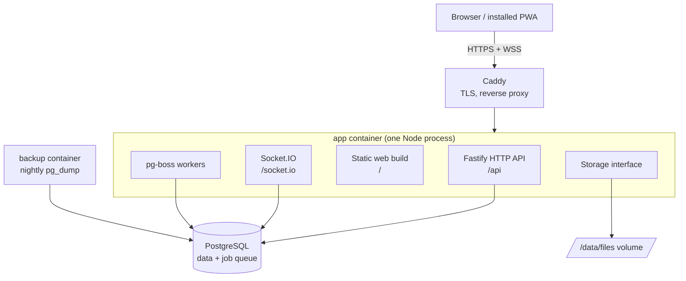

# Architecture overview

Spolu runs as `app`, `postgres` and `caddy`, plus a small `backup` container (nightly `pg_dump` and files archive). A single Node process (`app`) does all the work: API, realtime, background jobs and serving the web build. Redis, BullMQ and MinIO are not used (see [ADR 0002](../decisions/0002-postgres-job-queue-no-redis.md) and [ADR 0003](../decisions/0003-disk-storage-behind-interface.md)).



## The boxes

**Browser / installed PWA.** The React web app. It can be installed on a phone or desktop (see "PWA" below). It talks to the server over HTTPS for all writes and over a WebSocket for live updates.

The scaffold is built (`apps/web`): Vite, React, Tailwind v4 with the egrant theme (`src/styles/theme.css`), shadcn/ui components in `src/components/ui/` (button, card, badge, dropdown-menu, input, label; see [ADR 0009](../decisions/0009-web-client-stack.md)), TanStack Router with a code-based route tree in `src/router.tsx` (every screen is lazy-loaded, so each route is its own chunk) and TanStack Query (one `QueryClient`, `staleTime` 30 s, no refetch on window focus because realtime events keep data fresh). `src/lib/api.ts` has `apiGet(path, schema)`: it fetches `/api<path>` with cookies and `Accept-Language`, parses the body with a zod schema whatever the status (so a 503 health body is returned), and rejects with `ApiError` on non-JSON or a mismatching body; and `apiSend(method, path, body?, schema?)` for `POST`/`DELETE`, which rejects with `ApiError` on any non-2xx status. `ApiError.code` is the `error` (our routes) or `code` (better-auth) string of the body. `src/lib/query-client.ts` creates the one `QueryClient`: no mutation retries, and a 401 from any query or mutation clears the cached session and sends the user to `/login`. `src/lib/socket.ts` has `getSocket()`, the single same-origin Socket.IO connection (WebSocket transport only, not connected until the signed-in layout asks; see [realtime.md](realtime.md)).

**Routes and session (web).** `src/router.tsx` is a code-based tree. `/login` (`features/auth/login-page.tsx`: email step, then 6-digit code step, then a safe `redirect` back) is public and sends a signed-in visitor to `/`. A pathless `authed` layout (`features/auth/authed-layout.tsx`) wraps `/` (shell page), `/settings` (placeholder) and `/admins` (`features/admins/admins-page.tsx`: list, inline add form, inline remove confirmation; hidden for clients, who get the not-found page; the server answers 403 anyway). Its `beforeLoad` loads the session with `sessionQuery` (`features/auth/use-session.ts`, `GET /api/me`) and redirects to `/login?redirect=...` without one. The header's user menu (`features/auth/user-menu.tsx`) shows the user and logs out. Any other path renders the root route's `notFoundComponent` (`src/routes/not-found.tsx`, lazy).

**Shell (web).** `src/routes/root.tsx` renders `AppHeader` (`src/components/app-header.tsx`: the egrant.sk header pill with the brand "Spolu by eGrant" — the `app.name` wordmark, a small "by" and the egrant logo, one link named by `app.fullName` — and the language menu) above the routed page. The home page shows `StatusCard` (`src/features/system/status-card.tsx`): server version and database status from `GET /api/health` (TanStack Query, refetched every 30 s; `db: down` shows a destructive "Database: unavailable" badge; a failed request shows "Server unreachable" even when an earlier fetch succeeded, since TanStack Query keeps the last good data), and realtime status from `useSocketStatus` (`src/features/system/use-socket-status.ts`), which emits `system:ping` with a 5 s ack timeout on connect and every 30 s: "connected" only after a successful round trip, "disconnected" after a failed ping or a socket disconnect, plus the time of the last ping in the current language's format. The card takes an optional `socket` prop (default `getSocket()`) so tests pass a fake.

**PWA (web).** `vite-plugin-pwa` ([ADR 0011](../decisions/0011-pwa-with-vite-plugin-pwa.md)) generates `dist/manifest.webmanifest` (name "Spolu by eGrant", short name "Spolu", `lang` sk, standalone, `id` `/`, a short description, theme and background `#F5F3F1`) and a Workbox service worker `dist/sw.js` that registers itself (`registerSW.js`) and updates silently (`autoUpdate`). It precaches the app shell (`index.html`, hashed JS/CSS), both fonts, the logo, favicon and manifest icons; screenshots and other brand files are not precached. Navigation requests fall back to the cached `index.html` except `/api/*` and `/socket.io/*`, which always go to the server. Icons live in `public/icons/` (192, 512, maskable 512 with safe-zone padding, apple-touch 180); `pnpm --filter @spolu/web icons` regenerates them with sharp from `public/brand/favicon.svg` (`scripts/generate-icons.mjs`), and the PNGs are committed. The server sends `sw.js` and the manifest with `Cache-Control: no-cache` like every non-hashed file, so a new deploy is picked up on the next visit. `main.tsx` reloads the page on Vite's `vite:preloadError`, so a tab left open across a deploy (its old hashed chunks are gone) recovers instead of failing to open a screen.

**i18n (web).** All UI strings come from `i18next` keys in `src/locales/<code>.json` (nested by feature, e.g. `nav.settings`). The languages are one list, `SUPPORTED_LANGUAGES` in `src/i18n/languages.ts` (code and the language's own name, e.g. `sk` "Slovenčina"; `DEFAULT_LANGUAGE` is `en`). Adding a language = add its locale JSON, one list entry and its import in `src/i18n/index.ts` (the `resources` map is typed `Record<Language, …>`, so a missing one is a type error); a test fails when the locale files and the list differ or when any file's keys differ from `en.json`. `src/i18n/detect.ts` has `isLanguage` and the pure `detectInitialLanguage(stored, navigatorLanguages)`, both driven by the list: a stored choice wins, otherwise the first browser language whose base code is supported, else `en`. `src/i18n/index.ts` initialises i18next at startup (all locale files are bundled, they are small), sets `<html lang>` and exports `setLanguage(lang)`, which switches the language, stores it in `localStorage` under `spolu.lang` and updates `<html lang>`. `LanguageSwitcher` is the egrant.sk-style language menu in the header: a button showing the current code ("SK" and a chevron) opens a Radix dropdown below it with one `menuitemradio` per `SUPPORTED_LANGUAGES` entry (own name, `lang` attribute, check mark on the current one). The button is named by `language.current` ("Jazyk: Slovenčina"), so screen readers announce the current language; Radix names the menu after the button. It ships in the entry chunk (one of the reasons for the 200 kB budget in [performance.md](performance.md)).

**Caddy.** The front door. It gets and renews HTTPS certificates automatically and forwards traffic to the app. Nothing else is exposed to the internet.

**Fastify HTTP API.** The only way to change data. It validates input (zod), checks permissions, writes to the database in a transaction, and then tells Socket.IO what happened. Built so far: `buildApp(deps)` in `apps/server/src/app.ts`, which also attaches Socket.IO (`app.io`, closed by `app.close()` in a `preClose` hook), `GET /api/health` (200 `ok`, or 503 `degraded` when PostgreSQL is unreachable; see `modules/system/`), and one not-found handler: unknown `/api/*`, `/socket.io/*`, non-GET requests and file-like paths (a dot in the last segment, or anything under `/assets/`) answer JSON 404 `{"error":"not_found"}`; other GET/HEAD paths fall back to the web app when static serving is on.

**Admins API.** `modules/users/routes.ts`, admin only (`requireAdmin`), errors as `{ "error": code }`: `GET /api/admins` (active admins, superadmin first), `POST /api/admins` (body `AddAdminBody`; 201 `Admin`, 400 `validation_failed`, 409 `email_taken_admin` / `email_taken_client`; then queues `adminAddedEmail` in the `Accept-Language` language, a queue failure is only logged) and `DELETE /api/admins/:id` (404 unknown id, 403 when `canDeactivate` refuses; otherwise `deactivateUser`, `revokeAllSessions`, `disconnectUser`, 204).

**Groups API.** `modules/groups/routes.ts`, errors as `{ "error": code }`; the policy runs before the service. `GET /api/groups` (admin, `GroupSummary[]`), `POST /api/groups` (201 `Group`, 400 `validation_failed` also for an unparseable eGrant URL, 409 `egrant_url_taken`), `GET /api/groups/:id` (admin or a member of that group; anyone else and unknown ids get 404 `not_found`, never 403; `inviteUrl` = `PUBLIC_URL/join/<token>` for admins only), `PATCH /api/groups/:id`, `POST /api/groups/:id/invite` (new `inviteUrl`), `GET /api/groups/:id/members` (readers, verified active clients), `GET /api/groups/:id/members/removed` (admin), `DELETE /api/groups/:id/members/:userId` (`deactivateUser`, `revokeAllSessions`, `disconnectUser`; 204) and `POST .../restore` (`reactivateUser`; 204). The manage endpoints answer a client 403 and an unknown group 404; remove/restore answer 404 when the user is not a member of that group and 403 when the target is not a client. Logos live in `modules/groups/logo.ts` (plugin registered by `routes.ts`): `PUT /api/groups/:id/logo` (admin; raw body, route-scoped catch-all buffer parser with `bodyLimit` 512 KB, so too large is 413; the type is sniffed from magic bytes by `sniffImageType` and must equal the `Content-Type` header, otherwise 400 `invalid_logo` and nothing changes; stored at `groups/<id>/logo-<random>.<ext>` with the sniffed type; order is put new file, `setLogoKey`, delete the old file, and the new file is deleted if `setLogoKey` fails; 204), `DELETE /api/groups/:id/logo` (admin; 204, idempotent), `GET /api/groups/:id/logo` (readers; same 404 rule) and public `GET /api/join/:token/logo` (an old or unknown token is 404). Both GETs stream from storage with `Cache-Control: private, max-age=86400` and `ETag` = the quoted storage key (`If-None-Match` gives 304); 404 when there is no logo. `hasLogo` is `logo_key is not null`. 

**Join flow (invite link).** `modules/groups/join-routes.ts`, public (no preHandler; the token is the credential). `GET /api/join/:token` returns `{ name, hasLogo }` (`JoinInfo`) or 404 `not_found`. `POST /api/join/:token` with `{ email }`: the token is checked first (old or unknown token: 404), then the body (`JoinBodySchema`; bad email: 400 `validation_failed`), then `joinWithEmail` (groups service): an unknown email becomes a client (`email_verified false`, empty name) plus its membership in ONE transaction; any existing user (admin, client of any group, removed, unverified) is left unchanged, and a concurrent duplicate (unique violation) counts as existing. The answer is `200 {"ok":true}` for every email, so the endpoint reveals nothing about accounts. The web then asks for a code through the normal better-auth endpoint (`disableSignUp` stays on; a removed client gets no code); signing in sets `email_verified` and the name step follows. Rate limit: `createRateLimiter` (`infra/http/rate-limit.ts`, in-memory fixed window, single process per ADR 0005, expired keys dropped on access) allows 10 `POST`s per minute per `request.ip`, then `429 rate_limited`; `GET` is not limited.

**Auth.** Email-code login with better-auth ([ADR 0006](../decisions/0006-better-auth-email-otp.md)), in `apps/server/src/modules/auth/`. `buildApp` creates the instance once (`createAuth(deps)`, decorated as `app.auth`) and registers `authRoutes`, which forward an allow-list of three better-auth endpoints (`POST email-otp/send-verification-otp`, `POST sign-in/email-otp`, `POST sign-out` under `/api/auth/`; any other `/api/auth/` path is our JSON 404) and add `GET /api/me` (the `SessionUser` `Me`: `SessionUser` plus `groupId`, null for admins, or `401 {"error":"unauthorized"}`; for a valid user it also forwards a refreshed session cookie). Flow: the browser posts `{ email, type: 'sign-in' }` to `/api/auth/email-otp/send-verification-otp` -> always `200 {"success":true}`; only an existing, not disabled user gets the `email.send` job with the code (`emails.ts` `loginCodeEmail`, language from `Accept-Language` via `language.ts`) -> the browser posts `{ email, otp }` to `/api/auth/sign-in/email-otp` -> a `session` row and the httpOnly cookie `better-auth.session_token` -> later requests carry the cookie. Sign-out is `POST /api/auth/sign-out` with body `{}`. Routes guard themselves with `requireUser` / `requireAdmin` (`session.ts`, see [permissions.md](permissions.md)); `getSessionUser(auth, request)` (and `getSessionFromHeaders`, used by the socket handshake) returns null for a disabled user; `SessionUser` has no group (look it up with `getMembershipGroupId`); only `GET`/`PATCH /api/me` return `Me`, which adds `groupId`. `PATCH /api/me` (`{ name }`, 1..100 characters) changes only the caller's own name. Sign-out is detected by the matched route (`request.routeOptions.url`), not by the URL text. `revokeAllSessions(db, userId)` (`service.ts`) deletes the user's sessions. `adminAddedEmail` is the email for a new admin. `buildApp(deps, { logger? })` logs unless `nodeEnv` is `test`; `buildTestApp` always passes `logger: false`. Tests log in with `loginAs(app, email)` (`apps/server/test/login.ts`), which reads the code from Mailpit (`test/mailpit.ts`, `latestLoginCode`).

**Socket.IO.** Pushes events to browsers in real time (new message, edited task). Single instance, no Redis adapter. See [realtime.md](realtime.md).

**Static web build.** The built React app, served by the same process with `@fastify/static` (`registerStatic` in `apps/server/src/static.ts`), so there is no separate web server. Built; enabled when `WEB_DIST_DIR` is set (empty in dev, where Vite serves the web). Client routes such as `/settings` return `index.html` so deep links and refreshes work. `index.html` and other non-hashed files are sent with `Cache-Control: no-cache`; files under `/assets/` (Vite fingerprinted names) with `public, max-age=31536000, immutable`.

**pg-boss workers.** Background jobs: sending email (with retries), later push notifications and contract reminders. The queue lives in PostgreSQL (schema `pgboss`, created on first start). Built: `startJobs(databaseUrl, handlers, schedules?)` in `apps/server/src/infra/jobs/` starts pg-boss, creates a queue and a worker for each entry of `handlers` (`Record<jobName, (data) => Promise<void>>`), creates a cron schedule (`boss.schedule(name, cron)`) for each `{ name, cron }` of `schedules` (the name must have a handler) and returns `{ queue, stop }`; modules only see the `JobQueue` (`send(name, data)`). Jobs: `auth.cleanup-verifications` (`modules/auth/jobs.ts`, scheduled daily `15 3 * * *` in `createDeps`; deletes expired `verification` rows) and `email.send` (`emailJobHandlers`, `sendEmailLater` in `infra/email/`), so a slow email provider never blocks a request and pg-boss retries failures. Tests use `createInlineJobs`, which runs the handler inside `send`. In dev and tests SMTP points at `127.0.0.1` (Mailpit), not `localhost`: nodemailer's lookup of `localhost` times out on Node 26.

**Dependencies and modules.** `apps/server/src/deps.ts` defines `AppDeps = { config, db, email, storage, jobs }`; `createDeps(config)` builds the real ones. `buildApp(deps)` registers every module's route plugin (`FastifyPluginAsync<{ deps: AppDeps }>`) with `app.register(plugin, { prefix: '/api', deps })`. Tests build the same app with `buildTestApp()` (`apps/server/test/test-app.ts`: test database, SMTP to Mailpit, temp-dir storage, inline jobs).

**Email.** `createEmailSender(config.email)` in `apps/server/src/infra/email/` returns an `EmailSender` (`send({ to, cc?, subject, html, text })`). `EMAIL_DRIVER=smtp` uses nodemailer (Mailpit in dev and tests); `elastic` posts to the Elastic Email v4 transactional API. Failures throw `EmailSendError` (status and response text, never the API key). Built; `sendEmailLater(jobs, msg)` queues a send as the `email.send` job, which pg-boss retries.

**Storage.** An interface (put, get, delete, exists, signed URL) in `apps/server/src/infra/storage/`, built. `createDiskStorage(filesDir, appSecret)` writes files to a disk volume, with the content type in a `<key>.meta.json` sidecar; keys are `[a-z0-9/_.-]+` with no `..`, empty or absolute segments, and a bad key throws `InvalidStorageKeyError` before any disk access. `get` streams the file (never buffers it) and throws `StorageNotFoundError` when missing. Signed URLs are `/files/<key>?expires=<unix>&sig=<HMAC-SHA256 hex>`; the route that serves them arrives with the first upload feature (Phase 3); switching to S3-compatible storage later means swapping the implementation.

**PostgreSQL.** The single source of truth: all data plus the job queue. See [data-model.md](data-model.md).

Splitting workers into their own container later is a config change, not a rewrite. See [ADR 0005](../decisions/0005-single-process-deployment.md).

**Boot and shutdown.** `apps/server/src/main.ts` runs: `loadConfig` (a `ConfigError` prints its message and exits 1) -> `runMigrations` -> `createDeps` (database, email, storage, jobs) -> `buildApp` (includes Socket.IO) -> `registerStatic` (if `WEB_DIST_DIR`) -> listen on `0.0.0.0:PORT`. On SIGTERM or SIGINT it runs `app.close()` (Socket.IO and the HTTP server), then stops pg-boss and closes the database pool; a second signal forces exit 1. `pnpm --filter @spolu/server build` bundles `src/main.ts` with tsup into `dist/main.js` (ESM, node24; `@spolu/shared` inlined, npm dependencies external) and copies the SQL migrations to `dist/migrations`, which is where `runMigrations` looks relative to the running file in both layouts. Run with `node dist/main.js`.

**Production image and compose.** The root `Dockerfile` builds in three stages on `node:24-bookworm-slim`: `deps` (`pnpm fetch`, cached until the lockfile changes), `build` (`pnpm -r build`, then `pnpm --filter @spolu/server deploy --prod /out` for server production dependencies only) and `runtime` (non-root `node` user, `/app/server/main.js` + `migrations`, web at `/app/web`, `FILES_DIR=/data/files`, `APP_VERSION` from the build arg, a `HEALTHCHECK` using Node's built-in fetch on `/api/health`). `deploy/docker-compose.yml` runs `app`, `postgres:17` (not published), `caddy:2` (the only service with published ports: 80, 443, 443/udp; `deploy/Caddyfile` proxies `{$DOMAIN}` to `app:3000`, WebSockets included, TLS automatic) and `backup` (`deploy/backup/backup.sh`: nightly `pg_dump -Fc` and a `files-<timestamp>.tar.gz` of the read-only mounted `files` volume at `BACKUP_HOUR` (default 03:30) in `BACKUP_TZ` to the `backups` volume, 14 newest of each kept). All services restart `unless-stopped`, logs rotate (10 MB x 3) and `app` gets a 30 s stop grace period. Compose builds `DATABASE_URL` from `POSTGRES_PASSWORD`; the other variables come from the `.env` next to the compose file (on a server `/opt/spolu/<env>/.env`, template `deploy/test.env.example`).

**CI/CD.** All build, test and deploy logic is in `scripts/` ([ADR 0004](../decisions/0004-scripts-first-ci.md)); any CI only calls them. `scripts/ci.sh` runs every check (install, shellcheck, script tests, lint, typecheck, tests, e2e, docs check). `scripts/build-image.sh <sha>` builds the image for amd64 and arm64 and pushes `$IMAGE:<sha>` with `APP_VERSION=<sha>`. `scripts/deploy.sh <env> <sha>` copies the compose files and env file to `/opt/spolu/<env>/` over SSH, pulls and starts the new image, and waits until `/api/health` reports the new version. `scripts/server-setup.sh` prepares a fresh VM once. How to run them: [runbooks/deploy.md](../runbooks/deploy.md), [runbooks/server-setup.md](../runbooks/server-setup.md).

**Proxy trust.** The server trusts exactly one proxy hop (Fastify `trustProxy` as a function `hop < 1`; a plain number would mean "trust nothing" in Fastify 5), so `request.ip` is the last `X-Forwarded-For` entry, the one Caddy adds; entries a client prepends are ignored. This is safe only because the app port is reachable solely through Caddy in deployed environments. Dotfiles in the web dist are never served, and unknown `/api` and `/socket.io` paths (with or without a trailing path) answer JSON 404.

**Dev and e2e runs.** `pnpm dev` runs the server (tsx watch) and Vite in parallel; the browser uses :5173 and Vite proxies `/api` and `/socket.io` to :3000. `pnpm test:e2e` (Playwright, Chromium, root `playwright.config.ts`, specs in `e2e/`) builds all packages and starts `node apps/server/dist/main.js` with an absolute `WEB_DIST_DIR=apps/web/dist` on :3000 against its own PostgreSQL database `spolu_e2e` (created by `e2e/create-db.mjs` before the server starts, so dev data is never touched; `ADMIN_DATABASE_URL` overrides the admin connection) and the dev Mailpit, so it tests the same layout as production. The browser locale is fixed to `sk-SK`, so the default language is Slovak. `e2e/auth.setup.ts` logs the superadmin in once (code read from Mailpit, `e2e/mailpit.ts`) and saves the session as the default storage state. The suites cover the status card (DB and realtime), the language menu and its persistence, a deep link falling back to the SPA, the web manifest, the redirect of an anonymous visitor to `/login`, and the admins flow (add an admin, the new admin logs in, remove them). An already running server on :3000 is reused outside CI.

## Where code lives

```
apps/web/             React + Vite app (src/routes, src/features/<name> (system, auth, admins), src/components(/ui), src/lib, src/i18n, src/locales, src/styles; scripts/, public/icons)
apps/server/src/
  modules/            one folder per feature
    system/           (exists: health and socket ping)
    users/            (exists: user table, admin service and policy, admins API; the worked example for new modules)
    auth/             (exists: better-auth, email-code login, session guards, login and admin emails)
    (planned) groups/ chat/ dm/ tasks/ tickets/ contracts/ notifications/
  infra/              db/ email/ storage/ jobs/ realtime/ config/
packages/shared/      zod schemas and types used by both sides (source-only: server and web import `@spolu/shared` straight from `src/`; health response schema and socket event names live here)
```

Each module owns its routes, service logic, DB tables, socket events and tests.

**Module boundary rule.** Modules talk to each other only through exported service functions. A module never reads or writes another module's tables. Two deliberate exceptions: the auth adapter gets the users `user` table, and the groups service joins `user` read-only to count and list members in one query (no N+1); writes to users always go through the users service.

**Writes via HTTP, sockets push.** Every change goes through the HTTP API (validation, permissions, transaction). After the commit the server emits an event to the right room. Sockets never accept writes. This keeps one write path to test.

**Configuration.** The server reads all settings from environment variables once at boot (`apps/server/src/infra/config/config.ts`). `loadConfig(env)` validates them with zod and throws a `ConfigError` naming every invalid variable, so a bad deployment fails at startup, not later. Every variable is listed in `.env.example` at the repo root.

See also: [permissions.md](permissions.md), [roadmap](../roadmap.md), [glossary](../glossary.md).
