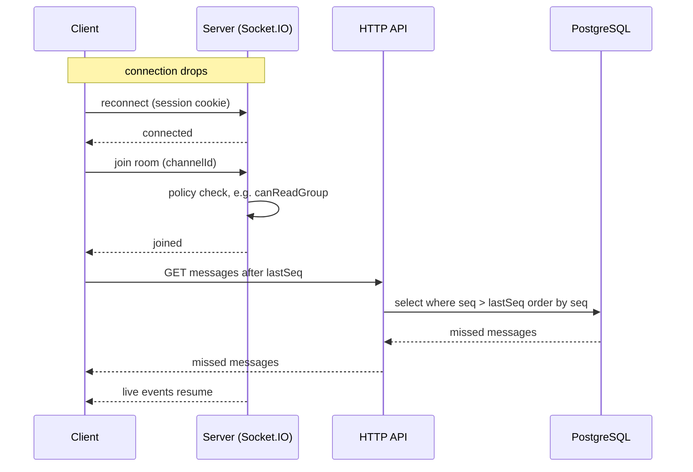

# Realtime

Socket.IO runs in the same process as the API, as a single instance (no Redis adapter).

Built so far: `attachSocket(app, config, auth)` in `apps/server/src/infra/realtime/socket.ts` (called by `buildApp`, available as `app.io`) serves Socket.IO at `/socket.io` and answers the `system:ping` event with an ack `{ pong: true, at: <ISO string> }`. The web client uses the ping as a liveness check: `useSocketStatus` (`apps/web/src/features/system/use-socket-status.ts`) pings on connect and every 30 s with a 5 s ack timeout and shows the result on the home status card.

## Handshake authentication

An `io.use` middleware runs on every connection:

1. **Origin.** In production the handshake `Origin` header must equal `new URL(PUBLIC_URL).origin`; a foreign or missing Origin gets `connect_error` `forbidden_origin`. (CORS alone does not stop a cross-site WebSocket handshake.) In development any origin is accepted.
2. **Session.** The session cookie of the handshake is read with `getSessionUserFromHeaders` (same logic as the HTTP routes). No session, or a disabled user, gets `connect_error` `unauthorized`. Socket.IO clients do not reconnect automatically after a middleware error, which is wanted: the web sends the user to `/login` instead of retrying.
3. **User room.** On success `socket.data.user` is the `SessionUser` and the socket joins the room `user:<id>` (`userRoom` in `rooms.ts`). `disconnectUser(io, userId)` closes every socket of that user; call it when a user is removed or disabled.

## Rules

- **Sockets are push-only.** Clients never send writes over a socket. Every write goes through the HTTP API, which then emits an event. See [overview.md](overview.md).
- **Permissions are checked on join.** A socket may join a room only if the module's policy function allows it (see [permissions.md](permissions.md)).

## Rooms

| room | who joins | carries |
|---|---|---|
| `user:<id>` | every socket of that user, on connect | events for one user (admin changes, notifications) |
| per group channel | members of that group, and admins | new, edited, deleted messages; read state (assumed; per-user room likely, settle in Phase 4 design) |
| per DM channel | the two participants | the same, for direct messages |
| per task channel | users who can see the task's group | task chat events |
| per group (board) | members of that group, and admins | task and ticket changes |

## Catch-up with `seq`

Every message has a `seq` number that increases by one per channel. After a disconnect the client asks for what it missed instead of relying on an event log.

1. The client keeps the highest `seq` it has seen for each open channel.
2. On (re)connect it re-establishes the socket and rejoins its rooms (the server checks permission on join).
3. Over HTTP it fetches missed messages: `GET` with `channelId` and `lastSeq`. The server checks permission and returns all messages with `seq > lastSeq`, ordered by `seq` ascending.
4. The client merges them by `seq`, ignoring ones it already has, and then handles live events as normal.

The catch-up read is an ordinary HTTP read, so it uses the same permission checks as everything else.
