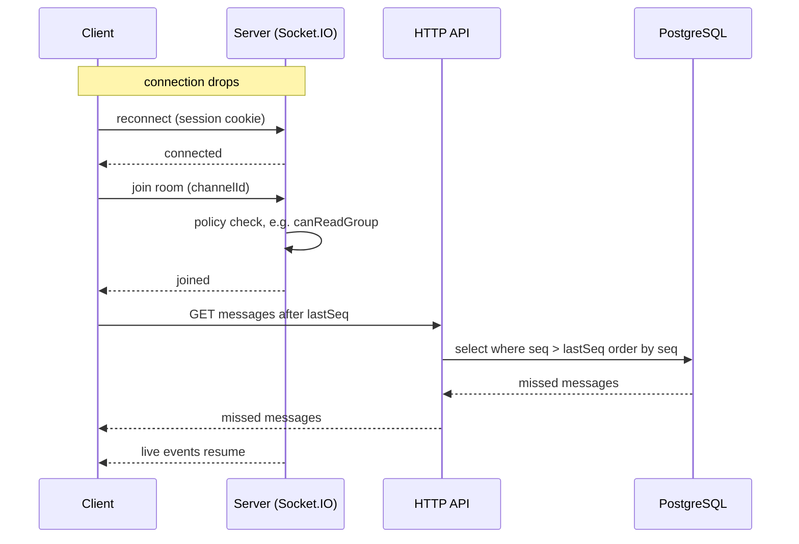

# Realtime

Socket.IO runs in the same process as the API, as a single instance (no Redis adapter).

## Rules

- **Sockets are push-only.** Clients never send writes over a socket. Every write goes through the HTTP API, which then emits an event. See [overview.md](overview.md).
- **Permissions are checked on join.** A socket may join a room only if the module's policy function allows it (see [permissions.md](permissions.md)).

## Rooms

| room | who joins | carries |
|---|---|---|
| per group channel | members of that group, and admins | new, edited, deleted messages, read state |
| per DM channel | the two participants | the same, for direct messages |
| per task channel | users who can see the task's group | task chat events |
| per group (board) | members of that group, and admins | task and ticket changes |

## Catch-up with `seq`

Every message has a `seq` number that increases by one per channel. After a disconnect the client asks for what it missed instead of relying on an event log.

1. The client keeps the highest `seq` it has seen for each open channel.
2. On (re)connect it rejoins its rooms and sends `{ channelId, lastSeq }`.
3. The server checks permission and returns all messages with `seq > lastSeq`, ordered by `seq` ascending.
4. The client merges them by `seq`, ignoring ones it already has, and then handles live events as normal.

The catch-up read is an ordinary HTTP read, so it uses the same permission checks as everything else.
