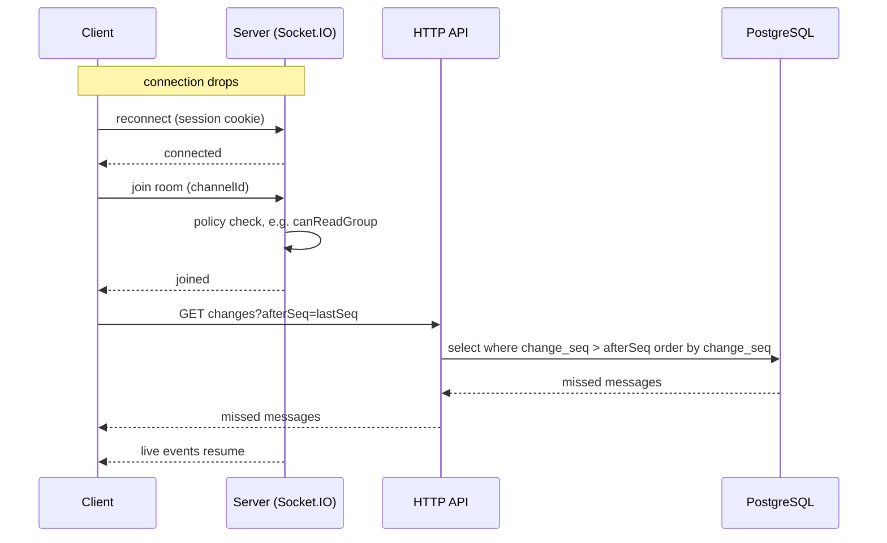

# Realtime

Socket.IO runs in the same process as the API, as a single instance (no Redis adapter).

Built so far: `attachSocket(app, config, auth, db)` in `apps/server/src/infra/realtime/socket.ts` (called by `buildApp`, available as `app.io`) serves Socket.IO at `/socket.io` and answers the `system:ping` event with an ack `{ pong: true, at: <ISO string> }`. The web client uses the ping as a liveness check: `useSocketStatus` (`apps/web/src/features/system/use-socket-status.ts`) pings on connect and every 30 s with a 5 s ack timeout and shows the result on the home status card.

**Client lifecycle.** `getSocket()` (`apps/web/src/lib/socket.ts`) creates the one shared socket with `autoConnect: false`, because the server refuses a handshake without a session. The signed-in layout (`features/auth/authed-layout.tsx`, a lazy chunk) calls `connectSocket()` once the session is known and `disconnectSocket()` when the session goes (logout, a 401 from any query or mutation) or the layout unmounts. A `connect_error` with message `unauthorized` clears the cached session and sends the user to `/login`; the socket is not reconnected. A `disconnect` with reason `io server disconnect` (the server dropped the socket, e.g. an admin was removed) is not retried by Socket.IO either, so the layout refetches the session: a 401 does the same trip to `/login`, a valid session changes nothing. `server_error` keeps the user signed in and the layout calls `connectSocket()` again after 1 s, then 2 s, 4 s … capped at 30 s (Socket.IO itself does not retry a middleware error). A successful `connect` resets the delay to 1 s; logout or unmounting the layout cancels a pending retry. There is no retry after `unauthorized`.

## Handshake authentication

An `io.use` middleware runs on every connection:

1. **Origin.** In production the handshake `Origin` header must equal `new URL(PUBLIC_URL).origin`; a foreign or missing Origin gets `connect_error` `forbidden_origin`. (CORS alone does not stop a cross-site WebSocket handshake.) The web client therefore uses the WebSocket transport only: browsers omit `Origin` on same-origin polling requests, a WebSocket handshake always sends it. Trade-off: there is no long-polling fallback, so a network that blocks WebSockets gets no realtime (the app still works over HTTP); the alternative would be to accept Origin-less polling requests on the server, which weakens the check. In development any origin is accepted. Socket.IO CORS also allows only the `PUBLIC_URL` origin in production (any origin in development).
2. **Session.** The session cookie of the handshake is read with `getSessionFromHeaders` (same logic as the HTTP routes). No session, or a disabled user, gets `connect_error` `unauthorized`. A failing session lookup (e.g. the database is down) gets `connect_error` `server_error` (logged server-side), so a client can tell "log in again" from "try again later". Socket.IO clients do not reconnect automatically after a middleware error, which is wanted: the web sends the user to `/login` on `unauthorized` instead of retrying.
3. **Rooms.** On success `socket.data.user` is the `SessionUser`, `socket.data.sessionId` the login session's id, and the socket joins the rooms `user:<id>` (`userRoom`) and `session:<sessionId>` (`sessionRoom`), both in `rooms.ts`. A client also joins `group:<groupId>` (`groupRoom`) of every group where they have an active `client` membership (`clientGroupIds`; a `ziadatel` membership gives no room); admins join group rooms through `group:join` (below). Removing a client from one group makes all their sockets leave that group's rooms (`leaveGroupRoom`), restoring joins it again (`joinGroupRoom`); removing the last membership disconnects them. After joining, the middleware reads the session again and refuses the socket (`unauthorized`) if the user was disabled in between, so a removal that ran `disconnectUser` between the lookup and the join is caught in most cases. This narrows the window but does not close it: a removal landing after that final check and before the connection is established is only caught by the next `disconnectUser`-style event. `POST /api/auth/sign-out` reads the session before better-auth deletes it and, after a 200, closes the sockets of that session room only (the user's other devices stay connected). `disconnectUser(io, userId)` closes every socket of that user; call it when a user is removed or disabled.

## Rules

- **Sockets are push-only.** Clients never send writes over a socket. Every write goes through the HTTP API, which then emits an event. See [overview.md](overview.md).
- **Web push is separate from sockets.** Push notifications go through the notification delivery jobs (pg-boss, Web Push), never through socket.io; a socket event is not a notification. See [overview.md](overview.md) (Notification delivery).
- **Permissions are checked on join.** A socket may join a room only if the module's policy function allows it (see [permissions.md](permissions.md)).

## Group room events (client to server)

These two events change no data; they only move the socket in and out of a room. Names are `SocketEvents.groupJoin` / `groupLeave`, the payload is `GroupRoomPayload` (`{ groupId }`).

- `group:join` with an ack `GroupJoinAck`. The payload must be an object with a string `groupId` of 1 to 100 characters. The server checks `canReadGroup(socket.data.user, groupId, clientGroupIds)` (read fresh from the database) and that the group exists, then joins `group:<id>` and acks `{ ok: true }`. An admin's socket (`isAdmin`) also joins `group:<id>:admins` (`groupAdminsRoom`) in the same call; a client's socket never joins an admins room, not even for their own group. Anything else (malformed payload, unreadable or unknown group) acks `{ ok: false, error: 'not_found' }`, the same answer as the HTTP routes. Joining is idempotent; a missing or non-function ack is ignored (the handlers never call a client-supplied value that is not a function, so a bad ack cannot crash the process).
- A leave that overtakes an in-flight join wins: the socket keeps a set of wanted group rooms (`socket.data.wantedGroups`); `group:join` adds the id before its database reads and joins only if the id is still wanted afterwards, `group:leave` removes it.
- `group:leave` leaves `group:<id>` and `group:<id>:admins` and acks `{ ok: true }`, except that a client never leaves a group room: they hold only their own groups' rooms, joined on connect, and lose one only when an admin removes them from that group.

Live handlers on the web should still ignore events whose `groupId` is not the open group (defence in depth).

Server code pushes into a group with `emitToGroup(io, groupId, event, payload)` from `rooms.ts`, and to the group's admins only with `emitToGroupAdmins(io, groupId, event, payload)`; call them after the transaction that made the change has committed. Anything clients must not see goes through `emitToGroupAdmins`, never `emitToGroup`.

### Web hook

`useGroupRoom(groupId)` (`features/groups/use-group-room.ts`) is called once by the group layout. It emits `group:join` when the socket is connected and on every `connect` event, and `group:leave` on unmount or when `groupId` changes. It returns a counter that is 0 until the first acknowledged join and grows by one after every acknowledged join (including the rejoin after a reconnect). A `not_found` ack does not count and is not retried until the next `connect`. The layout passes the counter to `GroupRoomProvider`; chat, board and the Knowledge tab (`useKnowledgeEvents`) read it with `useGroupRoomJoins()` (0 outside a provider) and run their catch-up when it changes.

**First join is not a rejoin** (Phase 27, finding W4). `lib/socket-history.ts` counts the shared socket's `connect` and `disconnect` events (`trackSocket`, called by `getSocket()`). A screen that refetches after a (re)join or `connect` takes `firstJoinCheck(socket)` while it is not in the room yet (the mount, a group switch: join counter 0; for `connect` listeners, the effect's setup). On the first join (or `connect`) after that, `stale(query.state)` keeps a query that was fetched, or is being fetched, since then, as long as the socket was up (or was making the app's first connection) at that moment and has not dropped since; everything else refetches as on a rejoin: data cached before the mount, and anything after the socket was down. Every later join or `connect` refetches everything. Used by the board (`useBoardEvents`: the board and cached task details), the Knowledge tab (`useKnowledgeEvents`: the first page and the folders), the ticket lists (`useTicketEvents`) and the bulk email list (`useBulkEvents`). Before, a cold load of a group screen fetched the board or the knowledge list twice (the first join ack counted as a rejoin), and the ticket and campaign lists refetched on the app's first `connect`. The chat and the tab badges keep their own catch-up (`seq`, `joins > 1`). A knowledge item or delete event that arrives while the list's first page has no data yet (still loading) cannot be applied and the response in flight may predate the write, so `useKnowledgeEvents` cancels that fetch and refetches the list.

## Board events (server to client)

Pushed to the `group:<id>` room after the write commits, by `modules/tasks/events.ts` (names in `BoardEvents`). Every payload carries the `groupId` (a `BoardTaskEvent` has it on `task.groupId`); web handlers ignore other groups.

| event                | payload                                             | when                                                  |
| -------------------- | --------------------------------------------------- | ----------------------------------------------------- |
| `board:buckets`      | `{ groupId, buckets }` (the full list, by position) | a custom bucket is created, renamed, moved or deleted |
| `board:task`         | `{ task, actor }`                                   | a task is created (one event per card when cards are made from a message), edited or moved (`task` is a `TaskDto`) |
| `board:task_deleted` | `{ groupId, taskId }`                               | a task is deleted                                     |

`actor` (`{ id, name }`) is who made the change, so a client can skip its own echo or say who changed a card. The board has no `seq`: after a reconnect (a new `useGroupRoomJoins()` value) the web refetches `GET /api/groups/:id/board` instead of catching up event by event; boards are small (the Completed column is paged, and the refetch asks for the completed tasks already shown).

After a bucket is deleted its tasks moved to To do without a `board:task` event; `useBoardEvents` (web) refetches the board when a `board:buckets` list drops a bucket the cache had.

## Rooms

| room           | who joins                                                                       | carries                                                                                                                            |
| -------------- | ------------------------------------------------------------------------------- | ---------------------------------------------------------------------------------------------------------------------------------- |
| `user:<id>`    | every socket of that user, on connect                                           | events for one user (admin changes, notifications)                                                                                 |
| `session:<id>` | every socket of that login session, on connect                                  | sign-out                                                                                                                           |
| `admins`       | every admin socket, on connect (`ADMINS_ROOM`)                                  | events about all groups for admins: `group:managers`, `admin:activity`, `bulk:updated`                                                             |
| `group:<id>`   | a client, on connect, for each of their client groups; an admin through `group:join` | every event of the group: chat, board (tasks and buckets), files, members (one room per group, no separate channel or board rooms) |
| `group:<id>:admins` | an admin's socket, together with `group:<id>` on `group:join` (left with it on `group:leave`); never a client | admins-only events of the group (knowledge items with visibility `admins`) |
| `finance`      | a socket whose user passes `canSeeFinance`, on connect (`FINANCE_ROOM`); moved by the grant routes | `finance:changed` only (Phase 32) |
| per DM channel | the two participants                                                            | direct messages (not built yet)                                                                                                    |

## Group events

`group:managers` (`GroupEvents.managers`, payload `GroupManagersEvent` = `{ groupId, managers: { id, name }[] }`, the group's full current active manager list by name) is pushed by `emitManagers` (`modules/groups/events.ts`) to `group:<id>` and `admins` in one `io.to([...]).emit`, so a socket in both gets it once. It is sent after `PUT` or `DELETE /api/groups/:id/managers/me` or `/managers/:userId` commits, only when the call changed something (an unchanged call pushes nothing). The client replaces the list.

## Admin activity

`admin:activity` (`AdminEvents.activity`, payload `AdminActivityEvent` = `{ groupId, kind: 'chat' | 'task' }`, Phase 20) goes to the `admins` room only (`emitAdminActivity` in `infra/realtime/rooms.ts`); clients never get it. Admins are not in every group room, so this tiny signal tells the admin home what to refetch. It is sent next to the group-room event, after the commit, by `emitMessage` (kind `chat`: a group or task chat message sent, edited or deleted; a reply sends it twice, once with the parent) by `emitTask` and `emitTaskDeleted` (kind `task`: a task created, edited, moved or deleted), so every call site is covered, and by the bucket delete route (kind `task`: the bucket's tasks moved to To do). The web coalesces bursts with a 2 s debounce into one refetch per visible consumer (`useAdminActivityRefetch`): the sidebar and the open dashboard cards on both kinds and on `chat:read` in the user room (reading clears counts), the global board on kind `task` only. With `tickets: true` the hook also listens to `ticket:created`, `ticket:updated` and `ticket:moved` (admins room): the dashboard's Tickets card listens to those only, and the header's Tasks and Tickets counts (the lazy `nav-count` chunk, mounted once by the header's Tasks count) to those and to kind `task`. A `group:managers` event also refetches the sidebar (its sections).

## Bulk email events

`bulk:updated` (`BulkEvents.updated`, payload `BulkEventPayload` = `{ campaignId }`, Phase 23) goes to the `admins` room only (`emitBulkUpdated` in `modules/bulk-email/events.ts`), after a campaign is created, saved, deleted or duplicated (part 23.2), after sending starts or is cancelled, after each batch run of the sending job and when a campaign becomes `sent` (part 23.5; the job reaches the sockets through `attachBulkRealtime`, set in `buildApp`). The list and an open campaign refetch; on an open report this also refetches the per-person list (its query key extends the campaign's), so the progress bar and the list move while sending (part 23.7).

## Knowledge events

Pushed after the write commits by `modules/knowledge/events.ts` (names in `KnowledgeEvents`, Phase 17). The payload's `item` is a `KnowledgeSummary` built from an allowlist of the summary's fields, so the detail's body, files, reminder and the writer's own `canEdit` never travel.

Phase 30: the meeting jobs (transcode, AI run) bump the item's `updated_at` after every step and push `knowledge:item` through a slot (`attachMeetingsRealtime`, like the reminders' fire job), routed by visibility as any item. The open dialog refetches on it, and also polls every 5 s while a conversion or a run is in progress (the global list has no live events).

| event | payload | room |
|---|---|---|
| `knowledge:item` | `{ item }` | created or edited: `group:<id>` for a public item, `group:<id>:admins` for an admins-only one; also a chat file (Phase 25), pushed by the chat route after the message with files commits (`chat/file-hooks.ts` `sent`) |
| `knowledge:item_deleted` | `{ groupId, id }` | deleted: the room the item was in (a chat file when its message is deleted: the ids are read before the delete, `removing`); also sent to the group's clients (`group:<id>` except `group:<id>:admins`) when an item turns admins-only, also by a move into an admins-only folder or a folder turning admins-only |
| `knowledge:meeting_tasks` | `{ groupId, id }` | a task made from the meeting `id` was created, edited, moved (completed) or deleted: the meeting's room by its visibility (`emitMeetingTasks` in `modules/knowledge/events.ts`, called after the write by the meeting tasks route and the task routes). The open meeting refetches its detail (`SummarySection`) |
| `knowledge:folder` | `{ folder }` | a folder created or changed (Phase 24): `group:<id>` for a public folder, `group:<id>:admins` for an admins-only one |
| `knowledge:folder_deleted` | `{ groupId, id }` | a folder deleted: the room it was in; also sent to the group's clients when a folder turns admins-only (before an `item_deleted` for each item that stopped being public) |

A visibility change from public to admins sends `knowledge:item_deleted` to the group room except its admins room (`emitToGroupClients`, `io.to(group).except(admins)`), then `knowledge:item` to the admins room, so a client drops the item and an admin's open detail and row stay in place. The server pushes before it answers the HTTP request, so the web tab ignores the `item_deleted` of an item this browser is deleting (`isDeletingKnowledge`) instead of showing "This item is no longer available.". An unknown item from `knowledge:item` goes where the server lists it (newest first); one older than every loaded row while more pages exist is left for "Load more", so it is never listed twice. Admins to public sends `knowledge:item` to the group room. There is no `seq`: after a rejoin the tab refetches its first page (and the folder list). In a folder (or at the top level) the tab upserts only items whose `folderId` is the open folder and drops others; a folder event refetches the group's folder list and its item lists, because one folder change can move or hide many items (a delete moves its contents up).

## Reminder events

`reminders:task` (`RemindersEvents.task`, payload `TaskRemindersEvent` = `{ groupId, taskId, upcomingReminders }`, Phase 19) goes to `group:<id>` when a task's count of unfired custom reminder times may have changed: after the fire job commits a batch that handled one of its times (fired or silent), and after `PUT /api/tasks/:id/reminders` commits (before the HTTP answer). The board sets the card's bell from the count; an open task panel refetches the task's reminders. The fire job is built before the app, so `buildApp` attaches its Socket.IO server to the reminders module (`attachRemindersRealtime` in `modules/reminders/realtime.ts`); `notifyTimesChanged` calls each subject adapter's `onTimesChanged`, which for tasks counts the times in one query (`countUpcomingReminders`) and emits. Errors there are logged, never thrown. Subscription changes are personal and push nothing.

## Ticket events

`ticket:created`, `ticket:updated` and `ticket:moved` (`TicketEvents`, Phase 21) carry only `{ ticketId, groupId }`; listeners refetch what they show, so an event never carries more than its room may read. `emitTicket` (`modules/tickets/events.ts`) sends them, after the write commits, to the `admins` room, the group's room (`group:<id>`) and the initiator's user room (a ziadatel is in no group room). A ticket without a client goes to the `admins` room and the initiator only. `ticket:moved` names the group the ticket left and goes to that group's room and the old initiator's user room; the new group gets `ticket:updated`. Adding or removing a riešiteľ sends `ticket:updated` too (only when something changed); "Watch tickets" sends nothing (it concerns the user alone).

On the web (part 21.4) `useTicketEvents` (`features/tickets/use-ticket-events.ts`) is mounted by every ticket list and by the ticket page. `ticket:updated` fetches that ticket once (`GET /api/tickets/:id`) and replaces its row in every cached list that shows it, or drops the row when it no longer matches that list's filter, without refetching the pages; a ticket no cached list shows makes the lists of the current source refetch. `ticket:created` refetches the current source's lists (for a group tab only when `groupId` is that group). `ticket:moved` drops the row from that group's tab and refetches the other lists. On My tickets a client also gets every event of their groups, so there `ticket:created` and an unlisted `ticket:updated` fetch the ticket and refetch the lists only when the viewer is its initiator, and `ticket:moved` touches only an open or listed ticket. A ticket that answers 404 leaves every list and the open ticket page shows the not-found page. A ticket whose client changed (seen in an event or after a client change in the ticket's Edit form) refetches its chat's people (`['chat', 'people', channelId]`). After a socket `connect` the lists refetch. On the ticket page the chat follows the group room (`useGroupRoom`) for admins and the group's clients; a requester's socket cannot join it, so their chat counts socket connections instead (the server joins their user room before the connection opens) and catches up on each.

## Chat events

A ticket chat's message events (Phase 21) go to the group room and also to the ticket initiator's user room (`extraRoomsOf`, from the rules the tickets module registers), because a ziadatel is in no group room. Sockets only in those extra rooms get the message without its task links (`.except(groupRoom)`), and `chat:message_tasks` goes to the group room only. Cards made from a ticket or its chat send `ticket:updated`, so an open ticket page refetches its task list; so do a later edit, move (completing is a move to Done) or delete of such a task (`emitTicketRefresh` in `modules/tickets/events.ts`, called by the task routes after the write; it runs no ticket hook, so nobody is notified). Listeners already filter by `channelId` (and task chats by `taskId`), so a ticket chat's events never touch the group Chat tab or the task chats.

All are pushed after the transaction committed, by the chat routes, or for `chat:message_tasks` by the task routes, through `modules/chat/events.ts`. Payload types are `ChatMessageEvent`, `ChatReadEvent`, `ChatThreadReplyEvent`, `ChatMessageTasksEvent` and `ChatReactionsEvent` in `packages/shared/src/chat.ts`; the event names are `ChatEvents.message`, `ChatEvents.read`, `ChatEvents.threadReply`, `ChatEvents.messageTasks` and `ChatEvents.reactions`.

| event | room | payload | sent when |
|---|---|---|---|
| `chat:message` | `group:<id>` (`emitToGroup`) | `{ groupId, channelId, taskId, message, isNew }` | a message is sent (`isNew: true`, and for a reply also the updated parent with `isNew: false`), edited or deleted (`isNew: false`). Never for a repeated `clientId` (the HTTP call answers 200 with the stored message and pushes nothing) or a second delete. |
| `chat:read` | `user:<id>` | `{ groupId, channelId, taskId, lastReadAt, rootId?, all? }` | the user marks the channel read, (with `rootId`) opens a thread they are one of the people of, or (with `all: true`, `POST /api/channels/:id/read-all`) reads the whole chat including their threads, as when opening a task's Chat tab; their other tabs refresh the unread badge, the thread dots and the task's unread flag |
| `chat:thread-reply` | `user:<id>` of each person of the thread still in the group, never the author | `{ groupId, channelId, taskId, rootId }` | a new reply: it counts as unread for them (the badge adds one, the thread gets its dot) |
| `chat:reactions` | `group:<id>` and the extra rooms (`emitReactions`) | `{ groupId, channelId, taskId, messageId, parentId, changeSeq, reactions }` | Phase 28: a reaction was added or removed (`PUT /api/messages/:id/reactions` that changed something). `reactions` is the message's full list `{ emoji, userIds }[]` (as `MessageDto.reactions`), `changeSeq` its new one. Not sent for a write that changed nothing; never `admin:activity` and never a notification. The web applies it to the window and the cached thread only over an older `changeSeq`. |
| `chat:message_tasks` | `group:<id>` (`emitMessageTasks`) | `{ groupId, channelId, messageId, parentId, tasks }` | the tasks made from a message changed: cards were created from it (`POST /api/groups/:id/tasks/from-message`, one event after the `board:task` of every card), one of them was edited (`PATCH /api/tasks/:id`), moved to another place (`completed` may flip) or deleted. `tasks` is the message's full current list `{ id, title, completed }[]` (the same as `MessageDto.tasks`), so the client replaces the message's list; `parentId` tells a thread reply from a top-level message. Not sent for a deleted or missing message. |

`message` is a full `MessageDto`; the client upserts it by id. A task link change does not move the message's `change_seq`, so the catch-up below does not replay `chat:message_tasks`; a missed one is corrected by the next page load of that chat. `isNew` tells the web whether to count it as unread and to append it. Handlers ignore events whose `groupId` is not the open group. `taskId` is the task whose chat the channel is (Phase 9), or null for the group chat; task chats use the same group room, so a listener also filters on `channelId` (the group Chat tab badge ignores task chats).

## Catch-up with `change_seq`

Every chat message has a `change_seq` taken from the channel's counter (`channels.last_seq`) whenever it is created, edited or deleted, or (Phase 28) its reactions change, and a reply moves its parent's `change_seq` too. There is no per-message `seq` that never changes. After a disconnect the client asks for what changed instead of relying on an event log.

1. The client keeps the highest `lastSeq` it has seen for the open channel (from the channel, a message page, a catch-up answer, a live event or the answer to its own send).
2. On (re)connect it rejoins its rooms (the server checks permission on join) and waits for `useGroupRoomJoins()` to change.
3. Over HTTP it calls `GET /api/channels/:id/changes?afterSeq=<lastSeq - 20>` (floor 0; it starts a little behind because a live event can overtake an earlier one by a few seqs, and the reducer ignores a row it already holds). The server checks permission and returns every message (top-level and replies) with `change_seq > afterSeq`, ascending, at most 500, as `{ messages, lastSeq, truncated }`. When `truncated` is true, `lastSeq` is the last complete seq; the web reloads the newest page.
4. A failed catch-up retries with backoff (1 s … 30 s, one retry loop per channel) unless the answer is 403 or 404. The client upserts them by id, then handles live events as normal.

On the web this is `useChannelMessages(channelId, { groupId, aroundMessageId? })` (`features/chat/use-channel-messages.ts`) over the pure reducer in `channel-window.ts`:

- The window holds a gap-free run of at most 300 top-level messages, oldest first, with `hasOlder` / `hasNewer`. A message outside the run while those are set is ignored (it comes with its page); an older page past 300 drops the newest rows, new rows past 300 drop the oldest. A row is never replaced by a version with a lower `changeSeq`.
- Live events, catch-up answers and the POST answer of a sent message all go through one `apply`: the window upsert, plus the cached thread (`['chat', 'thread', rootId]`) of the message. A deleted top-level message after the read cursor refetches the group's unread count; a deleted reply refetches it and the channel's unread threads.
- Catch-up runs when `useGroupRoomJoins()` changes while the window is loaded, never on a raw `connect`. It starts from the seq saved at the socket's `disconnect` (live events after the reconnect cannot move it) and clears that saved seq only after it succeeds. A failed catch-up (or its reload) retries from the same seq after 1 s, 2 s, 4 s … at most 30 s, until it succeeds, the channel changes or the chat unmounts. A `truncated` answer reloads the newest page and refetches open threads.
- Only full pages (latest, around) set the catch-up seq; older and newer pages never do. A page whose `lastSeq` is below a live event that arrived meanwhile triggers a catch-up from the page's seq, so a race between a page and an edit cannot leave a stale row. Replacing the window (jump to latest, reload) drops the answers of page requests made for the previous window.
- `send` shows a pending row at once (`clientId = crypto.randomUUID()`); a failure marks it failed and only the user's Retry sends it again, with the same `clientId`. Pending thread replies carry `input.parentId`.
- `unreadAnchor` (the read cursor when the chat opened, for the "New messages" line) stays fixed; `lastReadAt` moves with `markRead`.
- `applyLocal(message)` puts the answer of the reader's own edit (the PATCH result) or delete (a local copy marked deleted, with a made-up `changeSeq + 1`) into the window and the cached thread **without** moving `lastSeq` or any catch-up bookkeeping; the server's own change still arrives by event or catch-up and wins by its `changeSeq`.
- `<Conversation channelId groupId messageActions? renderMessageFooter? />` (`conversation.tsx`, the component Phase 9 reuses for task chats) must be rendered under the group layout (`GroupRoomProvider`), because catch-up follows the group room's join counter. Its URL params are scoped to its channel (`?thread=<rootId>&c=<channelId>`, `?message=<id>&c=<channelId>`, `use-chat-search.ts`); an around page or thread of another channel is never applied (the hook falls back to the newest page, the reducer ignores a foreign `loadedAround`, the panel renders nothing). It marks the chat read when the list is at the bottom of the newest page (`!hasNewer`), the tab is visible and the newest message is after `lastReadAt`: `markRead(newest.createdAt)` after 1 s (not while a thread overlay covers the list below 1024 px); a successful `markRead` refetches the channel's count and `GET /api/chat/unread`. The unread threads (`use-unread-threads.ts`, query `['chat', 'unread-threads', channelId]` from `GET /api/channels/:id/unread-threads`) give the dot on a root's "N replies" link: `chat:thread-reply` adds the root (and refetches when the answer was in flight), `chat:read` with a `rootId` of this channel and every rejoin after the first refetch. The conversation passes the thread in front of the reader (open, tab visible): the hook calls `POST /api/messages/:id/thread/read` when that thread is in the set, and again for every `chat:thread-reply` in it, also while an earlier POST is on its way (that mark may predate the new reply). After each POST the root leaves the set, and the set, the channel's count and `GET /api/chat/unread` are refetched, so the badge drops by those replies. The Chat tab badge (`chat-tab-badge.tsx`) adds one for each `chat:message` with `isNew`, top-level, not mine, in this group's channel and for each `chat:thread-reply` of this channel, and refetches `GET /api/groups/:id/chat` and the groups list counts (`GET /api/chat/unread`) on `chat:read` (any of the user's devices read it) and on every rejoin after the first.

The catch-up read is an ordinary HTTP read, so it uses the same permission checks as everything else.

## Finance events (Phase 32)

| event | payload | room | when |
|---|---|---|---|
| `finance:changed` | `{ groupId: string \| null, kind: 'items' \| 'time' \| 'rates' }` | `finance` | after a finance write commits (`emitFinanceChanged`; `groupId` null for rates); emitted by parts A2, B, C |
| `time:requests` | `{ count }` | `user:<id>` | the user's open time requests changed (`emitTimeRequests`; part A2) |
| `me:changed` | `{}` | `user:<id>` | the superadmin granted or removed the user's finance right |

Finance events never go to `group:<id>`, `group:<id>:admins` or `admins`. The grant routes move the target's sockets (`moveFinanceSockets`: `socketsJoin` / `socketsLeave` of `finance`, and `socket.data.user.finance` follows) before `me:changed`. The web: `useMeChanged` (signed-in layout) refetches `/api/me` and drops cached finance data when the right went; `useFinanceEvents(view)` (the Finance tab and page) invalidates `['finance', groupId | 'all']` 2 s after the last `finance:changed` of a burst — a client's tab reacts to its own client and to client-less changes, `/finance` to all.
