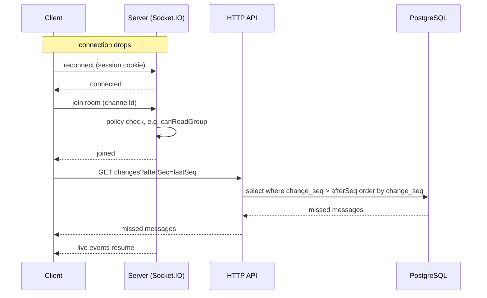

# Realtime

Socket.IO runs in the same process as the API, as a single instance (no Redis adapter).

Built so far: `attachSocket(app, config, auth, db)` in `apps/server/src/infra/realtime/socket.ts` (called by `buildApp`, available as `app.io`) serves Socket.IO at `/socket.io` and answers the `system:ping` event with an ack `{ pong: true, at: <ISO string> }`. The web client uses the ping as a liveness check: `useSocketStatus` (`apps/web/src/features/system/use-socket-status.ts`) pings on connect and every 30 s with a 5 s ack timeout and shows the result on the home status card.

**Client lifecycle.** `getSocket()` (`apps/web/src/lib/socket.ts`) creates the one shared socket with `autoConnect: false`, because the server refuses a handshake without a session. The signed-in layout (`features/auth/authed-layout.tsx`, a lazy chunk) calls `connectSocket()` once the session is known and `disconnectSocket()` when the session goes (logout, a 401 from any query or mutation) or the layout unmounts. A `connect_error` with message `unauthorized` clears the cached session and sends the user to `/login`; the socket is not reconnected. A `disconnect` with reason `io server disconnect` (the server dropped the socket, e.g. an admin was removed) is not retried by Socket.IO either, so the layout refetches the session: a 401 does the same trip to `/login`, a valid session changes nothing. `server_error` keeps the user signed in and the layout calls `connectSocket()` again after 1 s, then 2 s, 4 s … capped at 30 s (Socket.IO itself does not retry a middleware error). A successful `connect` resets the delay to 1 s; logout or unmounting the layout cancels a pending retry. There is no retry after `unauthorized`.

## Handshake authentication

An `io.use` middleware runs on every connection:

1. **Origin.** In production the handshake `Origin` header must equal `new URL(PUBLIC_URL).origin`; a foreign or missing Origin gets `connect_error` `forbidden_origin`. (CORS alone does not stop a cross-site WebSocket handshake.) The web client therefore uses the WebSocket transport only: browsers omit `Origin` on same-origin polling requests, a WebSocket handshake always sends it. Trade-off: there is no long-polling fallback, so a network that blocks WebSockets gets no realtime (the app still works over HTTP); the alternative would be to accept Origin-less polling requests on the server, which weakens the check. In development any origin is accepted. Socket.IO CORS also allows only the `PUBLIC_URL` origin in production (any origin in development).
2. **Session.** The session cookie of the handshake is read with `getSessionFromHeaders` (same logic as the HTTP routes). No session, or a disabled user, gets `connect_error` `unauthorized`. A failing session lookup (e.g. the database is down) gets `connect_error` `server_error` (logged server-side), so a client can tell "log in again" from "try again later". Socket.IO clients do not reconnect automatically after a middleware error, which is wanted: the web sends the user to `/login` on `unauthorized` instead of retrying.
3. **Rooms.** On success `socket.data.user` is the `SessionUser`, `socket.data.sessionId` the login session's id, and the socket joins the rooms `user:<id>` (`userRoom`) and `session:<sessionId>` (`sessionRoom`), both in `rooms.ts`. A client also joins `group:<groupId>` (`groupRoom`) for their membership group (stored as `socket.data.groupId`); admins join group rooms through `group:join` (below). After joining, the middleware reads the session again and refuses the socket (`unauthorized`) if the user was disabled in between, so a removal that ran `disconnectUser` between the lookup and the join is caught in most cases. This narrows the window but does not close it: a removal landing after that final check and before the connection is established is only caught by the next `disconnectUser`-style event. `POST /api/auth/sign-out` reads the session before better-auth deletes it and, after a 200, closes the sockets of that session room only (the user's other devices stay connected). `disconnectUser(io, userId)` closes every socket of that user; call it when a user is removed or disabled.

## Rules

- **Sockets are push-only.** Clients never send writes over a socket. Every write goes through the HTTP API, which then emits an event. See [overview.md](overview.md).
- **Web push is separate from sockets.** Push notifications go through the notification delivery jobs (pg-boss, Web Push), never through socket.io; a socket event is not a notification. See [overview.md](overview.md) (Notification delivery).
- **Permissions are checked on join.** A socket may join a room only if the module's policy function allows it (see [permissions.md](permissions.md)).

## Group room events (client to server)

These two events change no data; they only move the socket in and out of a room. Names are `SocketEvents.groupJoin` / `groupLeave`, the payload is `GroupRoomPayload` (`{ groupId }`).

- `group:join` with an ack `GroupJoinAck`. The payload must be an object with a string `groupId` of 1 to 100 characters. The server checks `canReadGroup(socket.data.user, groupId, socket.data.groupId ?? null)` and that the group exists, then joins `group:<id>` and acks `{ ok: true }`. An admin's socket (`isAdmin`) also joins `group:<id>:admins` (`groupAdminsRoom`) in the same call; a client's socket never joins an admins room, not even for their own group. Anything else (malformed payload, unreadable or unknown group) acks `{ ok: false, error: 'not_found' }`, the same answer as the HTTP routes. Joining is idempotent; a missing or non-function ack is ignored (the handlers never call a client-supplied value that is not a function, so a bad ack cannot crash the process).
- A leave that overtakes an in-flight join wins: the socket keeps a set of wanted group rooms (`socket.data.wantedGroups`); `group:join` adds the id before its database reads and joins only if the id is still wanted afterwards, `group:leave` removes it.
- `group:leave` leaves `group:<id>` and `group:<id>:admins` and acks `{ ok: true }`, except that a client never leaves their own group's room (the id equals `socket.data.groupId`).

Live handlers on the web should still ignore events whose `groupId` is not the open group (defence in depth).

Server code pushes into a group with `emitToGroup(io, groupId, event, payload)` from `rooms.ts`, and to the group's admins only with `emitToGroupAdmins(io, groupId, event, payload)`; call them after the transaction that made the change has committed. Anything clients must not see goes through `emitToGroupAdmins`, never `emitToGroup`.

### Web hook

`useGroupRoom(groupId)` (`features/groups/use-group-room.ts`) is called once by the group layout. It emits `group:join` when the socket is connected and on every `connect` event, and `group:leave` on unmount or when `groupId` changes. It returns a counter that is 0 until the first acknowledged join and grows by one after every acknowledged join (including the rejoin after a reconnect). A `not_found` ack does not count and is not retried until the next `connect`. The layout passes the counter to `GroupRoomProvider`; chat, board and the Knowledge tab (`useKnowledgeEvents`) read it with `useGroupRoomJoins()` (0 outside a provider) and run their catch-up when it changes.

## Board events (server to client)

Pushed to the `group:<id>` room after the write commits, by `modules/tasks/events.ts` (names in `BoardEvents`). Every payload carries the `groupId` (a `BoardTaskEvent` has it on `task.groupId`); web handlers ignore other groups.

| event                | payload                                             | when                                                  |
| -------------------- | --------------------------------------------------- | ----------------------------------------------------- |
| `board:buckets`      | `{ groupId, buckets }` (the full list, by position) | a custom bucket is created, renamed, moved or deleted |
| `board:task`         | `{ task, actor }`                                   | a task is created (one event per card when cards are made from a message), edited or moved (`task` is a `TaskDto`) |
| `board:task_deleted` | `{ groupId, taskId }`                               | a task is deleted                                     |

`actor` (`{ id, name }`) is who made the change, so a client can skip its own echo or say who changed a card. The board has no `seq`: after a reconnect (a new `useGroupRoomJoins()` value) the web refetches `GET /api/groups/:id/board` instead of catching up event by event; boards are small.

After a bucket is deleted its tasks moved to To do without a `board:task` event; `useBoardEvents` (web) refetches the board when a `board:buckets` list drops a bucket the cache had.

## Rooms

| room           | who joins                                                                       | carries                                                                                                                            |
| -------------- | ------------------------------------------------------------------------------- | ---------------------------------------------------------------------------------------------------------------------------------- |
| `user:<id>`    | every socket of that user, on connect                                           | events for one user (admin changes, notifications)                                                                                 |
| `session:<id>` | every socket of that login session, on connect                                  | sign-out                                                                                                                           |
| `group:<id>`   | a client, on connect, for their membership group; an admin through `group:join` | every event of the group: chat, board (tasks and buckets), files, members (one room per group, no separate channel or board rooms) |
| `group:<id>:admins` | an admin's socket, together with `group:<id>` on `group:join` (left with it on `group:leave`); never a client | admins-only events of the group (knowledge items with visibility `admins`) |
| per DM channel | the two participants                                                            | direct messages (not built yet)                                                                                                    |

## Knowledge events

Pushed after the write commits by `modules/knowledge/events.ts` (names in `KnowledgeEvents`, Phase 17). The payload's `item` is a `KnowledgeSummary` built from an allowlist of the summary's fields, so the detail's body, files, reminder and the writer's own `canEdit` never travel.

| event | payload | room |
|---|---|---|
| `knowledge:item` | `{ item }` | created or edited: `group:<id>` for a public item, `group:<id>:admins` for an admins-only one |
| `knowledge:item_deleted` | `{ groupId, id }` | deleted: the room the item was in; also sent to `group:<id>` when an item turns admins-only |

A visibility change from public to admins sends `knowledge:item_deleted` to the group room, then `knowledge:item` to the admins room; Socket.IO keeps order per connection, so an admin (in both rooms) ends with the item and a client drops it. Admins to public sends `knowledge:item` to the group room. There is no `seq`: after a rejoin the tab refetches its first page.

## Chat events

All are pushed after the transaction committed, by the chat routes, or for `chat:message_tasks` by the task routes, through `modules/chat/events.ts`. Payload types are `ChatMessageEvent`, `ChatReadEvent`, `ChatThreadReplyEvent` and `ChatMessageTasksEvent` in `packages/shared/src/chat.ts`; the event names are `ChatEvents.message`, `ChatEvents.read`, `ChatEvents.threadReply` and `ChatEvents.messageTasks`.

| event | room | payload | sent when |
|---|---|---|---|
| `chat:message` | `group:<id>` (`emitToGroup`) | `{ groupId, channelId, taskId, message, isNew }` | a message is sent (`isNew: true`, and for a reply also the updated parent with `isNew: false`), edited or deleted (`isNew: false`). Never for a repeated `clientId` (the HTTP call answers 200 with the stored message and pushes nothing) or a second delete. |
| `chat:read` | `user:<id>` | `{ groupId, channelId, taskId, lastReadAt, rootId?, all? }` | the user marks the channel read, (with `rootId`) opens a thread they are one of the people of, or (with `all: true`, `POST /api/channels/:id/read-all`) reads the whole chat including their threads, as when opening a task's Chat tab; their other tabs refresh the unread badge, the thread dots and the task's unread flag |
| `chat:thread-reply` | `user:<id>` of each person of the thread still in the group, never the author | `{ groupId, channelId, taskId, rootId }` | a new reply: it counts as unread for them (the badge adds one, the thread gets its dot) |
| `chat:message_tasks` | `group:<id>` (`emitMessageTasks`) | `{ groupId, channelId, messageId, parentId, tasks }` | the tasks made from a message changed: cards were created from it (`POST /api/groups/:id/tasks/from-message`, one event after the `board:task` of every card), one of them was edited (`PATCH /api/tasks/:id`), moved to another place (`completed` may flip) or deleted. `tasks` is the message's full current list `{ id, title, completed }[]` (the same as `MessageDto.tasks`), so the client replaces the message's list; `parentId` tells a thread reply from a top-level message. Not sent for a deleted or missing message. |

`message` is a full `MessageDto`; the client upserts it by id. A task link change does not move the message's `change_seq`, so the catch-up below does not replay `chat:message_tasks`; a missed one is corrected by the next page load of that chat. `isNew` tells the web whether to count it as unread and to append it. Handlers ignore events whose `groupId` is not the open group. `taskId` is the task whose chat the channel is (Phase 9), or null for the group chat; task chats use the same group room, so a listener also filters on `channelId` (the group Chat tab badge ignores task chats).

## Catch-up with `change_seq`

Every chat message has a `change_seq` taken from the channel's counter (`channels.last_seq`) whenever it is created, edited or deleted, and a reply moves its parent's `change_seq` too. There is no per-message `seq` that never changes. After a disconnect the client asks for what changed instead of relying on an event log.

1. The client keeps the highest `lastSeq` it has seen for the open channel (from the channel, a message page, a catch-up answer, a live event or the answer to its own send).
2. On (re)connect it rejoins its rooms (the server checks permission on join) and waits for `useGroupRoomJoins()` to change.
3. Over HTTP it calls `GET /api/channels/:id/changes?afterSeq=<lastSeq - 20>` (floor 0; it starts a little behind because a live event can overtake an earlier one by a few seqs, and the reducer ignores a row it already holds). The server checks permission and returns every message (top-level and replies) with `change_seq > afterSeq`, ascending, at most 500, as `{ messages, lastSeq, truncated }`. When `truncated` is true, `lastSeq` is the last complete seq; the web reloads the newest page.
4. A failed catch-up retries with backoff (1 s … 30 s, one retry loop per channel) unless the answer is 403 or 404. The client upserts them by id, then handles live events as normal.

On the web this is `useChannelMessages(channelId, { groupId, aroundMessageId? })` (`features/chat/use-channel-messages.ts`) over the pure reducer in `channel-window.ts`:

- The window holds a gap-free run of at most 300 top-level messages, oldest first, with `hasOlder` / `hasNewer`. A message outside the run while those are set is ignored (it comes with its page); an older page past 300 drops the newest rows, new rows past 300 drop the oldest. A row is never replaced by a version with a lower `changeSeq`.
- Live events, catch-up answers and the POST answer of a sent message all go through one `apply`: the window upsert, plus the cached thread (`['chat', 'thread', rootId]`) of the message. A deleted top-level message after the read cursor refetches the group's unread count; a deleted reply refetches it and the channel's unread threads.
- Catch-up runs when `useGroupRoomJoins()` changes while the window is loaded, never on a raw `connect`. It starts from the seq saved at the socket's `disconnect` (live events after the reconnect cannot move it) and clears that saved seq only after it succeeds. A failed catch-up (or its reload) retries from the same seq after 1 s, 2 s, 4 s … at most 30 s, until it succeeds, the channel changes or the chat unmounts. A `truncated` answer reloads the newest page and refetches open threads.
- Only full pages (latest, around) set the catch-up seq; older and newer pages never do. A page whose `lastSeq` is below a live event that arrived meanwhile triggers a catch-up from the page's seq, so a race between a page and an edit cannot leave a stale row. Replacing the window (jump to latest, reload) drops the answers of page requests made for the previous window.
- `send` shows a pending row at once (`clientId = crypto.randomUUID()`); a failure marks it failed and only the user's Retry sends it again, with the same `clientId`. Pending thread replies carry `input.parentId`.
- `unreadAnchor` (the read cursor when the chat opened, for the "New messages" line) stays fixed; `lastReadAt` moves with `markRead`.
- `applyLocal(message)` puts the answer of the reader's own edit (the PATCH result) or delete (a local copy marked deleted, with a made-up `changeSeq + 1`) into the window and the cached thread **without** moving `lastSeq` or any catch-up bookkeeping; the server's own change still arrives by event or catch-up and wins by its `changeSeq`.
- `<Conversation channelId groupId messageActions? renderMessageFooter? />` (`conversation.tsx`, the component Phase 9 reuses for task chats) must be rendered under the group layout (`GroupRoomProvider`), because catch-up follows the group room's join counter. Its URL params are scoped to its channel (`?thread=<rootId>&c=<channelId>`, `?message=<id>&c=<channelId>`, `use-chat-search.ts`); an around page or thread of another channel is never applied (the hook falls back to the newest page, the reducer ignores a foreign `loadedAround`, the panel renders nothing). It marks the chat read when the list is at the bottom of the newest page (`!hasNewer`), the tab is visible and the newest message is after `lastReadAt`: `markRead(newest.createdAt)` after 1 s (not while a thread overlay covers the list below 1024 px); a successful `markRead` refetches the channel's count and `GET /api/chat/unread`. The unread threads (`use-unread-threads.ts`, query `['chat', 'unread-threads', channelId]` from `GET /api/channels/:id/unread-threads`) give the dot on a root's "N replies" link: `chat:thread-reply` adds the root (and refetches when the answer was in flight), `chat:read` with a `rootId` of this channel and every rejoin after the first refetch. The conversation passes the thread in front of the reader (open, tab visible): the hook calls `POST /api/messages/:id/thread/read` when that thread is in the set, and again for every `chat:thread-reply` in it, also while an earlier POST is on its way (that mark may predate the new reply). After each POST the root leaves the set, and the set, the channel's count and `GET /api/chat/unread` are refetched, so the badge drops by those replies. The Chat tab badge (`chat-tab-badge.tsx`) adds one for each `chat:message` with `isNew`, top-level, not mine, in this group's channel and for each `chat:thread-reply` of this channel, and refetches `GET /api/groups/:id/chat` and the groups list counts (`GET /api/chat/unread`) on `chat:read` (any of the user's devices read it) and on every rejoin after the first.

The catch-up read is an ordinary HTTP read, so it uses the same permission checks as everything else.
