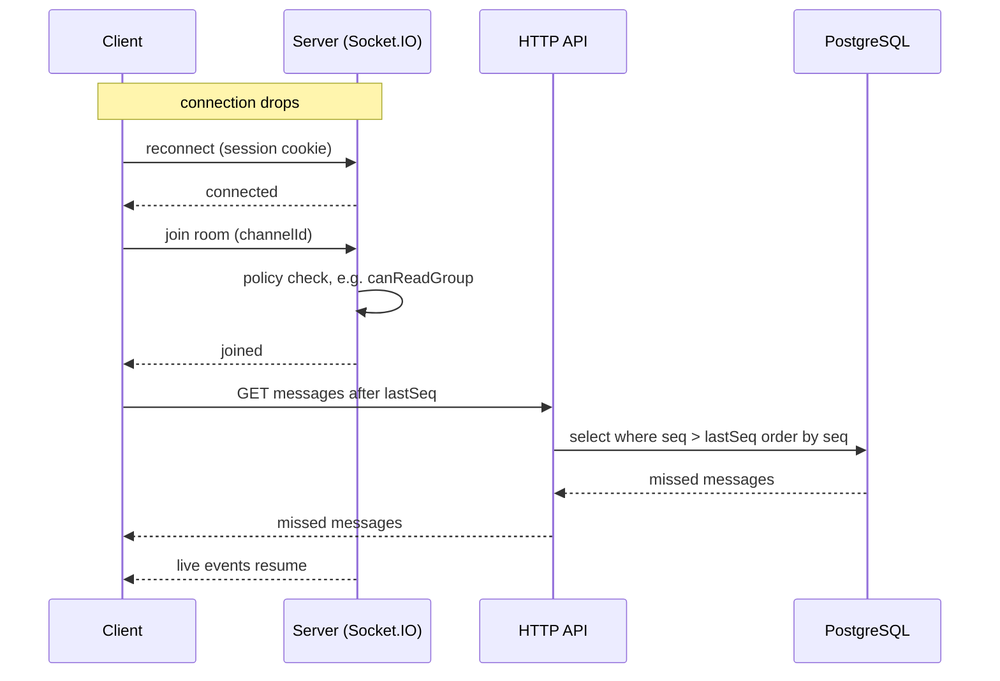

# Realtime

Socket.IO runs in the same process as the API, as a single instance (no Redis adapter).

Built so far: `attachSocket(app, config, auth, db)` in `apps/server/src/infra/realtime/socket.ts` (called by `buildApp`, available as `app.io`) serves Socket.IO at `/socket.io` and answers the `system:ping` event with an ack `{ pong: true, at: <ISO string> }`. The web client uses the ping as a liveness check: `useSocketStatus` (`apps/web/src/features/system/use-socket-status.ts`) pings on connect and every 30 s with a 5 s ack timeout and shows the result on the home status card.

**Client lifecycle.** `getSocket()` (`apps/web/src/lib/socket.ts`) creates the one shared socket with `autoConnect: false`, because the server refuses a handshake without a session. The signed-in layout (`features/auth/authed-layout.tsx`, a lazy chunk) calls `connectSocket()` once the session is known and `disconnectSocket()` when the session goes (logout, a 401 from any query or mutation) or the layout unmounts. A `connect_error` with message `unauthorized` clears the cached session and sends the user to `/login`; the socket is not reconnected. A `disconnect` with reason `io server disconnect` (the server dropped the socket, e.g. an admin was removed) is not retried by Socket.IO either, so the layout refetches the session: a 401 does the same trip to `/login`, a valid session changes nothing. `server_error` keeps the user signed in and the layout calls `connectSocket()` again after 1 s, then 2 s, 4 s … capped at 30 s (Socket.IO itself does not retry a middleware error). A successful `connect` resets the delay to 1 s; logout or unmounting the layout cancels a pending retry. There is no retry after `unauthorized`.

## Handshake authentication

An `io.use` middleware runs on every connection:

1. **Origin.** In production the handshake `Origin` header must equal `new URL(PUBLIC_URL).origin`; a foreign or missing Origin gets `connect_error` `forbidden_origin`. (CORS alone does not stop a cross-site WebSocket handshake.) The web client therefore uses the WebSocket transport only: browsers omit `Origin` on same-origin polling requests, a WebSocket handshake always sends it. Trade-off: there is no long-polling fallback, so a network that blocks WebSockets gets no realtime (the app still works over HTTP); the alternative would be to accept Origin-less polling requests on the server, which weakens the check. In development any origin is accepted. Socket.IO CORS also allows only the `PUBLIC_URL` origin in production (any origin in development).
2. **Session.** The session cookie of the handshake is read with `getSessionFromHeaders` (same logic as the HTTP routes). No session, or a disabled user, gets `connect_error` `unauthorized`. A failing session lookup (e.g. the database is down) gets `connect_error` `server_error` (logged server-side), so a client can tell "log in again" from "try again later". Socket.IO clients do not reconnect automatically after a middleware error, which is wanted: the web sends the user to `/login` on `unauthorized` instead of retrying.
3. **Rooms.** On success `socket.data.user` is the `SessionUser`, `socket.data.sessionId` the login session's id, and the socket joins the rooms `user:<id>` (`userRoom`) and `session:<sessionId>` (`sessionRoom`), both in `rooms.ts`. A client also joins `group:<groupId>` (`groupRoom`) for their membership group (stored as `socket.data.groupId`); admins join group rooms through `group:join` (below). After joining, the middleware reads the session again and refuses the socket (`unauthorized`) if the user was disabled in between, so a removal that ran `disconnectUser` between the lookup and the join is caught in most cases. This narrows the window but does not close it: a removal landing after that final check and before the connection is established is only caught by the next `disconnectUser`-style event. `POST /api/auth/sign-out` reads the session before better-auth deletes it and, after a 200, closes the sockets of that session room only (the user's other devices stay connected). `disconnectUser(io, userId)` closes every socket of that user; call it when a user is removed or disabled.

## Rules

- **Sockets are push-only.** Clients never send writes over a socket. Every write goes through the HTTP API, which then emits an event. See [overview.md](overview.md).
- **Permissions are checked on join.** A socket may join a room only if the module's policy function allows it (see [permissions.md](permissions.md)).

## Group room events (client to server)

These two events change no data; they only move the socket in and out of a room. Names are `SocketEvents.groupJoin` / `groupLeave`, the payload is `GroupRoomPayload` (`{ groupId }`).

- `group:join` with an ack `GroupJoinAck`. The payload must be an object with a string `groupId` of 1 to 100 characters. The server checks `canReadGroup(socket.data.user, groupId, socket.data.groupId ?? null)` and that the group exists, then joins `group:<id>` and acks `{ ok: true }`. Anything else (malformed payload, unreadable or unknown group) acks `{ ok: false, error: 'not_found' }`, the same answer as the HTTP routes. Joining is idempotent; a missing or non-function ack is ignored (the handlers never call a client-supplied value that is not a function, so a bad ack cannot crash the process).
- A leave that overtakes an in-flight join wins: the socket keeps a set of wanted group rooms (`socket.data.wantedGroups`); `group:join` adds the id before its database reads and joins only if the id is still wanted afterwards, `group:leave` removes it.
- `group:leave` leaves `group:<id>` and acks `{ ok: true }`, except that a client never leaves their own group's room (the id equals `socket.data.groupId`).

Live handlers on the web should still ignore events whose `groupId` is not the open group (defence in depth).

Server code pushes into a group with `emitToGroup(io, groupId, event, payload)` from `rooms.ts`; call it after the transaction that made the change has committed.

### Web hook

`useGroupRoom(groupId)` (`features/groups/use-group-room.ts`) is called once by the group layout. It emits `group:join` when the socket is connected and on every `connect` event, and `group:leave` on unmount or when `groupId` changes. It returns a counter that is 0 until the first acknowledged join and grows by one after every acknowledged join (including the rejoin after a reconnect). A `not_found` ack does not count and is not retried until the next `connect`. The layout passes the counter to `GroupRoomProvider`; chat and board read it with `useGroupRoomJoins()` (0 outside a provider) and run their catch-up when it changes.

## Board events (server to client)

Pushed to the `group:<id>` room after the write commits, by `modules/tasks/events.ts` (names in `BoardEvents`). Every payload carries the `groupId` (a `BoardTaskEvent` has it on `task.groupId`); web handlers ignore other groups.

| event                | payload                                             | when                                                  |
| -------------------- | --------------------------------------------------- | ----------------------------------------------------- |
| `board:buckets`      | `{ groupId, buckets }` (the full list, by position) | a custom bucket is created, renamed, moved or deleted |
| `board:task`         | `{ task, actor }`                                   | a task is created or edited (`task` is a `TaskDto`)   |
| `board:task_deleted` | `{ groupId, taskId }`                               | a task is deleted                                     |

`actor` (`{ id, name }`) is who made the change, so a client can skip its own echo or say who changed a card. The board has no `seq`: after a reconnect (a new `useGroupRoomJoins()` value) the web refetches `GET /api/groups/:id/board` instead of catching up event by event; boards are small.

After a bucket is deleted its tasks moved to To do without a `board:task` event; `useBoardEvents` (web) refetches the board when a `board:buckets` list drops a bucket the cache had.

## Rooms

| room           | who joins                                                                       | carries                                                                                                                            |
| -------------- | ------------------------------------------------------------------------------- | ---------------------------------------------------------------------------------------------------------------------------------- |
| `user:<id>`    | every socket of that user, on connect                                           | events for one user (admin changes, notifications)                                                                                 |
| `session:<id>` | every socket of that login session, on connect                                  | sign-out                                                                                                                           |
| `group:<id>`   | a client, on connect, for their membership group; an admin through `group:join` | every event of the group: chat, board (tasks and buckets), files, members (one room per group, no separate channel or board rooms) |
| per DM channel | the two participants                                                            | direct messages (not built yet)                                                                                                    |

## Catch-up with `seq`

Every message has a `seq` number that increases by one per channel. After a disconnect the client asks for what it missed instead of relying on an event log.

1. The client keeps the highest `seq` it has seen for each open channel.
2. On (re)connect it re-establishes the socket and rejoins its rooms (the server checks permission on join).
3. Over HTTP it fetches missed messages: `GET` with `channelId` and `lastSeq`. The server checks permission and returns all messages with `seq > lastSeq`, ordered by `seq` ascending.
4. The client merges them by `seq`, ignoring ones it already has, and then handles live events as normal.

The catch-up read is an ordinary HTTP read, so it uses the same permission checks as everything else.
